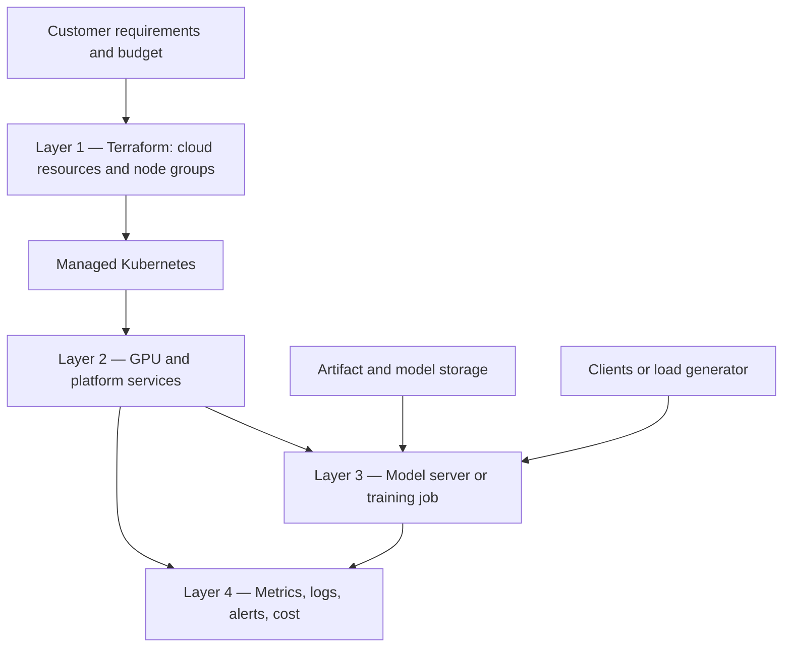
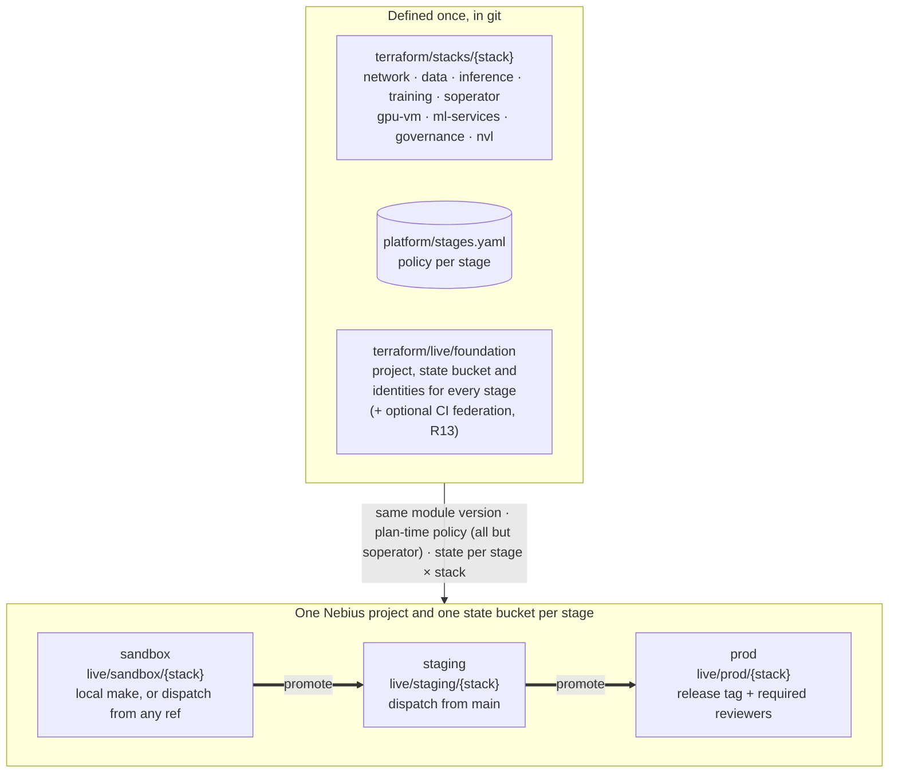
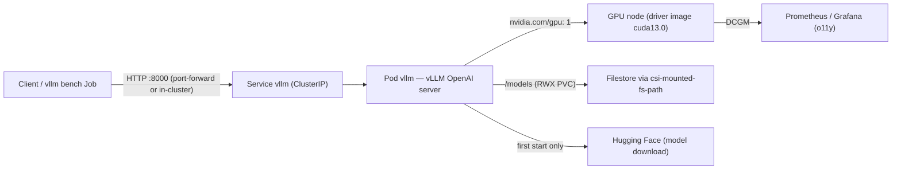

# Architecture

Four layers, one owner each; stages and stacks as two independent axes; the inference request
path. Per-recipe resources live on the recipe pages linked below.

## Layers

## Stage × stack × foundation

A **stack** is promoted by applying the same module version through the next stage's **live
root**, which holds only that stage's sizing (`<stage>.auto.tfvars`, or `stage.tfvars` for
Soperator). The stage policy in `platform/stages.yaml` is enforced as plan-time preconditions by the
network, data, inference, training, gpu-vm, ml-services and nvl stacks (through `modules/stage-policy`) and by
governance (TTL label and a project-limit ceiling read from the same file); gpu-vm has no prod root because
prod caps it at 0 GPUs, and nvl (R15) has no root in any stage until a GB300 reservation is approved and
`max_gpu_nodes.nvl` is raised. The Soperator root layers `stage.tfvars` over the upstream recipe and
gets none of those guards (endpoint, TTL, GPU caps, reservations), so its stage values are reviewed by hand
([ADR-0009](decisions/0009-environment-and-promotion-model.md)). Each stage is its own project, state bucket and identities (the CI service account is
optional per stage, and can be reached through GitHub OIDC federation instead of a key: R13,
[`runbooks/identity.md`](../runbooks/identity.md)); the foundation creates them, or `scripts/bootstrap-backend.sh` creates the bucket and state identity for a stage that has
no foundation yet. Model and rationale: [ADR-0009](decisions/0009-environment-and-promotion-model.md);
layout, state and authentication: [`terraform/README.md`](../terraform/README.md); per-stage values:
[Stage policy](../platform/README.md#stage-policy).

What each stack creates, resource by resource: [`stacks/inference`](../terraform/stacks/inference/README.md),
[`stacks/training`](../terraform/stacks/training/README.md),
[`stacks/soperator`](../terraform/stacks/soperator/README.md),
[`stacks/network`](../terraform/stacks/network/README.md), [`stacks/data`](../terraform/stacks/data/README.md),
[`stacks/gpu-vm`](../terraform/stacks/gpu-vm/README.md), [`stacks/ml-services`](../terraform/stacks/ml-services/README.md),
[`stacks/governance`](../terraform/stacks/governance/README.md), [`stacks/nvl`](../terraform/stacks/nvl/README.md); which modules each one composes:
[building blocks](building-blocks.md). Apply order in a stage, each step only when used: R9 governance
(spot caps) → R7 network → R8 data → R12 ml-services → R1/R3 or R10. R1 and R3 then take the network's
`subnet_id` and `security_group_ids`, the data plane's `existing_filesystem_id`, R12's
`node_service_account_id` and R9's `pricing_policy_ids[<platform>]` (as `gpu_spot_pricing_policy_id`);
R10 takes the same network and filesystem inputs; R15 (NVL72 racks) joins R3's `cluster_id` after R3.
R6 and R11 (Token Factory) run no infrastructure of this repository at all. Layer 4 (metrics, logs,
alerts) is R14: `modules/o11y` inside R1/R3 and the read side in
[`recipes/observability`](../recipes/observability/README.md#which-signal-comes-from-where). Team
queues on a training cluster (Layer 3, platform-owned) are R16 ([`workloads/kueue`](../workloads/kueue/README.md)).

## Request path (inference)

**Boundary:** the Service and the vLLM Pod are the serving application (Layer 3, app team);
the GPU node, driver image, device plugin, StorageClass/Filestore and o11y are platform
(Layers 1–2). "Terraform apply succeeded" proves the platform side exists; only
`tests/validate/04-workload.sh` proves the request path through the application works.

## Ownership map

| Concern | Owner | Escalation |
|---|---|---|
| Cluster and node groups | platform (Terraform) | Nebius support for control-plane issues |
| GPU drivers / device plugin | platform | `runbooks/incident.md` → new node group |
| Model server, images, model pins | application team | rollback (`runbooks/rollback.md`) |
| Dashboards, alerts, cost review, teardown | platform/SRE + customer | `runbooks/teardown.md` |
