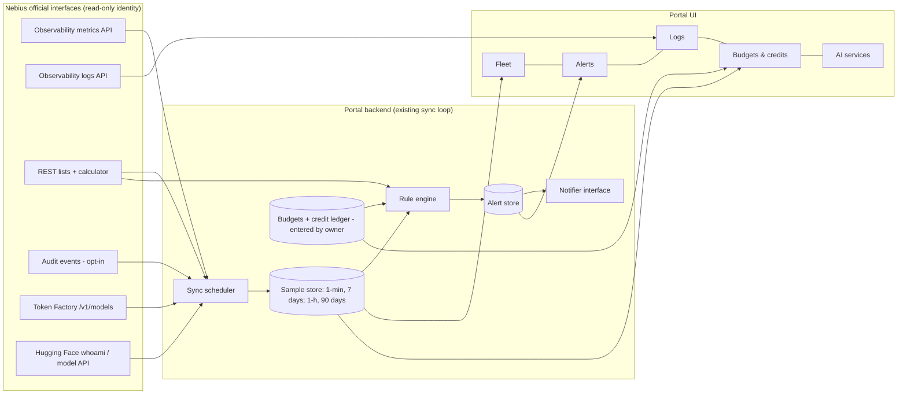

# Fleet insight, live alerting and full Nebius coverage in Nebius Estate

Date: 2026-10-11. Status: approved by the owner ("full approval to take the recommended development
path"). Real-time control is out of scope here and comes last (see [Later](#later-real-time-control)).

## Intent

Nebius Estate is the place a solutions architect sees the whole Nebius footprint live, understands
cost and risk, and resolves problems fast. Today it is used by one person on one Mac; it must grow to
a team or customer demos without a rewrite (owner's choice "C").

Success means:

- every signal Nebius exposes through an official interface is either shown or listed with the reason
  it cannot be (no silent gaps, no duplicated sources);
- a problem on a GPU, node, cluster, quota, connector or budget raises an alert within one sync, and
  every alert links a guided fix;
- every budget and credit the owner tracks is visible with spend against it and a depletion forecast;
- every figure says where it came from and how fresh it is.

## Constraints (unchanged)

- Read-only against the cloud: GET plus the billing calculator POST. One read-only identity
  (`nip-portal-viewer`); no credentials in the browser; official Nebius interfaces only.
- Local data the owner types in (budgets, credits, rate books) lives in the portal database, never in
  git, and is labelled "entered by you".
- No new infrastructure: the existing Backstage backend, its database and its sync loop.

## Coverage: every Nebius surface (docs.nebius.com sections, 2026-10-11)

| Surface | Official interface | Today | This design |
|---|---|---|---|
| Compute VMs, disks, filesystems, GPU clusters, NVLink groups, platforms | REST lists | shown | unchanged |
| Managed Kubernetes clusters and node groups | REST lists | shown | unchanged |
| Kubernetes workloads | Kubernetes API, portal IAM identity | shown when a cluster exists | unchanged |
| VPC, Object Storage, Registry, KMS, SecretStash (metadata), DNS, Tunnels | REST lists | shown | unchanged |
| PostgreSQL, MLflow, Serverless endpoints/jobs/DevLabs, Applications | REST lists | shown | unchanged |
| Quotas (tenant + project), capacity advice, block groups, allowances | REST lists | shown | feed alerts |
| Maintenance | REST list | shown | feed alerts |
| Prices (list, contract, preemptible) | billing calculator | shown | feed budgets |
| Billing export (FOCUS) | Object Storage pull | built, waits for the console export | feed budgets |
| **VM and GPU metrics** (DCGM, CPU, memory, network, disk) | Observability Prometheus read API | GPU snapshot only | **history, heat map, alerts** |
| **Volume, Object Storage, PostgreSQL, MLflow metrics** | same API | not read | **service health panels + alerts** |
| Cluster metrics from the observability agent | same API, ingested path | built, waits for agent | history + alerts |
| **Logs** (serial console, MK8s control plane and audit, Kubernetes releases, PostgreSQL, MLflow, cloud apps) | Observability Logs, Loki-compatible read API (`read.logging.api.nebius.cloud`); the portal identity is accepted (verified 2026-10-11) | not read | **Logs page + log-based alerts** |
| **Audit events** | `GET /audit/v2/audit-events` (`audit.api.nebius.cloud`; `parentId`, `region`, `start`, `end` required) | readable since the owner granted `auditlogs.audit-event-viewer` on the tenant to `nip-portal-viewers` (verified 2026-10-11, every region of the listed projects) | **built** (2026-10-11): connector `nebius-audit` and a recent-events section on the Logs page |
| Nebius native alerts | console only, email only, Compute + Object Storage; no API | cannot be read | listed as "console-only"; portal alerts do not duplicate them because they cannot be read |
| **Budgets** (AI Cloud) | console only, no API | not shown | **mirrored by the owner** (entered once) and tracked by the portal |
| **Balance, promo credits** (AI Cloud and Token Factory) | console only, no API | not shown | **credit ledger entered by the owner** |
| **Token Factory** | OpenAI-compatible API (`/v1/models` verified 200); no usage/balance API | not connected | **AI services page**: models, key health; spend entered by the owner |
| **Hugging Face** (gated weights for workloads) | `whoami-v2`, model metadata API | key stored, not shown | **AI services page**: token health, gated-access check per model the workloads use |
| Slurm (Soperator) | Slurm exporter into Observability | planned | needs a Soperator run (quota) |
| Traces | Observability traces | n/a | only for workloads that send traces; listed |

## Pages

Existing pages stay; four are added. Navigation group in brackets.

| Page | Purpose |
|---|---|
| **Fleet** (OPERATE) | GPU heat map (GPU × time, colour = utilisation; toggles: temperature, power, memory), node-group and cluster roll-ups, idle-GPU cost ("4 GPU-hours idle today ≈ $3.00"), service health panels (volumes, buckets, PostgreSQL, MLflow), drill-down GPU → VM → node group → cluster → logs |
| **Alerts** (OPERATE) | inbox of firing / pending / resolved alerts with severity, scope, since, evidence (the query and its value) and a **guided fix**: what it means, the read-only checks to run, the runbook section and docs page, what a fix would change. Mute and acknowledge are local notes only |
| **Logs** (OPERATE) | per project and bucket; presets (serial-console errors, control-plane errors, PostgreSQL errors); time range; opened pre-filtered from an alert or a VM |
| **Budgets & credits** (FINANCE) | every budget and credit with amount, period, spend to date, burn rate, depletion forecast and source of each figure; feeds budget alerts |
| **AI services** (FINANCE or OPERATE) | Token Factory models and key health, Hugging Face token health and gated access per workload model, Serverless endpoints and jobs |

## Architecture

- **Sample store.** The sync loop already queries metrics; it now also writes samples to the portal
  database: 1-minute resolution for 7 days, hourly roll-ups for 90 days (sizes bounded and tested).
  Queries use `query_range` for back-fill after a restart, so a gap heals itself.
- **Rule engine.** One rule format, the Prometheus rule files already in `platform/alerts/*.yaml`, plus
  portal rules in the same format under `platform/alerts/portal/` for things only the portal can see:
  quota blocking a node group, a connector failing, a budget threshold, credit expiry, maintenance
  scheduled, a GPU VM advertising 0 allocatable GPUs. Rules whose metrics are not on the Nebius
  endpoint are listed as "needs in-cluster Prometheus" rather than silently skipped. `for:` durations
  are honoured by keeping pending state between syncs.
- **Guided fixes.** Each rule's annotations name `runbook` (repo path + anchor) and `docs`
  (docs.nebius.com anchor checked by `make docs-links`). A test fails when a rule lacks either.
- **Notifier interface.** Phase 1: in-portal inbox and the browser Notification API while the portal
  is open. The interface takes Slack, email and webhooks later (team mode) without changing rules.
- **Budgets and credits.** Nebius exposes no budget, balance or credit API, so the owner enters each
  budget (mirroring the console) and each credit (amount, start, expiry; for example the Token
  Factory promo credit). Spend comes from the best available source, labelled per row: FOCUS export
  (actual, hours late) for AI Cloud; live run-rate × time since the last export (estimate) to fill
  the gap; Token Factory spend entered by the owner from its Usage tab until an API exists.
  Forecast = current burn rate to period end / to credit exhaustion.
- **Team-ready seams (C).** Every stored row carries an owner and a tenant; the notifier is
  pluggable; sign-in already supports GitHub OAuth in production config. Nothing team-specific is
  built now.

## Fallbacks

Every panel states one of: live (with age), stale (with last success), waiting (what must exist),
not set up (what to configure, linked), not available from Nebius (console link). A sync that fails
keeps the last good samples and raises a connector alert; nothing shows a bare dash, a question mark
or a zero that is really "unknown".

## Testing

- Unit: sample store retention and roll-up, rule evaluation (threshold, `for:`, resolve), every
  portal rule against fixtures, budget forecast arithmetic, credit expiry, log query building.
- Contract: metrics `query_range`, Loki `query_range`/`labels`, Token Factory `/v1/models`, HF
  `whoami-v2`, audit events, against recorded shapes.
- E2E (stub): each new page in both themes and at 390 px; alert → guided fix → logs drill-down.
- Live (`verify:live`): metrics history, logs labels, Token Factory and HF health.
- Evidence: the populate run of 2026-10-11 records which alerts fired and how fast.

## Phases

1. Sample store + Fleet page (heat map, roll-ups, idle cost) + service health panels.
2. Rule engine + Alerts page + guided fixes (existing `platform/alerts` rules + portal rules).
3. Logs page + log-based rules.
4. Budgets & credits page + budget and credit alerts.
5. AI services page (Token Factory, Hugging Face).
6. Audit events behind the opt-in grant (owner approves the IAM change separately). Done 2026-10-11: the grant was approved and the reader built.

## Later: real-time control

After every phase above is complete, tested and used in practice: a separate write identity, a
per-action approval step, an audit trail and dry-run previews. Designed on its own; nothing in this
design writes to the cloud.
