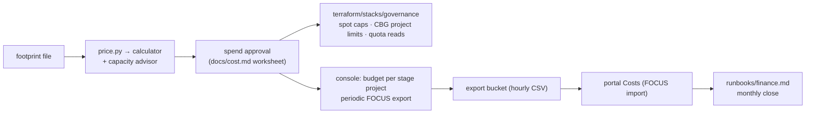

# `recipes/finance` — Finance and governance (R9)

**Purpose.** Know what a stage costs before it is applied, get told when it overspends, stop it
where the platform can stop it, and attribute every billed hour to a stage and a run. Five
controls per stage project, plus a pricing method that compares on-demand, preemptible and
reserved capacity with figures read from the API on the day, never typed in by hand.

**Used by.** [S1](../../solutions/S1-private-llm-serving-vpn/README.md) private LLM serving with VPN (budget), [S2](../../solutions/S2-fine-tune-70b-two-weeks/README.md) 70B fine-tune, [S3](../../solutions/S3-llm-api-token-factory/README.md) LLM API without GPUs, [S4](../../solutions/S4-burst-training-preemptible/README.md) burst training on preemptible, [S8](../../solutions/S8-batch-inference/README.md) batch inference (budget); `price.py` prices every solution's footprint ([all solutions](../../solutions/README.md)).

Budgets *notify*, quotas and project limits *stop*, labels *attribute*, pricing policies *cap*
the spot price ([`docs/cost.md`](../../docs/cost.md#spend-controls)). Each answers a different
failure and none replaces another.



## What it builds

| Control | Mechanism | Where | Automatable at provider 0.6.67 |
|---|---|---|---|
| Spot price cap per GPU platform | pricing policy (max price per GPU-hour) | [`terraform/stacks/governance`](../../terraform/stacks/governance/README.md) `spot_price_caps` | **yes**: `nebius_billing_v1_pricing_policy` |
| Project limit on a capacity block group | capacity allowance (GPUs) | same, `capacity_limits` | **yes**: `nebius_capacity_v1_capacity_allowance` |
| Quota usage | quota allowance data source | same, `quota_watch` | read only (see [Quotas](#quotas)) |
| Budget per stage project, alerts to a tenant contact | console wizard | [Budgets](#budgets) below | **no**: no provider resource |
| Periodic FOCUS export to a bucket | console | [Usage export](#usage-export-focus) below | **no** (periodic); one-time exports have a CLI |
| Cost allocation labels | the `nip-*` labels every stack already sets | [Labels](#cost-allocation-labels) below | **yes**, through each stack's `labels` |
| Price of a footprint | [`price.py`](price.py) → billing calculator | this directory | script (read-only API calls) |
| Capacity availability | [`price.py --advice`](price.py) → capacity advisor | this directory | script; Terraform does not support the capacity advisor ([capacity advisor](https://docs.nebius.com/compute/virtual-machines/capacity-advisor#prerequisites)) |

The provider schema at 0.6.67 has no budget, export, contact or subscription resource; it has
`nebius_billing_v1_pricing_policy`, `nebius_capacity_v1_capacity_allowance` and
`nebius_quotas_v1_quota_allowance` (resources and data sources), plus a
`nebius_capacity_v1_capacity_block_group` data source (`terraform providers schema -json`,
2026-10-11).

## The controls

### Budgets

A budget tracks pay-as-you-go spend against an amount over a calendar-aligned period (daily,
monthly, quarterly, yearly, from 00:00 UTC) and emails when recorded spend crosses a threshold. It
does **not** stop or cap usage; its data updates every few hours, so an alert can arrive after the
threshold has passed; amounts exclude VAT; it alerts on recorded spend only, not forecasts
([budgets](https://docs.nebius.com/signup-billing/budgets#how-to-create-a-budget)). Commitment
usage is excluded from PAYG billing and the PAYG balance
([commitments](https://docs.nebius.com/signup-billing/billing-models/committed-usage#how-to-apply-for-commitment-discounts)),
so a budget does not see reserved spend.

One budget per stage project, created in the console by a member of a group with at least
`editor` in the tenant or project ([prerequisites](https://docs.nebius.com/signup-billing/budgets#prerequisites)):

1. **Billing → Budgets → Create budget.**
2. **Details and scope.** Name `nip-<stage>-monthly`. Time period **Monthly**. Scope
   **Conditions** → **Project** = the stage project (add a **Product** condition as well for a
   separate GPU-only budget; conditions combine with AND).
3. **Amount and alerts.** Amount from the approved figure ([`docs/cost.md`](../../docs/cost.md#spend-controls),
   control 9): sandbox = 1 × the approved run budget, staging = monthly run-rate, prod = monthly
   run-rate + 20 %. Thresholds in **percentage**: **50** and **100** (the docs recommend a low
   threshold next to 100 % for an early warning).
4. **Notifications.** **Add email → Tenant contact**: the platform team's shared mailbox. A tenant
   contact is a shared mailbox only tenant administrators manage, recommended for billing
   alerts ([budgets](https://docs.nebius.com/signup-billing/budgets#how-to-create-a-budget),
   [tenant contacts](https://docs.nebius.com/overview/contacts#tenant-contacts)); create it first
   if it does not exist ([manage contacts](https://docs.nebius.com/overview/contacts/manage-contacts#how-to-create-a-contact)).
   Without a recipient the budget tracks usage but sends nothing. Allow-list Nebius as a sender on
   the shared mailbox, or alerts may be filtered as external ([tenant contacts](https://docs.nebius.com/overview/contacts#tenant-contacts)).
5. **Review → Create budget.** Record the name, amount and thresholds in the stage's evidence
   file.

Status and the spend behind an alert: **Billing → Budgets**, then **Billing → Usage** filtered by
the budget's scope ([check a budget](https://docs.nebius.com/signup-billing/budgets#how-to-check-a-budget-status)).

### Usage export (FOCUS)

The export is a CSV in FOCUS 1.2 with hourly detail of everything on the invoice: commitment
consumption, adjustments and taxes
([export](https://docs.nebius.com/signup-billing/usage/export#export-types)). Two kinds:

| | One-time | Periodic |
|---|---|---|
| Created with | console or CLI `nebius billing v1alpha1 one-time-export create --parent-id <contract> --start-period <yyyy-mm> --end-period <yyyy-mm> --format export_format_focus_1_2_csv` | console only |
| Role | `viewer` in the tenant | `admin` in the tenant or project |
| Delivered | download; files kept 7 days, download links expire after 15 minutes | to an Object Storage bucket once per hour; one active periodic export per contract |
| Source | [one-time exports](https://docs.nebius.com/signup-billing/usage/export#one-time-exports) | [periodic export](https://docs.nebius.com/signup-billing/usage/export#periodic-export) |

Periodic export, console steps (a tenant admin, once per contract):

1. Choose the bucket's home: a finance or `prod` project that outlives every run. Storing and
   reading the export is billed at Object Storage prices
   ([export types](https://docs.nebius.com/signup-billing/usage/export#export-types)).
2. **Billing → Export → Periodic export → Create export.** If one exists, it must be deleted
   first: only one can be active
   ([create](https://docs.nebius.com/signup-billing/usage/export#how-to-create-an-export)).
3. **Start month**: the first month to export.
4. **Project and bucket**: the project from step 1 and an existing bucket, or create one in the
   dialog (new buckets use the Standard class by default). Regions without Standard offer only
   Enhanced Throughput ([storage classes](https://docs.nebius.com/object-storage/storage-classes#enhanced-throughput-storage-class);
   `platform/regions.yaml`).
5. **Bucket prefix** (optional): `billing/focus`.
6. **Create export.** The tab then shows name, ID, **Last successful run**, **Status** (hover a
   **Failed** status for the reason) and the destination bucket
   ([state](https://docs.nebius.com/signup-billing/usage/export#how-to-view-the-export-state)).
7. Reading the files needs `storage.viewer` on the bucket, its project or the tenant; by default
   every member of `viewers`, `editors` and `admins` can read them, so restrict the bucket with a
   custom group if billing data is not for everyone
   ([access](https://docs.nebius.com/signup-billing/usage/export#how-to-access-the-export-files)).
   The portal's billing export pull uses a read-only key on this bucket
   ([`docs/portal/billing-and-pricing.md`](../../docs/portal/billing-and-pricing.md#billing-export-pull)).

Deleting the export stops it but leaves the files
([delete](https://docs.nebius.com/signup-billing/usage/export#how-to-delete-an-export)). What the
columns mean: `Tags` (cost allocation labels), `x_ContainerId` / `x_ContainerName` (project),
`CommitmentDiscountStatus = Unused` (prepaid, not consumed), and four cost columns (`BilledCost`,
`EffectiveCost`, `ListCost`, `ContractedCost`) that are never added together
([FOCUS fields](https://docs.nebius.com/signup-billing/usage/focus-fields#focus-defined-fields),
[Nebius fields](https://docs.nebius.com/signup-billing/usage/focus-fields#nebius-specific-fields),
[interpreting](https://docs.nebius.com/signup-billing/usage/export#how-to-interpret-the-export-results)).
Known gaps against FOCUS: [conformance](https://docs.nebius.com/signup-billing/usage/focus-conformance#deviations).

### Cost allocation labels

Our labels are the cost allocation labels: `nip-stage`, `nip-stack` (and its deprecated twin
`nip-env`), `nip-run`, `nip-owner`, `nip-region` and, in the sandbox, `nip-ttl-expires` ([`docs/cost.md`](../../docs/cost.md#required-labels)).
Billing → Usage filters (table view) or groups (chart view) by label key and value, and the
export carries them in the `Tags` column
([view the breakdown](https://docs.nebius.com/signup-billing/usage/cost-allocation-labels#how-to-view-the-cost-allocation-breakdown-by-labels)).

**Scope: Compute billable resources only** — VMs, disks, shared filesystems. Labels on any other
resource (buckets, pricing policies, capacity allowances, clusters) do not reach the billing
report ([cost allocation labels](https://docs.nebius.com/signup-billing/usage/cost-allocation-labels)).
So a per-run total from labels covers compute and volumes; Object Storage and everything else is
attributed by project (one project per stage, ADR-0009). `nip-run` reaches Billing only on directly
created VMs, disks and filesystems: `propagate_cost_labels` deliberately leaves `nip-run` and
`nip-ttl-expires` off Managed Kubernetes node VMs, and `nip-ttl-expires` is not a cost split
([`docs/naming.md`](../../docs/naming.md#5-labels), label table and rules). MK8s node spend is
attributed by `nip-stack` (and `nip-stage`) plus the run's time window. How Managed Kubernetes node VMs get
their labels, and what to check before trusting node totals, is in
[`docs/cost.md`](../../docs/cost.md#required-labels).

### Spot price cap (pricing policy)

Preemptible GPU capacity is billed at a spot price that can change every 15 minutes, before and
during use; its range tops out below the PAYG price
([how spot pricing works](https://docs.nebius.com/signup-billing/pricing-policy#how-spot-pricing-works)).
A **pricing policy** belongs to one project and one GPU platform and sets the max price per GPU
hour in the billing currency; resources under it pay the spot price, not the max, and are stopped
when the spot price rises above it. A max below the current spot price shows the policy as
**Blocked**: nothing under it can start
([pricing policies](https://docs.nebius.com/signup-billing/pricing-policy#pricing-policies)).
Without a policy a preemptible resource follows the spot price, uncapped
([following the spot price](https://docs.nebius.com/signup-billing/pricing-policy#following-the-spot-price)).

In Terraform: `spot_price_caps = { "gpu-h100-sxm" = "2.500" }` creates
`nip-<stage>-spot-gpu-h100-sxm`; its id (`pricing_policy_ids`) goes to R1/R3 as
`gpu_spot_pricing_policy_id`. `max_price` is a decimal string with 3 digits of precision, must be
inside the allowed range, and can change only while no VM runs under the policy
([resource](https://docs.nebius.com/terraform-provider/reference/resources/billing_v1_pricing_policy#nested-schema-for-pricingmax_price_v1),
[edit](https://docs.nebius.com/signup-billing/manage-pricing-policy#how-to-edit-a-pricing-policy)).
Creating or editing one needs `editor` in the project
([prerequisites](https://docs.nebius.com/signup-billing/manage-pricing-policy#prerequisites)).
Deleting a policy can stop the resources that use it
([delete](https://docs.nebius.com/signup-billing/manage-pricing-policy#how-to-delete-a-pricing-policy)).

Setting the cap: read the current spot price for the preset (`price.py`, preemptible row, or the
console's **Billing → Pricing → Pricing history**), divide by the preset's GPU count, and choose
the most you will pay per GPU-hour
([create](https://docs.nebius.com/signup-billing/manage-pricing-policy#how-to-create-a-pricing-policy)).
The capacity advisor's preemptible figures assume **Follow spot price**; under a lower cap fewer
VMs may start, possibly none
([capacity advisor](https://docs.nebius.com/compute/virtual-machines/capacity-advisor#how-to-get-data-from-the-capacity-advisor)).

### Project limits on capacity block groups

Reserved GPUs come from capacity block groups (CBGs), created by a Nebius manager with an addendum
for commitment billing; GPUs taken from a CBG do not count towards GPU quotas
([capacity block groups](https://docs.nebius.com/overview/limits/capacity-block-groups)). Every
project in the tenant can draw from a CBG up to its size unless a **project limit** caps it: `0`
disables CBG use for the project; a limit above the CBG size is effective only once the CBG grows;
no limit means the CBG size ([how project limits work](https://docs.nebius.com/overview/limits/project-limits#how-project-limits-work)).
Lowering a limit below current usage does not stop running workloads, but they may not restart and
new allocations are blocked ([running workloads](https://docs.nebius.com/overview/limits/project-limits#how-limits-affect-running-workloads)).
Managing them needs `admin` in the tenant ([prerequisites](https://docs.nebius.com/overview/limits/manage-project-limits#prerequisites)).

In Terraform: `capacity_limits = { h200 = { capacity_block_group_id = "...", limit = 0 } }` in the
sandbox and staging projects keeps them off prod's reservation; prod gets an explicit limit equal
to what it may use. In the provider an omitted `limit` means an **unlimited** allowance
([resource](https://docs.nebius.com/terraform-provider/reference/resources/capacity_v1_capacity_allowance#optional)),
so the stack makes `limit` mandatory, and it refuses a limit above the stage's own GPU ceiling
(sum of `max_gpu_nodes` × 8 from `platform/stages.yaml`). CBG IDs: `nebius capacity
capacity-block-group list` ([set a limit](https://docs.nebius.com/overview/limits/manage-project-limits#how-to-set-a-custom-project-limit)).

### Quotas

Quotas are per project and per region; they are the only hard cap on PAYG usage, and a decrease is
the documented way to limit spend ([budgets](https://docs.nebius.com/signup-billing/budgets),
[quotas](https://docs.nebius.com/overview/quotas#change-quotas)). Only a group with `admin` can
change them, through a request (**Administration → Limits → Quotas**); unused quota can be reduced
automatically towards the defaults after an email and a grace period of usually two days
([automatic reduction](https://docs.nebius.com/overview/quotas#automatic-quota-reduction)).
Per-stack quota arithmetic is in [`docs/capacity.md`](../../docs/capacity.md#quotas-per-stack).

**An omitted quota limit means 0.** The REST API is generated from the gRPC definitions
([REST and gRPC](https://docs.nebius.com/rest-api#rest-and-grpc)), and proto3 JSON leaves
zero-valued fields out, so an absent `spec.limit` decodes as 0: a tool must read it as "nothing may
be created", never as unlimited. On 2026-10-11 the API omitted the limit on every quota, even where
usage was above 0 ([evidence](../../docs/evidence/2026-10-11-portal-live-read-only.md#quotas),
[gaps](../../docs/solutions/gaps-and-discrepancies.md)), so the console figure is the authority.
The stack's `quota_watch` therefore reports `usage` and leaves `limit` as the API returned it (null
in the mocked test), and it does **not** manage `nebius_quotas_v1_quota_allowance`: its `limit` is
optional ([resource](https://docs.nebius.com/terraform-provider/reference/resources/quotas_v1_quota_allowance#optional)),
the docs describe quota changes only as console requests, and a resource that omitted the limit
could ask for exactly that 0.

## Pricing and TCO method

`price.py` prices a footprint file through the billing calculator and prints, per line and for the
whole footprint, the price **per hour, per run and per month** (730 h, the pricing unit of
volumes; [Compute pricing](https://docs.nebius.com/compute/resources/pricing#how-charges-and-prices-work)).

```bash
nebius iam get-access-token >/dev/null                      # a fresh login (token valid 12 h)
python3 recipes/finance/price.py recipes/finance/examples/training-2x8-h200.yaml \
  --project "$NEBIUS_PROJECT_ID" [--contract] [--advice --tenant "$NEBIUS_TENANT_ID"] [--json]
python3 recipes/finance/price.py <footprint> --project project-e00example --dry-run   # requests only, no calls
```

| Footprint field | Meaning |
|---|---|
| `name`, `region`, `project_id` or `projects: {<region>: <project>}` | the project fixes the region the calculator prices in; the script reads the project's region and refuses a mismatch |
| `items[].platform`, `preset`, `count`, `hours` | a VM group; `hours` = hours the resources **exist** ([`docs/cost.md`](../../docs/cost.md#cost-shape-per-recipe)) |
| `items[].preemptible` | `compare` (default for `gpu-*`): price on-demand and preemptible; `true`: preemptible only; `false`: on-demand only |
| `items[].disk_type` / `filesystem_type`, `size_gib`, `count`, `hours` | a disk or shared filesystem, priced through its create request (verified live for VMs only) |

How it reads prices, and what each figure is:

| Offer | Request | What the figure is | Source |
|---|---|---|---|
| On-demand | `POST https://api.nebius.cloud/billing/v1/calculator/estimate-batch`, a `CreateInstanceRequest` (or disk/filesystem request) packed as `Any` | list (PAYG) price at that moment | observed 2026-10-11 with a project `viewer` ([evidence](../../docs/evidence/2026-10-11-portal-live-read-only.md#pricing)); the documented CLI equivalent is `nebius billing v1alpha1 calculator estimate` ([create a pricing policy](https://docs.nebius.com/signup-billing/manage-pricing-policy#how-to-create-a-pricing-policy)) |
| Preemptible | same, with `preemptible.onPreemption = STOP` | the current hourly spot price for the preset; divide by the GPU count for a per-GPU-hour cap | [create a pricing policy](https://docs.nebius.com/signup-billing/manage-pricing-policy#how-to-create-a-pricing-policy) |
| Contract (`--contract`) | same, with `offerTypes: [OFFER_TYPE_CONTRACT_PRICE]` | the account's contract price; 403 without `resource.billinggroup.get` on the billing group, which the script reports and continues with list prices | [evidence](../../docs/evidence/2026-10-11-portal-live-read-only.md#tenant-level-reads-refused-as-expected) |
| Availability (`--advice`) | `GET https://api.nebius.cloud/capacity/v1/resource-advice?parentId=<tenant>` | per region, fabric, platform, preset and VM type (on-demand, preemptible, reserved): VMs you can launch, your quota, a chance-of-launch level, data freshness; not a guarantee | [capacity advisor](https://docs.nebius.com/compute/virtual-machines/capacity-advisor#how-to-get-data-from-the-capacity-advisor) |

Rules the script keeps: every request sends an explicit `User-Agent` (the API answered 403 to
Python's default urllib agent); it creates nothing; a line the API does not price (unknown preset,
usage-priced unit) prints "not priced" with the reason and is listed as unpriced in each scenario
total, never filled in; a figure the advisor omits stays "?" and is never read as 0.

**Comparing the three capacity types** (dated, labelled "not a quote", attached to the spend
approval):

| Step | On-demand | Preemptible | Reserved (CBG + commitment) |
|---|---|---|---|
| Rate | `price.py`, on-demand scenario | `price.py`, preemptible scenario (GPU lines at spot, the rest on-demand); the cap you set bounds it above | contract price (`--contract`) when the account has one; otherwise the rate in the commitment addendum from sales ([apply](https://docs.nebius.com/signup-billing/billing-models/committed-usage#how-to-apply-for-commitment-discounts)) |
| Hours paid | hours the resources exist | hours they run, plus rework after each interruption (the checkpoint interval is the worst case per preemption) | **every hour of the term**: commitments are prepaid on agreed dates and unused amounts show as `CommitmentDiscountStatus = Unused` ([paying](https://docs.nebius.com/signup-billing/billing-models/committed-usage#paying-for-the-commitment), [export](https://docs.nebius.com/signup-billing/usage/export#how-to-interpret-the-export-results)) |
| Availability | `--advice` on-demand level | `--advice` preemptible level (at the current spot price) | guaranteed GPUs from the CBG, outside GPU quotas |
| Break-even | — | cheaper when spot × (1 + rework share) < on-demand | cheaper when utilisation of the committed hours > contract rate ÷ on-demand rate (`price.py` prints it when both are read) |
| Risk | capacity may be absent at apply time | stopped for capacity or price; never for recorded benchmarks ([ADR-0007](../../docs/decisions/0007-capacity-on-demand-vs-preemptible.md)) | extending depends on capacity; shortening or cancelling only as the addendum allows ([change](https://docs.nebius.com/signup-billing/billing-models/committed-usage#how-to-change-your-commitment-discounts)) |

Commitments can cover GPUs, vCPUs, RAM, disks and shared filesystems; everything outside them is
PAYG ([eligible types](https://docs.nebius.com/signup-billing/billing-models/committed-usage#resource-types-eligible-for-the-commitment-discounts)).
Spot prices and the effective hourly price of each charge are in the FOCUS export, which is how a
preemptible estimate is checked afterwards ([usage and invoices](https://docs.nebius.com/signup-billing/pricing-policy#usage-and-invoices)).

## Inputs that matter

| Input | Where | Meaning |
|---|---|---|
| `spot_price_caps` | `terraform/stacks/governance` | `{ <gpu platform> = "<max per GPU-hour>" }`; platform must carry `spot_price_cap: true` for `region` in `platform/regions.yaml` (H100 and H200 only; the API refused L40S, 2026-10-11) |
| `capacity_limits` | same | `{ <key> = { capacity_block_group_id, limit } }`; whole GPUs ≥ 0, ≤ the stage ceiling |
| `quota_watch` | same | quota names to read, e.g. `compute.instance.gpu.h100` |
| footprint file | `price.py` | see [Pricing and TCO method](#pricing-and-tco-method) |
| `NEBIUS_IAM_TOKEN` or the `nebius` CLI; `NEBIUS_PROJECT_ID`; `NEBIUS_TENANT_ID` (for `--advice`) | `price.py` | token from `nebius iam get-access-token` ([access tokens](https://docs.nebius.com/iam/authorization/access-tokens#getting-an-access-token)) |

## Outputs and composition

`pricing_policy_ids[<platform>]` → R1/R3 `gpu_spot_pricing_policy_id`. `capacity_allowances` and
`quota_usage` feed the monthly review ([`runbooks/finance.md`](../../runbooks/finance.md)).
`price.py --json` output is attached to the spend approval and, after a run, compared with the
FOCUS rows of the same `nip-run` (directly created VMs, disks, filesystems) or, for MK8s nodes, of the
same `nip-stack` in the run's time window ([labels](#cost-allocation-labels)). Solutions S2, S3 and S4 take their cost model from this method
([design](../../docs/design/2026-10-11-solutions-and-recipes.md#solutions)).

## Quotas and cost

The stack creates no compute or storage and needs no quota. Pricing policies and capacity
allowances carry no price on the pricing pages. The periodic export bills the bucket's storage and
requests ([export types](https://docs.nebius.com/signup-billing/usage/export#export-types));
budgets and the calculator are console and API features with no listed charge.

## Validate

- Static: `terraform test` in `terraform/stacks/governance` (mocked): naming, parent project,
  price format and precision, platform per region, GPU-only caps, whole-GPU limits, the stage
  ceiling, limit 0 kept, quota usage with a missing limit, label policy.
  `python3 -m py_compile recipes/finance/price.py` and `price.py <footprint> --dry-run` (no calls).
- Live: `price.py` against the real API with a project `viewer` (read-only), then one apply of the
  stack in the sandbox with a cap and a `limit = 0` allowance. `price.py` has run live; the stack
  apply has not (Evidence, below).

## Teardown

`make destroy-plan destroy STAGE=<stage> STACK=governance CONFIRM=yes` once a live root exists.
Deleting a pricing policy can stop the VMs that use it, so destroy the clusters first; removing a
project limit returns the project to the full CBG size
([remove a limit](https://docs.nebius.com/overview/limits/manage-project-limits#how-to-remove-a-project-limit)).
Budgets and the periodic export are deleted in the console; deleting the export leaves its files.

## Evidence

| Date | What | Result |
|---|---|---|
| 2026-10-11 | `price.py --contract --advice` on all S1–S9 footprints (calculator + capacity advisor, `eu-north1`, `eu-west1`, `eu-west2`) | ran live: list and spot prices, no contract rate (`--contract` returned the list price: no commitment on the account); an estimate, not a quote ([evidence](../../docs/evidence/2026-10-11-solutions-pricing.md)) |
| 2026-10-11 | FOCUS periodic export imported by the portal during the second sandbox apply | 261 rows, $8.75, equal to the console ([evidence](../../docs/evidence/2026-10-11-sandbox-inference-populate.md#results)) |
| 2026-10-11 | sandbox apply of `stacks/governance`: one spot price cap | an L40S cap refused at apply (now refused at plan), an H100 cap created `STATE_ACTIVE`, read back and destroyed; the API keeps no labels and stores the price canonically (both fixed) ([evidence](../../docs/evidence/2026-10-11-sandbox-governance-live.md)) |
| — | a `limit = 0` project allowance; monthly close ([`runbooks/finance.md`](../../runbooks/finance.md)) | **not yet run** |

## Upstream references

[Budgets](https://docs.nebius.com/signup-billing/budgets) ·
[usage export](https://docs.nebius.com/signup-billing/usage/export) ·
[FOCUS fields](https://docs.nebius.com/signup-billing/usage/focus-fields) ·
[cost allocation labels](https://docs.nebius.com/signup-billing/usage/cost-allocation-labels) ·
[spot pricing](https://docs.nebius.com/signup-billing/pricing-policy) and
[pricing policies](https://docs.nebius.com/signup-billing/manage-pricing-policy) ·
[project limits](https://docs.nebius.com/overview/limits/project-limits) ·
[capacity block groups](https://docs.nebius.com/overview/limits/capacity-block-groups) ·
[quotas](https://docs.nebius.com/overview/quotas) ·
[commitment discounts](https://docs.nebius.com/signup-billing/billing-models/committed-usage) ·
[capacity advisor](https://docs.nebius.com/compute/virtual-machines/capacity-advisor) ·
[Compute pricing](https://docs.nebius.com/compute/resources/pricing) ·
provider resources [`billing_v1_pricing_policy`](https://docs.nebius.com/terraform-provider/reference/resources/billing_v1_pricing_policy),
[`capacity_v1_capacity_allowance`](https://docs.nebius.com/terraform-provider/reference/resources/capacity_v1_capacity_allowance)
and data source [`quotas_v1_quota_allowance`](https://docs.nebius.com/terraform-provider/reference/data-sources/quotas_v1_quota_allowance#nested-schema-for-by_name_in_region).
