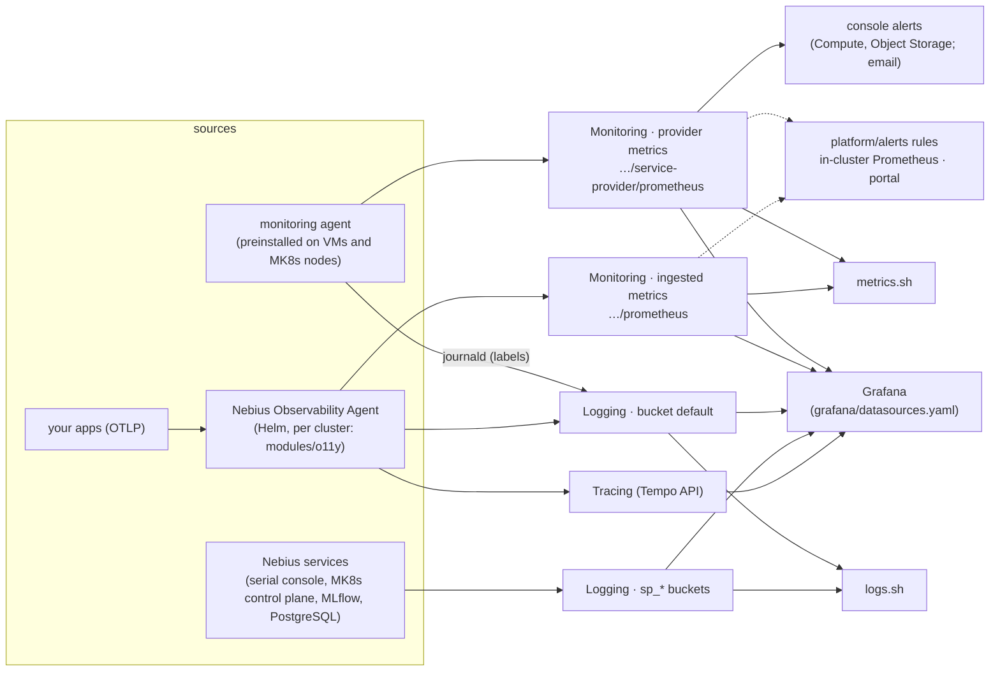

# `recipes/observability` — Observability (R14)

**Purpose.** Know which signal comes from where on Nebius AI Cloud, read any of them from a
terminal with a read-only identity, and point a Grafana at all of them without a secret in the
repository. Nebius Observability (Monitoring, Logging, Tracing) is in preview and free of charge
([pricing](https://docs.nebius.com/observability/resources/pricing)); the repository's own alert rules
run in-cluster and in the portal, because Nebius-managed alerts cover only Compute and Object
Storage. Operator procedure: [`runbooks/observability.md`](../../runbooks/observability.md).

**Used by.** [S1](../../solutions/S1-private-llm-serving-vpn/README.md) private LLM serving with VPN, [S2](../../solutions/S2-fine-tune-70b-two-weeks/README.md) 70B fine-tune, [S6](../../solutions/S6-multi-region-dr/README.md) multi-region DR, [S9](../../solutions/S9-data-science-notebooks/README.md) data-science notebooks ([all solutions](../../solutions/README.md)).



## Which signal comes from where

| Signal | Produced by | Stored in | Read with | Retention |
|---|---|---|---|---|
| VM and node system metrics: GPU (DCGM), vCPU, RAM, OS, InfiniBand | monitoring agent (`nebius-observability-agent`, preinstalled on every new VM and MK8s node; [agent](https://docs.nebius.com/observability/agents/monitoring-agent#how-the-agent-works)) | Monitoring, provider metrics: `https://read.monitoring.api.nebius.cloud/projects/<p>/service-provider/prometheus`; per service `…/buckets/{compute,gpu,nbs,sp_storage,msp}/prometheus` ([Prometheus](https://docs.nebius.com/observability/metrics/prometheus#how-to-connect-prometheus)) | console dashboards ([VMs](https://docs.nebius.com/compute/monitoring/virtual-machines#gpu-monitoring-metrics), [MK8s](https://docs.nebius.com/kubernetes/monitoring#monitoring-metrics)), Grafana, `metrics.sh` | 14 days ([constraints](https://docs.nebius.com/observability/resources/quotas-limits#metrics-constraints)); the agent page says 1 month at full resolution and 1 year at 5 minutes ([retention](https://docs.nebius.com/observability/agents/monitoring-agent#data-retention-and-deletion)): plan on 14 days |
| Volumes, Object Storage, MLflow and PostgreSQL metrics | the services | same, buckets `nbs`, `sp_storage`, `msp` ([services](https://docs.nebius.com/observability/services#metrics)) | as above | as above |
| Kubernetes cluster and app metrics (kube-state-metrics, pods' `/metrics`) | Nebius Observability Agent for Kubernetes (Helm; `modules/o11y` installs it from the Marketplace) ([targets](https://docs.nebius.com/observability/metrics/ingest/nebius-o11y-agent#collected-targets)) | Monitoring, ingested metrics: `…/projects/<p>/prometheus` ([ingest](https://docs.nebius.com/observability/metrics/ingest#connect-grafana-to-view-your-own-metrics)) | Grafana, `metrics.sh --ingested` | 14 days |
| Container logs | the same agent ([logs](https://docs.nebius.com/observability/logs/ingest/nebius-o11y-agent#data-enrichment)) | Logging, bucket `default`, labels `k8s_*` | console **Observability → Logs**, Grafana (Loki), `logs.sh`, `nebius logging` | 14 days ([constraints](https://docs.nebius.com/observability/resources/quotas-limits#logs-constraints)) |
| journald of MK8s nodes (kubelet, containerd …) | monitoring agent, switched on by instance metadata labels `nebius.o11y.systemd-logs-collection.*` on the node group (R1/R3 inputs `journald_logs`, `journald_units`; changing them recreates the nodes) ([journald](https://docs.nebius.com/kubernetes/logs#how-to-enable-journald-logs)) | Logging, bucket `default`, label `mk8s_cluster_id` ([view](https://docs.nebius.com/kubernetes/logs#how-to-view-journald-logs)) | as above | 14 days |
| journald of plain VMs | the same labels on the VM ([VMs](https://docs.nebius.com/observability/logs/journald#configuration-labels)) | bucket `default`, label `instance_id` | as above | 14 days |
| Serial console of VMs | Compute | bucket `sp_serial` | as above ([serial logs](https://docs.nebius.com/compute/monitoring/serial-logs#view-serial-logs-in-grafana)) | 14 days |
| MK8s control plane (API server, scheduler, autoscaler, controller managers, node events) | Managed Kubernetes, always on | bucket `sp_mk8s_control_plane` ([logs](https://docs.nebius.com/kubernetes/logs#how-to-view-audit-and-control-plane-logs)) | as above | 14 days |
| MK8s audit logs | Managed Kubernetes, **off by default**; on where the stage policy sets `audit_logs` (staging, prod) ([enable](https://docs.nebius.com/kubernetes/logs#how-to-enable-audit-logs)) | bucket `sp_mk8s_audit_logs` | as above | 14 days |
| MLflow, PostgreSQL, standalone and MK8s applications | the services | `sp_mlflow`, `sp_postgres`, `sp_cloudapps`, `sp_k8srelease` ([buckets](https://docs.nebius.com/observability/logs/nebius-cli#running-log-queries)) | as above | 14 days |
| Traces | your apps through OTLP to the agent (`nebius-observability-agent.<namespace>.svc.cluster.local:4317`; `o11y` with `modules/o11y`) ([ingest](https://docs.nebius.com/observability/traces/ingest#send-traces-from-your-application)) or directly to `write.tracing.<region>.nebius.cloud:443` ([direct](https://docs.nebius.com/observability/traces/direct-ingest#endpoint-and-headers)) | Tracing, per project ([tracing](https://docs.nebius.com/observability/tracing)) | Grafana (Tempo) ([traces](https://docs.nebius.com/observability/traces/grafana#how-to-connect-grafana)) | not documented |
| Alerts on VM and bucket metrics | console only: **Observability → Alerts**, Compute VMs and Object Storage buckets, notification by email ([alerts](https://docs.nebius.com/observability/alerts), [services](https://docs.nebius.com/observability/services#alerts)) | — | console | — |
| Alerts from [`platform/alerts/`](../../platform/alerts/) | in-cluster Prometheus + Alertmanager (`modules/o11y`, on where the stage sets `alertmanager`: staging, prod) for `kube_*`, `vllm:*`, `node_*`, DCGM from dcgm-exporter; the portal for the DCGM rules against provider metrics and its own `nebius_estate_*` signals ([fleet alerts](../../runbooks/fleet-alerts.md)) | — | Alertmanager receivers ([`runbooks/alerting.md`](../../runbooks/alerting.md)), portal Alerts page | — |

There is no alerting API: the provider at 0.6.67 has no alert, monitoring or logging resource
(`terraform providers schema -json`, 2026-10-11), and the docs describe console steps only. LogQL
alerts on aggregated values are not supported either
([limitations](https://docs.nebius.com/observability/logs/query-language#limitations)).

## Decision table

| Question | Use | Why not the others |
|---|---|---|
| Is a GPU idle, hot, throttling or throwing Xid/ECC errors? | provider metrics (`DCGM_*`, bucket `gpu`): console Metrics tab, Grafana, `metrics.sh query`; the portal's GPU rules | no agent or Prometheus to install; works on VMs and nodes alike |
| Page a person (Slack, PagerDuty) on a workload symptom | `platform/alerts/*.yaml` in in-cluster Prometheus + Alertmanager (`modules/o11y`, `alertmanager_enabled`) | console alerts email only and cover only VMs and buckets |
| Email when one VM's or one bucket's metric crosses a threshold | console alert | the only Nebius-managed alerting; nothing to run |
| Why was a pod not scheduled, why did a node scale or leave? | `logs.sh query '{level="error"}' --bucket sp_mk8s_control_plane` | node events and scheduler/autoscaler logs live only there |
| Who changed or deleted a Kubernetes object? | audit logs (`sp_mk8s_audit_logs`) | off by default; on in staging and prod by stage policy |
| A VM or node does not boot or lost its disk | `logs.sh query '{}' --bucket sp_serial` | the serial console is there before any agent runs |
| kubelet or containerd misbehaves on a node | journald (`journald_logs = true` in R1/R3, set at node-group creation) | container logs do not include systemd units |
| An application's own logs and metrics | the observability agent (`modules/o11y`): bucket `default`, ingested metrics | already installed by R1/R3; pod annotations select what is scraped |
| Latency across services of one request | traces through the agent's OTLP endpoint, Grafana Tempo | the only signal that joins spans across services |
| Logs older than 14 days | an export to an Object Storage bucket (needs `editor`; quotas: 3 pending exports, 1 TiB) ([export](https://docs.nebius.com/observability/logs/export#how-to-export-logs), [quotas](https://docs.nebius.com/observability/resources/quotas-limits#logs-quotas)) or support for longer retention | Logging keeps 14 days |
| Dashboards for a team | Grafana with [`grafana/datasources.yaml`](grafana/datasources.yaml) and the Nebius dashboards from the Grafana marketplace ([dashboards](https://docs.nebius.com/observability/dashboards#installing-a-dashboard-in-grafana)), or the "Grafana solution by Nebius" application | console dashboards cannot combine projects or signals |

## What it builds

Nothing in the cloud. Three read-only clients, a Grafana provisioning file, an offline test and an
end-to-end acceptance script (its one write is a test alert into the cluster's Alertmanager):

| File | What | Notes |
|---|---|---|
| [`metrics.sh`](metrics.sh) | PromQL against Monitoring: `names`, `query`, `series`, `coverage` | `--bucket <service>`, `--ingested`, `--json`, `--dry-run` |
| [`logs.sh`](logs.sh) | LogQL against Logging (Loki API): `buckets`, `labels`, `values`, `query` | adds `__bucket__` from `--bucket`; refuses the documented unsupported functions; `--limit` ≤ 1000, `--since` ≤ 14 days |
| [`lib.sh`](lib.sh) | token, project, GET with the token on curl's stdin | never prints a token |
| [`grafana/datasources.yaml`](grafana/datasources.yaml) | Grafana provisioning: provider metrics, ingested metrics, logs, traces | URLs and headers as the docs give them; `${NEBIUS_PROJECT_ID}` and `${PROMETHEUS_TOKEN}` from Grafana's environment |
| [`test.sh`](test.sh) | offline check (`make recipes-check`) | dry-run URLs, refusals, coverage parsing, no secret in the provisioning file |
| [`acceptance.sh`](acceptance.sh) | end-to-end check against a running Grafana and in-cluster Prometheus/Alertmanager | data sources provisioned and healthy; `platform/alerts` rules loaded; a test alert active and routed to a receiver ([runbook](../../runbooks/observability.md#alerts-end-to-end-in-cluster-prometheus-and-alertmanager-moduleso11y)); a failing part names its [cause class](#acceptance-cause-classes); fixture test `tests/scripts/test-o11y-acceptance.sh` (`make selftest`) |

`metrics.sh coverage` lists every metric the rules in `platform/alerts/` use and whether the project's
provider or ingested metrics have it now: a rule whose metric is in neither needs in-cluster
Prometheus (dcgm-exporter, vLLM) or uses a renamed metric.

## Credentials

Read-only by construction (`GET` only) and by identity. Token, first match wins:
`NEBIUS_IAM_TOKEN`, `PROMETHEUS_TOKEN` (an OBSERVABILITY static key,
[credentials](../../docs/credentials.md#observability-static-key)), or
`nebius --profile "${NEBIUS_PROFILE:-nip-portal-viewer}" iam get-access-token`: the read-only
portal identity ([`docs/credentials.md`](../../docs/credentials.md#portal-read-only-service-account)).
The service account needs `viewer` ([Grafana prerequisites](https://docs.nebius.com/observability/metrics/grafana#prerequisites));
a static key never has more access than its account
([static keys](https://docs.nebius.com/iam/authorization/static-keys)).

```bash
export NEBIUS_PROFILE=nip-portal-viewer NEBIUS_PROJECT_ID=<project>
recipes/observability/metrics.sh names '^DCGM_FI_DEV_(GPU_UTIL|XID)'
recipes/observability/metrics.sh query 'avg by (instance_id) (DCGM_FI_DEV_GPU_UTIL)'
recipes/observability/metrics.sh --ingested query 'sum by (namespace) (kube_pod_status_phase{phase="Pending"})'
recipes/observability/metrics.sh coverage
recipes/observability/logs.sh buckets --since 24h
recipes/observability/logs.sh labels --bucket sp_mk8s_control_plane
recipes/observability/logs.sh query '{level="error"}' --bucket sp_mk8s_control_plane --since 15m
```

The `nebius` CLI reads the same logs: `nebius logging query '<logql>' --bucket <bucket> --since 15m`,
`nebius logging labels --bucket <bucket>`, `nebius logging label-values <label> --bucket <bucket>`
([CLI](https://docs.nebius.com/observability/logs/nebius-cli#getting-labels-and-their-values)). It has
no PromQL command; metrics are read over HTTP.

**Grafana.** Copy `grafana/datasources.yaml` into `<grafana>/provisioning/datasources/` and start
Grafana with `NEBIUS_PROJECT_ID` and `PROMETHEUS_TOKEN` in its environment. The docs set the
`Authorization` header to the key itself for Prometheus and Loki and to `Bearer <key>` for Tempo
([metrics](https://docs.nebius.com/observability/metrics/grafana#how-to-connect-grafana-data-source),
[logs](https://docs.nebius.com/observability/logs/grafana#how-to-connect-grafana),
[traces](https://docs.nebius.com/observability/traces/grafana#how-to-connect-grafana)); the file keeps
that. The in-cluster Grafana from `modules/o11y` is reached by `kubectl port-forward` only
([`runbooks/alerting.md`](../../runbooks/alerting.md)).

## Where `modules/o11y` fits

[`terraform/modules/o11y`](../../terraform/modules/o11y/main.tf) is the in-cluster half, installed by
R1 and R3: the Nebius observability agent (logs, metrics and traces into Nebius Observability, with a
node-label allowlist that keeps series under the label limit) and the Marketplace Prometheus +
Grafana + Alertmanager that evaluates `platform/alerts/`. The stacks pass it two files of this
repository: `platform/alerts/*.yaml` (rules, loaded whenever Prometheus runs; Alertmanager per stage
policy) and [`grafana/datasources.yaml`](grafana/datasources.yaml), which the in-cluster Grafana gets
as its own provisioning file once a Kubernetes Secret with an OBSERVABILITY static key is named
(`grafana_datasource_token_secret`; [runbook](../../runbooks/observability.md#in-cluster-grafana-moduleso11y)).
That key is the one Nebius-side input: without it the plan output `o11y_provisioning` says the data
sources are not provisioned and why. The same file serves a Grafana you run yourself.

## Inputs that matter

| Input | Default | Meaning |
|---|---|---|
| `--project` / `NEBIUS_PROJECT_ID` | — | the project to read; metrics, logs and traces are per project |
| `NEBIUS_PROFILE` | `nip-portal-viewer` | CLI profile used when no token is set |
| `NEBIUS_IAM_TOKEN` / `PROMETHEUS_TOKEN` | unset | a token instead of the CLI |
| `--bucket` | provider metrics / — | a metrics service bucket, or the log bucket |
| `NIP_O11Y_MONITORING_URL`, `NIP_O11Y_LOGGING_URL` | the global `read.*.api.nebius.cloud` hosts | the regional `read.monitoring.<region>.nebius.cloud` host answers the same paths |

## Acceptance cause classes

`acceptance.sh` writes each failing part's cause to `details.causes` (`class`, `part`, `severity`,
`detail`, `hint`) and prints one line per cause. With `O11Y_PROVISIONING` set to a file of
`terraform output -json o11y_provisioning` it also tells an input the plan never had from values that
were sent and did not arrive.

| Class | Means | First action |
|---|---|---|
| `grafana_unreachable`, `prometheus_unreachable`, `alertmanager_unreachable` | nothing answers at the URL | the port-forward: Grafana and the Prometheus server listen on service port 80, Alertmanager on 9093 |
| `grafana_auth_failed` | Grafana answered 401/403 | admin password from the stack output or SecretStash, or a token with Viewer |
| `grafana_api_error` | any other non-JSON or non-200 answer | Grafana's log |
| `datasources_not_provisioned` | sources missing, plan output not given | rerun with `O11Y_PROVISIONING` |
| `datasources_token_secret_unset` | the plan sent no sources: no token Secret named | Nebius-side input: an OBSERVABILITY static key in a Secret ([runbook](../../runbooks/observability.md#in-cluster-grafana-moduleso11y)) |
| `datasources_not_applied` | the plan sent them, Grafana lacks them | the Grafana ConfigMap (`nebius.yaml`), restart Grafana; if absent, the app does not pass `grafana.datasources` through |
| `datasource_token_rejected` | Nebius answered 401/403 to a source | Secret missing or created after Grafana started, wrong key type, or no `viewer` |
| `datasource_unhealthy` | any other health failure | egress to `read.*.api.nebius.cloud`, the URL |
| `prometheus_config_no_rule_files` | the running `prometheus.yml` does not name `alerting_rules.yml` | the release values did not reach `serverFiles` |
| `prometheus_config_no_alerting` | no `alerting` section | `alertmanager_enabled` was false at plan (sandbox default; export `TF_VAR_alertmanager_enabled=true` before the plan that is applied) |
| `rules_not_loaded` / `rules_not_sent` / `rules_sent_not_loaded` | 0 rules: unknown which / the plan sent none / sent but not loaded | `O11Y_PROVISIONING`; the server's log for a rejected rule file |
| `rules_missing`, `rules_unhealthy` | some rules absent / failing evaluation | re-plan and apply; `/api/v1/rules` `lastError` |
| `alertmanager_not_discovered`, `alertmanager_dropped_by_relabel` | Prometheus has no active Alertmanager / found and dropped one | the pod's state and labels, Prometheus RBAC on pods |
| `alertmanager_config_not_applied` | Alertmanager has only the chart's `default-receiver` | inline config or Secret did not arrive ([alerting](../../runbooks/alerting.md)) |
| `test_alert_not_posted`, `test_alert_not_active`, `receiver_not_reached` | the test alert was refused / never active / routed elsewhere than `EXPECT_RECEIVER` | Alertmanager's log and route |
| `receiver_null_only` (note) | routed only to `null` | expected in sandbox |

## Quotas and cost

Observability is in preview and free of charge. Read limits: 3000 series and 10 000 points per
series per metrics request, 1000 rows per logs response, 50 lines per graph point; series above
the label limit are dropped while the write API answers `OK`
([constraints](https://docs.nebius.com/observability/resources/quotas-limits#metrics-constraints),
[time series](https://docs.nebius.com/observability/metrics/ingest#prepare-time-series)). Log exports
count against 3 pending requests and 1 TiB per region and are stored at Object Storage prices.

## Validate

- **Static (CI):** `make recipes-check` runs [`test.sh`](test.sh): every script parses; `--dry-run`
  builds the documented URLs (provider, ingested and per-service metrics; Loki labels, values and
  `query_range`) and never prints the token; a query without a bucket, the documented unsupported
  LogQL functions, `--limit` above 1000 and `--since` above 14 days are refused; `coverage` reads metric
  names, not functions, out of `platform/alerts`; the Grafana file has four data sources on the
  documented hosts and no literal credential. `make shellcheck` covers the scripts.
- **Live, read-only:** run on 2026-10-11 with `nip-portal-viewer`
  ([evidence](../../docs/evidence/2026-10-11-observability-read-only.md)): 952 provider metric names,
  445 ingested; buckets `default`, `sp_mk8s_control_plane`, `sp_serial` and their labels; error lines
  from the control plane; the coverage table below.
- **Live, partly run:** 2026-10-12 on sandbox inference with Alertmanager on: Grafana up, 0 of 4 data
  sources, 0 of 13 rules, 0 Alertmanagers in Prometheus, the test alert routed to `null` (see the
  findings below). Not yet run: a trace through the agent; journald on a node group; a console alert.

## Findings from the read-only run

| Finding | Effect | Where to act |
|---|---|---|
| `DCGM_FI_DEV_CLOCK_THROTTLE_REASONS` is not in Nebius Monitoring; `DCGM_FI_DEV_CLOCKS_EVENT_REASONS` is (the VM monitoring page still names the old field, [GPU metrics](https://docs.nebius.com/compute/monitoring/virtual-machines#gpu-monitoring-metrics)) | `GpuThermalOrPowerThrottling` in `platform/alerts/gpu-health.yaml` matches both names (`DCGM_FI_DEV_CLOCKS_EVENT_REASONS or DCGM_FI_DEV_CLOCK_THROTTLE_REASONS`), so it is evaluated against provider metrics as well as in-cluster (dcgm-exporter); the portal evaluates it against Nebius Monitoring | none: both names are matched |
| Provider DCGM series carry `instance_id`, `uuid`, `mk8s_cluster_id`, `mk8s_node_group_id`; no `Hostname`, no `gpu` | the `{{ $labels.Hostname }}` and `{{ $labels.gpu }}` in rule summaries render empty when a rule runs against provider metrics | the rule owner, with the portal |
| `kube_*` and `node_*` are in the ingested metrics once the agent runs; `vllm:*` only while vLLM serves | the scheduling and inference rules need the agent or in-cluster Prometheus | — |
| 2026-10-12 sandbox: the in-cluster Grafana had none of the four data sources | nothing sent them: `modules/o11y` gave Grafana no sources and the file was only for a Grafana run by hand | fixed: the stacks pass the file, provisioned with a token Secret (the plan names it when missing) |
| 2026-10-12 sandbox: Prometheus loaded 0 of 13 rules and 0 Alertmanagers while Alertmanager answered | not reproducible offline: the module's values rendered with the community prometheus chart 29.36.1 give 13 rules (`promtool check rules`) and an `alerting` section; the Marketplace app's chart versions are unknown, and the old script turned unreachable endpoints into zero counts | rules now ship whenever Prometheus runs, `rule_files` is restated, the receiver Secret uses the alertmanager 2.x keys (`configFromSecret` does not exist there), and `acceptance.sh` names the cause class on the next run |
| Metrics retention: 14 days on the constraints page, 1 month / 1 year on the agent page | plan capacity reviews on 14 days | docs owner ([gaps](../../docs/solutions/gaps-and-discrepancies.md)) |

## Teardown

Nothing to remove. Revoke a static key that is no longer used ([`runbooks/credential-rotation.md`](../../runbooks/credential-rotation.md)).

## Evidence

| Date | What | Result |
|---|---|---|
| 2026-10-11 | `metrics.sh`, `logs.sh` read-only with `nip-portal-viewer` | metric names, log buckets and labels read; coverage of `platform/alerts` ([evidence](../../docs/evidence/2026-10-11-observability-read-only.md)) |
| 2026-10-12 | `acceptance.sh` against the o11y releases of an R1 apply | Grafana and Alertmanager answer; a test alert routes to the sandbox `null` receiver; **no data source provisioned**; the rules check read the Grafana service, so whether the rules load is unknown ([evidence](../../docs/evidence/2026-10-12-sandbox-inference-o11y-acceptance.md)) |
| — | Grafana provisioned from `grafana/datasources.yaml`; a trace through the agent; journald on a node group | **not yet run** |

## Upstream references

[Observability](https://docs.nebius.com/observability) ·
[metrics](https://docs.nebius.com/observability/monitoring) ·
[logs](https://docs.nebius.com/observability/logging) ·
[tracing](https://docs.nebius.com/observability/tracing) ·
[agents](https://docs.nebius.com/observability/agents) ·
[alerts](https://docs.nebius.com/observability/alerts) ·
[LogQL](https://docs.nebius.com/observability/logs/query-language) ·
[quotas and constraints](https://docs.nebius.com/observability/resources/quotas-limits).
