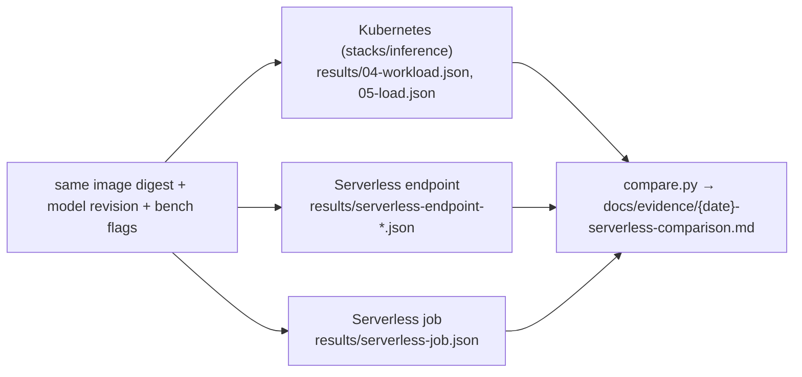

# `recipes/serverless` — Serverless AI vs. Kubernetes (Recipe 6)

The same model, image digest and prompt set run on a Nebius serverless endpoint, a serverless
job and the Kubernetes inference cluster, so the choice between them is made with measurements
([ADR-0001](../../docs/decisions/0001-kubernetes-vs-serverless.md)).

**Used by.** [S8](../../solutions/S8-batch-inference/README.md) batch inference ([all solutions](../../solutions/README.md)).

| Use it when | Don't use it when |
|---|---|
| A customer asks whether a managed endpoint or job removes enough operating scope to beat their own cluster | The customer already needs runtime control (custom engine, private networking, own observability): go straight to [`stacks/inference`](../../terraform/stacks/inference/README.md) |
| Demand is bursty and idle time matters | You need a published throughput figure today: nothing has been measured yet (Evidence, below) |

## What it runs

| | Kubernetes (`stacks/inference` + `workloads/inference`) | Serverless endpoint | Serverless job |
|---|---|---|---|
| Created by | this repository (Terraform + kustomize) | `endpoint.sh create` → `nebius ai endpoint create` (serverless-ai-cookbook `inference/vllm-endpoint`) | `job.sh` → `nebius ai job create` (cookbook `quickstarts/first-job`) |
| Who runs the GPU node | you (node group) | Nebius | Nebius |
| Runtime control | full: image digest, engine args, scheduling, Pod Security Standards (PSS), network | image + command + preset; managed `https://` URL with token auth (80 Mbps / 300 connections per endpoint) | image + command + preset; ends on `COMPLETED`/`FAILED` or the timeout (1 h, the documented minimum) |
| Observability | your Prometheus/DCGM/Grafana | `nebius ai logs`, console | `nebius ai logs` |
| Scaling | replicas you manage | one container VM per endpoint (autoscaling not documented) | one job per invocation |
| Billing | GPU node per second while it exists | per second while running (a stopped endpoint is not billed) | per second until the job ends |
| Data | the R8 claim | `--volume` mounts an R8 bucket or filesystem | `--volume <filesystem or bucket>:/data:ro` reads R8 data |

| Script | What it does | Records |
|---|---|---|
| `CONFIRM=yes endpoint.sh create` | vLLM endpoint with the Kubernetes overlay's image digest and model revision, random per-run token | create → first `200 /health` cold start |
| `endpoint.sh measure` | the `04-workload.sh` probe, then the R1 load method ([`tests/load/`](../../tests/load/README.md): first request, warm-up, concurrency sweep, bars; the probe is the cold first request) from the operator host; `MEASURE_FROM=cluster` runs the same sweep as a Job inside the R1 cluster (current `kubectl` context, namespace `nip-bench`, token in a Secret deleted on every exit path), in-region like the R1 figures; the endpoint region (`NEBIUS_REGION` at create) and the Job's region are recorded | per point: TTFT/TPOT/E2E p50/p99, req/s, output tokens/s, cost per 1M output tokens; the generator's vantage |
| `endpoint.sh delete` | deletes the endpoint | end timestamp |
| `job.sh` | `vllm bench throughput` (200 random prompts, 256 in / 128 out) as a serverless job, waits up to 90 min (capacity wait included), deletes it | wall time, final state and its `state_details.code`, req/s, output tokens/s |
| `compare.py` | merges the passing results per concurrency point (a point only one side ran prints "not measured" on the other) and labels the comparison **like-for-like** only when both generators ran in-region, the endpoint and the R6 Job are in the lab's region, and the image, model and sweep params match (`input_len`, `output_len`, `num_prompts`, `warmup_prompts`; otherwise "no" and why; the note names the remaining path difference: in-cluster Service over HTTP vs managed https:// URL); a missing or failed step prints "not measured" | `docs/evidence/<date>-serverless-comparison.md` |

## Key inputs (environment variables)

| Variable | Default | Meaning |
|---|---|---|
| `VLLM_IMAGE` | `vllm/vllm-openai:v0.31.0@sha256:c1c9…` | must match `workloads/inference/base/deployment.yaml` |
| `MODEL` / `MODEL_REVISION` | `Qwen/Qwen2.5-1.5B-Instruct` @ `989aa79…` | must match the Kubernetes overlay |
| `PLATFORM` / `PRESET` | `gpu-l40s-a` / `1gpu-8vcpu-32gb` | serverless preset; record it next to the Kubernetes preset, since they differ by default |
| `ENDPOINT_NAME`, `JOB_NAME` | `nip-vllm-compare`, `nip-vllm-batch-<epoch>` | resource names |
| `RESULTS_DIR` | `results/` | output directory; the endpoint state file (id, token) is git-ignored and `0600` |

## Quotas, cost, run, validate

| | |
|---|---|
| Quotas | the endpoint/job preset's GPU quota in the project and region ([`docs/capacity.md`](../../docs/capacity.md)); the Kubernetes side needs the R1 quotas |
| Cost shape | per second while the endpoint exists or the job runs, cold start included; cost per output token is the formula in [`docs/evidence/costs.md`](../../docs/evidence/costs.md); rates on the day go into the comparison file ([`docs/cost.md`](../../docs/cost.md#cost-shape-per-recipe)) |
| Run | needs the `nebius` CLI logged in, `jq`, `curl`; costs money while running. Run R1 first ([`runbooks/deploy.md`](../../runbooks/deploy.md), `WITH_LOAD=1`), then `NEBIUS_REGION=<region> CONFIRM=yes endpoint.sh create` (it refuses without `CONFIRM=yes`, records the endpoint id in `results/serverless-endpoint.state` before it polls, retries transient polling errors, and on any failure prints the `nebius ai endpoint delete` command), `MEASURE_FROM=cluster endpoint.sh measure` (with the R1 cluster's kubeconfig; plain `endpoint.sh measure` measures over the WAN and is labelled not like-for-like), `endpoint.sh delete`, `job.sh`, `python3 recipes/serverless/compare.py` |
| Validate | every script writes a pass/fail JSON; `compare.py` ignores failed steps. Load method: [`tests/load/README.md`](../../tests/load/README.md) |

### Price (derived, 2026-10-13)

Serverless AI has no pricing of its own: while an endpoint runs it is billed for its compute and
storage under Compute VM and disk pricing, and a stopped endpoint is not billed
([pricing and quotas](https://docs.nebius.com/serverless/pricing-quotas); mirror
`.cache/nebius-docs/serverless/pricing-quotas.md`). `endpoint.sh create` starts an **on-demand**
`gpu-l40s-a` / `1gpu-8vcpu-32gb` container VM (no `--preemptible`) with `--disk-size 200Gi`, so its
rate is that VM's: `python3 recipes/finance/price.py recipes/finance/examples/serverless-endpoint-l40s.json --project <sandbox>`
(read-only billing calculator, `eu-north1`, 2026-10-13T00:43Z) returned **$1.5484/h** for the VM and
**$0.0194/h** for 200 GiB of Network SSD, **≈ $1.5678/h** in all. Not observed on a bill; the
container disk's type is not documented (unknown: the disk line assumes Network SSD), and
`--preemptible --follows-spot-price` would bill the spot rate instead (the L40S spot rate was
$0.7492/h on 2026-10-12, run 2's re-price), which `endpoint.sh` does not use. Re-price on the day:
list and spot prices change.

"Cheaper" needs, per workload: the minutes the endpoint or node must exist (cold starts
included), request volume, and whether idle time can be avoided. Serverless wins on bursty
demand with no runtime control needed; the cluster wins when the GPU is busy most of the time or
the customer needs the control row above.

## Evidence

| File | Proves | Does not prove |
|---|---|---|
| [`costs.md` → runs with a cost estimate only](../../docs/evidence/costs.md#runs-with-a-cost-estimate-only) | a vLLM-on-B300 vs. serverless bench was attempted on 2026-10-08; it left a lab-harness cost estimate only and most likely never received its GPU (no GPU charge on the bill) | anything: no figure from it may be quoted (`costs.md`, "Runs with a cost estimate only") |

No run of these scripts is recorded yet.

## Related

ADR: [0001](../../docs/decisions/0001-kubernetes-vs-serverless.md). Upstream findings:
[R6-1, R6-2](../../docs/upstream-findings.md#r6-serverless-comparison) (cost-per-token method;
token visible on the CLI argument list).
