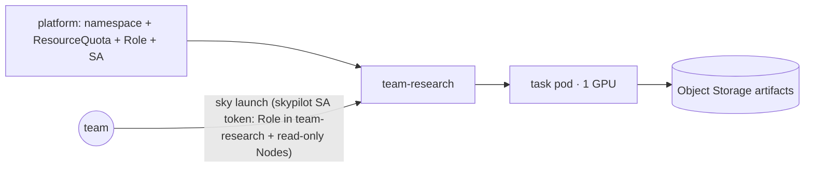

# `recipes/team-platform` — team namespaces and SkyPilot (Recipe 5)

The developer-facing layer **above** infrastructure, as `nebius/nebius-physical-ai` (NPA, commit
`c76fe41`, verified 2026-10-09) builds it: team namespaces selected through the kubeconfig
context, workloads submitted with **SkyPilot 0.12.2**, artifacts in Object Storage. This
directory maps that pattern onto the [`stacks/inference`](../../terraform/stacks/inference/README.md)
cluster so several teams share it without touching Terraform.

**Used by.** [S9](../../solutions/S9-data-science-notebooks/README.md) data-science notebooks ([all solutions](../../solutions/README.md)).

| Use it when | Don't use it when |
|---|---|
| Several teams share one GPU cluster and each should see only its own namespace and GPU share | One team owns the cluster: give it the kubeconfig and the workload overlays directly |
| Teams want to launch from workflow YAML (`sky launch`) instead of writing manifests | The users want Slurm: [`stacks/soperator`](../../terraform/stacks/soperator/README.md); or hosted inference with no cluster (Token Factory / [R6](../serverless/README.md)) |

## What it builds

Kubernetes objects only, applied with `kubectl apply -k recipes/team-platform/namespaces`;
no Terraform, no cloud resource.

| File | Object | Notes |
|---|---|---|
| `namespaces/namespace.yaml` | Namespace `team-research` | Pod Security Standards (PSS) `baseline` enforced, `restricted` warned |
| `namespaces/quota.yaml` | ResourceQuota | 1 GPU, 16 CPU, 128 GiB memory, 5 PVCs, 200 GiB storage: the team's cost boundary |
| `namespaces/rbac.yaml` | ServiceAccount, Role, RoleBinding `skypilot` | namespace-scoped, plus one cluster-wide read-only grant on Nodes (SkyPilot's GPU discovery). Pre-created by the platform and named in `remote_identity`, so SkyPilot never creates RBAC objects: the Role grants no write on `roles`, `rolebindings` or `serviceaccounts` (a team that could write RoleBindings could make itself namespace admin) |
| `skypilot/config.yaml` | SkyPilot global config | Kubernetes only, one allowed context, `remote_identity: skypilot`, GPU toleration and `nip.nebius.io/gpu` node selector |
| `skypilot/task.yaml` | one SkyPilot task | 1 × H100, pinned PyTorch image, runs `workloads/training/ddp/train.py` via `torchrun`, writes `/artifacts/metrics.json` |

## One workload, end to end

| Step | Who | Boundary |
|---|---|---|
| 1. Create `team-research` with its quota and the `skypilot` SA (`kubectl apply -k recipes/team-platform/namespaces`) | platform | cluster-wide objects stay with platform |
| 2. Hand the team a credential bound to the namespace Role, not the operator kubeconfig: `kubectl -n team-research create token skypilot --duration 8h`, set as the user of a context pinned to `team-research` (NPA: `npa workbench namespace context`) | platform | the `skypilot` Role/RoleBinding (`rbac.yaml`) is namespace-scoped plus read-only Nodes; the kubeconfig from `make kubeconfig` authenticates as the operator and must never be shared — a namespace default alone restricts nothing |
| 3. `sky launch -c ddp recipes/team-platform/skypilot/task.yaml` from the repository root | team | SkyPilot places pods in the context's namespace; the quota enforces the GPU cap |
| 4. The pod runs `torchrun … train.py` on the GPU node | cluster | same node, driver and CSI stack that `tests/validate` checks (not yet run live; no run recorded in [`docs/evidence/`](../../docs/evidence/README.md)) |
| 5. Artifacts go to `s3://<bucket>/<team>/<run>/` with a team-scoped key (`ARTIFACT_BUCKET`) | team | Object Storage is the system of record; the filesystem is cache ([ADR-0004](../../docs/decisions/0004-storage-design.md)) |
| 6. `sky down ddp` releases the GPU and frees the quota | team | no Terraform change for steps 3–6 |

The platform keeps node groups and their cost, the driver path, the StorageClass, o11y and the
quota numbers; everything inside the namespace moves to the team.

## Key inputs

| Input | Default | Meaning |
|---|---|---|
| `ResourceQuota` `requests.nvidia.com/gpu` | `1` | the team's GPU share; size the inference stack's `gpu_node_count` to the sum of all shares |
| `allowed_contexts` | `REPLACE-WITH-KUBECONFIG-CONTEXT` | the context `scripts/get-kubeconfig.sh` (`make kubeconfig`) writes for `nip-<stage>-inference`; read it with `kubectl config current-context`. `nip-lab` was the old default cluster name, replaced by `nip-<stage>-inference` (`terraform/live/sandbox/inference/sandbox.auto.tfvars:6`; [`docs/naming.md`](../../docs/naming.md) §7 item 3) |
| `resources.accelerators` | `H100:1` | `L40S:1` when the cluster uses `gpu-l40s-a` |
| `ARTIFACT_BUCKET` | empty | `s3://<bucket>/team-research`; empty keeps artifacts in the pod |

## Quotas, cost, run, validate

| | |
|---|---|
| Quotas | none beyond the R1 cluster ([`docs/capacity.md`](../../docs/capacity.md#stacksinference)); the namespace quota divides the existing GPUs |
| Cost shape | no new billable resource; a task occupies the R1 GPU node while it runs ([`docs/cost.md`](../../docs/cost.md#cost-shape-per-recipe)) |
| Run | `pip install "skypilot[kubernetes]==0.12.2"` (the NPA pin), `make kubeconfig` for the inference cluster, `sky check kubernetes` enabled, then the steps above |
| Validate | `make kustomize` builds the namespace manifests (CI); live: the task's `/artifacts/metrics.json` and `sky down` freeing the quota |

Why not `npa` itself: it bundles many tools (Genesis, LeRobot, Rerun …) and needs a Linux
operator host with its own SkyPilot environment. The reusable infrastructure pattern is the
namespace + SkyPilot + Object Storage split; adopt `npa` on top when the workloads are
physical-AI.

Managed alternative: the Managed SkyPilot API Server (a Nebius standalone application, billed)
auto-discovers every Managed Kubernetes cluster in the project, with no local kubeconfig, and
`kubernetes.allowed_contexts` in its dashboard limits which clusters it uses
([SkyPilot on Managed Kubernetes](https://docs.nebius.com/3p-integrations/skypilot-mk8s#add-managed-kubernetes-clusters-to-skypilot)).
It does not by itself give the per-namespace Role and quota split above. Set `S3_ENDPOINT` in
`task.yaml` to the artifact bucket's region.

## Evidence

None: the manifests build in CI; nothing here has run on a live cluster.

## Related

ADRs: [0004](../../docs/decisions/0004-storage-design.md) (storage),
[0006](../../docs/decisions/0006-reconciler-ownership.md) (platform vs. team ownership).
Upstream findings: none for R5 ([register](../../docs/upstream-findings.md)).
