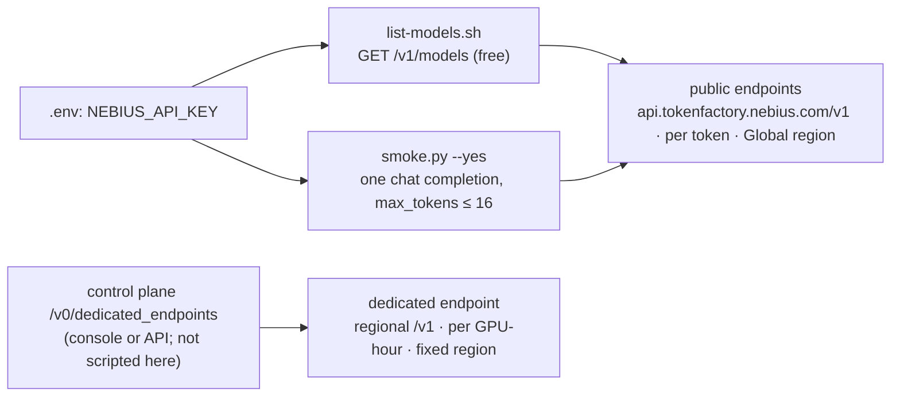

# `recipes/token-factory` — Token Factory (R11)

**Purpose.** Call open models through Nebius's hosted, OpenAI-compatible inference API, with no
GPU, cluster or VM to run, and know when that is the better choice than serving the model yourself
(R1, R10). The recipe is a client configuration, a free read-only model listing, a one-request
smoke test that refuses to spend without `--yes`, and the facts a customer conversation needs:
rate limits, dedicated endpoints, the cost model and the risks.

**Used by.** [S3](../../solutions/S3-llm-api-token-factory/README.md) LLM API without GPUs, [S8](../../solutions/S8-batch-inference/README.md) batch inference (alt.: the Batch API) ([all solutions](../../solutions/README.md)).

Token Factory is a separate product with its own console (`tokenfactory.nebius.com`), API keys,
billing account and documentation at `docs.tokenfactory.nebius.com`. It is not part of the Nebius
AI Cloud console or of this repository's Terraform: nothing here creates anything in it. Every
claim below cites those docs, read on **2026-10-11**, as plain URLs.



## What it is, against self-hosting

| | **R11 Token Factory, public endpoints** | **R11 dedicated endpoint** | **R1** MK8s + vLLM / **R10** GPU VM |
|---|---|---|---|
| Who runs the GPUs | Nebius, shared multi-tenant capacity | Nebius, capacity reserved for your organisation while the endpoint is active | you (node group or VM) |
| Models | the catalog (`list-models.sh`); base models only | templates (model × flavor × GPU × region); custom weights in beta, on request | any image and weights you pin (`platform/versions.yaml`) |
| Region | **Global**: processing location can change at any time, without notice | fixed, chosen at creation: `eu-north1`, `eu-west1`, `us-central1` | the project's region |
| Throughput limits | dynamic rate limits (below) | none standard; what the replicas you deployed can serve | the GPUs you pay for |
| Network | public HTTPS API with a bearer key | public regional HTTPS API with a bearer key | private by default (R7), your security groups |
| Price unit | per token | per GPU-hour, billed per minute | per second of GPU VM existence ([Compute pricing](https://docs.nebius.com/compute/resources/pricing#virtual-machines-gpus-vcpus-ram)) |
| You operate | a key and a client | a key, a template choice, replica counts | the cluster or VM, drivers, runtime, observability, upgrades |

Sources: dedicated vs public comparison, https://docs.tokenfactory.nebius.com/ai-models-inference/dedicated-endpoints/overview ;
"Global" region, https://docs.tokenfactory.nebius.com/public-serverless ; regions of dedicated endpoints,
https://docs.tokenfactory.nebius.com/ai-models-inference/dedicated-endpoints/operating ; custom weights,
https://docs.tokenfactory.nebius.com/ai-models-inference/dedicated-endpoints/custom-weights .

Token Factory is also not R6: R6 runs **your** container on Nebius AI Cloud Serverless
([Serverless AI](https://docs.nebius.com/serverless/overview)); Token Factory serves Nebius's
catalog of models behind one shared API.

### When to choose which

[ADR-0001](../../docs/decisions/0001-kubernetes-vs-serverless.md) leads with self-hosting when the
customer needs a specific runtime or version, custom scheduling, private networking, its own
observability or has a Kubernetes platform team, and with a managed option when they need none of
those. Token Factory is the far end of the managed side:

| Choose | When |
|---|---|
| **Public endpoints** | the model is in the catalog; traffic is modest or bursty; testing, prototypes, internal or non-critical use. The docs say public endpoints "are not intended for production use cases that depend on a stable region" (https://docs.tokenfactory.nebius.com/public-serverless) |
| **Dedicated endpoint** | predictable capacity, a fixed region for data residency or latency, fine-tuned weights, or throughput beyond the public rate limits (https://docs.tokenfactory.nebius.com/ai-models-inference/dedicated-endpoints/overview) |
| **R1 / R10 (self-hosted)** | a model or runtime not offered as a template; private networking (no public API); your own observability and data path; or GPU-hours already committed in Nebius AI Cloud (R9) |
| **Enterprise tier** | sustained traffic that dwarfs the standard limits: removes the soft caps, adds dedicated capacity and an SLA (https://docs.tokenfactory.nebius.com/ai-models-inference/rate-limits) |

Neither side is "cheaper" without the customer's token volumes (ADR-0001, P6): price both with the
listed per-token prices and the R1/R10 cost shapes, and label the result "not a quote".

## Client configuration

The API is OpenAI-compatible; switching an OpenAI client means setting the base URL to
`https://api.tokenfactory.nebius.com/v1/`, the key from `NEBIUS_API_KEY`, and a model id
(https://docs.tokenfactory.nebius.com/switch , https://docs.tokenfactory.nebius.com/quickstart).
The key travels as `Authorization: Bearer <key>`
(https://docs.tokenfactory.nebius.com/api-reference/introduction).

```python
import os
from openai import OpenAI                      # any OpenAI-compatible client; this recipe's scripts use only the stdlib

client = OpenAI(base_url="https://api.tokenfactory.nebius.com/v1/", api_key=os.environ["NEBIUS_API_KEY"])
```

| Setting | Value | Source |
|---|---|---|
| Base URL, public endpoints | `https://api.tokenfactory.nebius.com/v1/` | https://docs.tokenfactory.nebius.com/quickstart |
| Base URL, dedicated endpoint data plane | `eu-north1`: `https://api.tokenfactory.nebius.com`; `eu-west1`: `https://api.tokenfactory.eu-west1.nebius.com`; `us-central1`: `https://api.tokenfactory.us-central1.nebius.com` (each + `/v1`) | https://docs.tokenfactory.nebius.com/ai-models-inference/dedicated-endpoints/control-data-plane |
| Model | an id from `GET /v1/models`; a dedicated endpoint's `routing_key` | https://docs.tokenfactory.nebius.com/api-reference/models/list-models , https://docs.tokenfactory.nebius.com/ai-models-inference/dedicated-endpoints/deploy-api |
| Fast flavor | append `-fast` to the model name: same outputs, lower latency, different price | https://docs.tokenfactory.nebius.com/ai-models-inference/overview |
| Key | Token Factory → **API keys** → **Create API key**; shown once, "You cannot open it later" | https://docs.tokenfactory.nebius.com/api-reference/introduction |

In this repository the key lives in `.env` as `NEBIUS_API_KEY` (mode 600, git-ignored;
[`docs/credentials.md`](../../docs/credentials.md)), stored and verified with
`scripts/store-credentials.sh NEBIUS_API_KEY`, rotated per
[`runbooks/credential-rotation.md`](../../runbooks/credential-rotation.md). Never put it in
client-side code: "If a key is compromised, Nebius Token Factory can automatically revoke it"
(https://docs.tokenfactory.nebius.com/api-reference/introduction). Do not hard-code the base URL of
a public endpoint with a region in it: such a URL "can stop working if the endpoint's processing
region changes" (https://docs.tokenfactory.nebius.com/public-serverless).

## Scripts

| Script | What it does | Cost |
|---|---|---|
| [`list-models.sh`](list-models.sh) | `GET /v1/models`: id and owner per model; `--verbose` adds context length, the price fields and per-model requests/tokens per minute as the API returns them; `--json` the raw response | free, read-only |
| [`smoke.py`](smoke.py) | one `POST /v1/chat/completions`: an 8-token reply cap by default (hard cap 16), `temperature 0`; prints whole-request latency, prompt/completion/total tokens, `finish_reason` and the `x-ratelimit-*` headers. **Refuses without `--yes`.** `--dry-run` prints the request with the key redacted and sends nothing | a fraction of a cent of the owner's credit (Cost model) |
| [`test.sh`](test.sh) | offline check in `make ci`: `smoke.py` imports, `--dry-run` works without a key or network and never prints one, no `--yes` → exit 2, `max_tokens` cap holds | none |

```bash
recipes/token-factory/list-models.sh                       # free; key from the environment or .env
python3 recipes/token-factory/smoke.py --dry-run           # the exact request, nothing sent
python3 recipes/token-factory/smoke.py --yes [--model <id>] [--json]   # the account owner decides
```

`smoke.py` defaults to `nvidia/Nemotron-3_5-Lightning`: the docs name it as a recommended
replacement model (https://docs.tokenfactory.nebius.com/august-2026-deprecation-notice), it was listed
by `GET /v1/models` on 2026-10-11 and had the lowest listed prompt and completion price that day.
The quickstart's own model, `deepseek-ai/DeepSeek-R1-0528`
(https://docs.tokenfactory.nebius.com/quickstart), was **not** in the listing (Evidence).

## Rate limits

From https://docs.tokenfactory.nebius.com/ai-models-inference/rate-limits :

- Every user has a default rate limit (requests and tokens per minute), shown in the console under
  **Rate Limits**. Limits are dynamic, evaluated in rolling 15-minute windows: average use ≥ 80 % of
  the limit raises the next window's limit by 20 % (× 1.2); ≤ 50 % lowers it by a third (÷ 1.5); the
  hard ceiling is **20 ×** the base allocation, beyond which an Enterprise plan is required.
- The page's worked example starts at 60 RPM / 400,000 TPM and reaches 258 RPM / 1,720,000 TPM after
  two hours at ≥ 80 % use. It is labelled a visual example, not a guaranteed default.
- Over the limit: **HTTP 429**, with `Retry-After`. Track headroom in `x-ratelimit-remaining-requests`
  and `x-ratelimit-remaining-tokens` (full list of `x-ratelimit-*` headers on the page). A request
  over the limit may still be served at lower priority, flagged `x-ratelimit-over-limit: yes`: treat
  it as an early warning. "Sudden bursts … may be subject to throttling": ramp load gradually.
- The page points asynchronous work at the Batch API, which "has significantly higher limits".
- Dedicated endpoints have no standard rate limits; throughput depends on deployed capacity
  (https://docs.tokenfactory.nebius.com/ai-models-inference/dedicated-endpoints/overview).

`list-models.sh --verbose` also prints a per-model `per_request_limits` object (requests and tokens
per minute) that the API returns; its keys are not described in the docs, so read the console's
**Rate Limits** page as the authority. On 2026-10-11 the values ranged from 100 to 10,000 RPM and
200,000 to 2,000,000 TPM across models (Evidence).

## Dedicated endpoints

Isolated deployments of a model template, managed through a control plane and called through a
regional, OpenAI-compatible data plane
(https://docs.tokenfactory.nebius.com/ai-models-inference/dedicated-endpoints/overview ,
https://docs.tokenfactory.nebius.com/ai-models-inference/dedicated-endpoints/control-data-plane).

| Topic | What the docs say | Source |
|---|---|---|
| Create | console, or `GET /v0/dedicated_endpoints/templates` then `POST /v0/dedicated_endpoints` on `https://api.tokenfactory.nebius.com` with `name`, `model_name`, `flavor_name`, `gpu_type`, `gpu_count` (per replica), `region`, `scaling.min_replicas` / `max_replicas`; the templates are the source of truth for valid combinations | https://docs.tokenfactory.nebius.com/ai-models-inference/dedicated-endpoints/deploy-api , https://docs.tokenfactory.nebius.com/ai-models-inference/dedicated-endpoints/operating |
| Call | `model = <routing_key>` returned at creation, on the region's data-plane URL; `404` while it provisions | https://docs.tokenfactory.nebius.com/ai-models-inference/dedicated-endpoints/deploy-api |
| Change | `PATCH /v0/dedicated_endpoints/{endpoint_id}` updates only the given fields; `region` cannot change after creation; `enabled: false` stops it and frees the replicas | https://docs.tokenfactory.nebius.com/ai-models-inference/dedicated-endpoints/operating |
| Status | lifecycle (Starting, Updating, Running, Warning, Stopping, Stopped) is separate from readiness (Not ready, Partially ready, Ready): "Use Readiness to decide whether to send traffic"; Warning or Partially ready for more than 3 h → support | https://docs.tokenfactory.nebius.com/ai-models-inference/dedicated-endpoints/lifecycle-and-status |
| Capacity | self-service endpoints run on Nebius AI Cloud **on-demand** capacity; min replicas are reserved and non-preemptible only while the endpoint is active. Any stop (manual, incident, maintenance) releases the GPUs to the shared pool; a restart may sit in Starting / Not ready until capacity frees up. Above min replicas, scaling depends on burst capacity | https://docs.tokenfactory.nebius.com/ai-models-inference/dedicated-endpoints/capacity-and-scaling ([AI Cloud reservations](https://docs.nebius.com/compute/virtual-machines/reservations)) |
| SLA | none for self-service endpoints unless contracted; historical average monthly request success "approximately 99.9%" | https://docs.tokenfactory.nebius.com/ai-models-inference/dedicated-endpoints/capacity-and-scaling |
| Sizing | GPU type and `gpu_count` set per-replica performance; replicas set traffic capacity. Start with the smallest GPU that fits; raise GPU type or count before adding replicas | https://docs.tokenfactory.nebius.com/ai-models-inference/dedicated-endpoints/best-practice |
| Errors | `401` key, `403` key lacks dedicated-endpoint permission, `404` not ready / wrong regional URL / wrong `routing_key`, `409` capacity or config conflict, `422` invalid payload | https://docs.tokenfactory.nebius.com/ai-models-inference/dedicated-endpoints/faq |

This recipe does not script dedicated endpoints: creating one starts per-GPU-hour billing as soon
as a replica is ready. The runbook gives the read-only checks and the console/API steps for an
owner-approved trial.

## Cost model

| Offer | Billed | Source |
|---|---|---|
| Public endpoints | per token; Base and Fast flavors differ in token price | https://docs.tokenfactory.nebius.com/ai-models-inference/dedicated-endpoints/overview , https://docs.tokenfactory.nebius.com/ai-models-inference/overview |
| Dedicated endpoints | per GPU-hour, per-minute granularity, while at least one replica runs and the endpoint is `ready`; provisioning, `not ready`, `partially ready`, replica restarts and graceful shutdowns are not billed; zero replicas = no charge; scaling above min replicas is PAYG; contracts may differ | https://docs.tokenfactory.nebius.com/ai-models-inference/dedicated-endpoints/overview , https://docs.tokenfactory.nebius.com/ai-models-inference/dedicated-endpoints/billing-policy |
| Account | a billing account with a bank card is mandatory at sign-up; **$1 trial credit valid 30 days**; balance debited in real time; the card is charged at the start of the month if the balance is negative or when the billing threshold is reached; **a failed charge suspends the account**; bank transfer for companies; usage per project/service in Organisation → Usage; VAT per location | https://docs.tokenfactory.nebius.com/other-capabilities/billing-new |

**Prices.** `GET /v1/models?verbose=true` returns `pricing.prompt` and `pricing.completion` per
model as decimal strings (https://docs.tokenfactory.nebius.com/api-reference/models/list-models). The
schema states neither unit nor currency; the values read as USD per token, which matches the
per-token billing above, but confirm on the Token Factory pricing page before quoting. Observed on
2026-10-11 (list prices, **not a quote**; re-read with `list-models.sh --verbose`):

| Model (observed 2026-10-11) | `pricing.prompt` | `pricing.completion` | = per 1M tokens, if USD/token |
|---|---|---|---|
| `nvidia/Nemotron-3_5-Lightning` (smoke default) | 0.00000006 | 0.00000024 | $0.06 in / $0.24 out |
| `openai/gpt-oss-120b` | 0.00000015 | 0.0000006 | $0.15 in / $0.60 out (same on 2026-10-12) |
| `Qwen/Qwen3-30B-A3B-Instruct-2507` (bench default; observed 2026-10-12) | — | — | $0.10 in / $0.30 out |
| `moonshotai/Kimi-K3` (highest listed) | 0.000003 | 0.000015 | $3 in / $15 out |

**Worked example (assumption-labelled).** A smoke run with a prompt under 100 tokens and at most 16
completion tokens on the default model costs at most 100 × 0.00000006 + 16 × 0.00000024 ≈ $0.00001
at the listed prices: a thousandth of a cent. A workload of 10M input + 2M output tokens a month on
`gpt-oss-120b` lists at 10 × $0.15 + 2 × $0.60 = $2.70. A dedicated endpoint has no price in the docs
pages read; get the per-GPU-hour rate from the console's template or from sales, and compare its
`min_replicas × gpu_count × hours` with the token bill. Token Factory has its own billing account
and balance; whether its charges reach the Nebius AI Cloud budgets and FOCUS export that R9 uses is
not stated in the pages read (open question; track spend in Token Factory → Organisation → Usage).

## Quotas

The Token Factory docs read describe **rate limits** (above), not quotas. None of the Nebius AI Cloud
project quotas in [`docs/capacity.md`](../../docs/capacity.md) apply to public endpoints, and no
AI Cloud project is needed. Dedicated endpoints consume Nebius AI Cloud on-demand GPU capacity
(https://docs.tokenfactory.nebius.com/ai-models-inference/dedicated-endpoints/capacity-and-scaling);
the docs read do not say whether that counts against any quota the customer sees. A region or GPU
type missing from the templates is a capacity question for sales, as is guaranteed capacity across
restarts (https://docs.tokenfactory.nebius.com/ai-models-inference/dedicated-endpoints/faq).

## Risks

| Risk | Consequence | Mitigation | Source |
|---|---|---|---|
| Model deprecation on public endpoints | requests to a removed id fail; no automatic reroute (ten models were removed on 2026-08-31) | pin ids in config, re-run `list-models.sh` before a release, test the documented replacement; dedicated endpoints were unaffected | https://docs.tokenfactory.nebius.com/august-2026-deprecation-notice |
| Docs examples name ids that are not served | copy-pasted quickstart code fails | take ids from `list-models.sh`, never from examples (Evidence) | this recipe, 2026-10-11 |
| A served id is not a Hugging Face repo | tools that load the tokenizer by the model id (`vllm bench serve`) fail before the first request | bench a model whose id is a public repo, or name a compatible tokenizer (`--tokenizer`, counts approximate); `bench.sh` checks first | this recipe, 2026-10-12 |
| No region guarantee on public endpoints | data residency and latency cannot be promised; a regional URL can stop working | dedicated endpoint in a chosen region | https://docs.tokenfactory.nebius.com/public-serverless |
| Throttling | HTTP 429 on bursts | ramp gradually, honour `Retry-After`, Batch API, Enterprise or dedicated | https://docs.tokenfactory.nebius.com/ai-models-inference/rate-limits |
| Capacity lost on stop | a stopped or interrupted dedicated endpoint may not come back quickly | keep it running, or reserve capacity through sales | https://docs.tokenfactory.nebius.com/ai-models-inference/dedicated-endpoints/capacity-and-scaling |
| Account suspension | a failed card charge suspends the account and every endpoint with it | valid payment method, top-ups, or bank transfer for companies | https://docs.tokenfactory.nebius.com/other-capabilities/billing-new |
| Optimised serving differs from the reference model | quantisation and other optimisations keep "approximately 99%" of the original quality (e.g. `gpt-oss-120b` listed as `fp4`) | evaluate on the customer's prompts before committing | https://docs.tokenfactory.nebius.com/ai-models-inference/overview |
| Key leak | anyone with the key spends the credit | `.env` only, never client-side; rotation runbook; Nebius may revoke a compromised key | https://docs.tokenfactory.nebius.com/api-reference/introduction |
| Data handling | the pages read do not state retention or training use of prompts | ask before sending customer data; open question | — |

Team access (organisation and per-project groups, invitations) is described at
https://docs.tokenfactory.nebius.com/team-access/overview ; this recipe uses one key and no projects.

## Validate

- **Static** (`make ci`): `recipes/token-factory/test.sh` (offline: import, dry run, refusal without
  `--yes`, `max_tokens` cap, no key in output) and `shellcheck` over the scripts.
- **Live, free**: `list-models.sh` (done 2026-10-11, Evidence).
- **Live, paid** (the owner decides each run): `smoke.py --yes --json`; record the output in `docs/evidence/`
  ([`runbooks/token-factory.md`](../../runbooks/token-factory.md#smoke-test-paid-owner-decides)). Run live
  2026-10-11: HTTP 200, 947 ms, 31 tokens, one request, no percentile
  ([evidence](../../docs/evidence/2026-10-11-token-factory-smoke.md)).
- **Load, paid** (the owner decides each run): the R1 method against the public base URL,
  `CONFIRM=yes tests/load/bench.sh --target r11 [--model <id>] [--tokenizer <hf repo>]` (key from
  `BENCH_API_KEY` or `NEBIUS_API_KEY` in the environment). The default model is
  `Qwen/Qwen3-30B-A3B-Instruct-2507`, not the smoke default: `vllm bench serve` loads the tokenizer
  from Hugging Face by the model id, and `nvidia/Nemotron-3_5-Lightning` is not a Hugging Face repo
  (Evidence, 2026-10-12). Before sending anything, `bench.sh` checks the tokenizer repo anonymously on
  Hugging Face (free) and refuses if it does not resolve or is gated. A model with no public repo is
  benched with `--tokenizer` (`BENCH_TOKENIZER`) naming a compatible public tokenizer; token counts are
  then approximate. Same sweep, bars and JSON as R1
  ([`tests/load/README.md`](../../tests/load/README.md)), written to `results/bench-r11.json`; without
  `CONFIRM=yes` it prints the request and token count and sends nothing. Cost per 1M output tokens is
  the listed price (`BENCH_USD_PER_1M_OUTPUT`); the rate limits above cap what concurrency can show.
  Not yet run.

## Teardown

Nothing to destroy for public endpoints: no resource is created. Delete an unused API key in
Token Factory → API keys. A dedicated endpoint, if one was created by hand, is stopped with
`enabled: false` (capacity released) or deleted with `DELETE /v0/dedicated_endpoints/{endpoint_id}`,
which is permanent (https://docs.tokenfactory.nebius.com/ai-models-inference/dedicated-endpoints/operating).

## Evidence

| Date | What | Result |
|---|---|---|
| 2026-10-11 08:17 UTC | `list-models.sh` and `--verbose` against `https://api.tokenfactory.nebius.com/v1` (read-only, free) | HTTP 200; **25 models**, all `owned_by: system`, e.g. `openai/gpt-oss-120b`, `nvidia/Nemotron-3_5-Lightning`, `deepseek-ai/DeepSeek-V4-Pro`, `Qwen/Qwen3.5-397B-A17B`, `Qwen/Qwen3-Embedding-8B`. The docs' example ids `deepseek-ai/DeepSeek-R1-0528` (quickstart), `moonshotai/Kimi-K2.5` (switch) and `meta-llama/Meta-Llama-3.1-70B-Instruct` (API introduction) were not listed. `per_request_limits`: 100–10,000 RPM, 200,000–2,000,000 TPM per model |
| 2026-10-12 | `CONFIRM=yes tests/load/bench.sh --target r11` with the then default `nvidia/Nemotron-3_5-Lightning` | failed before any request: `vllm bench serve` asked Hugging Face for the tokenizer by the model id (`Repository Not Found for url: https://huggingface.co/api/models/nvidia/Nemotron-3_5-Lightning … 401`). Ids served by Token Factory that are public, ungated Hugging Face repos, checked that day: `Qwen/Qwen3-30B-A3B-Instruct-2507` ($0.10 in / $0.30 out per 1M, `GET /v1/models?verbose=true`) and `openai/gpt-oss-120b` ($0.15 / $0.60). The bench default moved to the former ([R11-3](../../docs/upstream-findings.md#r11-token-factory)) |
| 2026-10-12 | `tests/load/bench.sh --target r11`, `Qwen/Qwen3-30B-A3B-Instruct-2507`, 200 prompts at each of 1, 8, 32 concurrent, from the operator host | 600/600 answered; E2E p99 14.1 s at 1 (**fails** the 10 s bar), 3.9 s at 8 and 4.4 s at 32 (pass); 30, 463 and 1,195 output tok/s; $0.30 per 1M output (list) ([evidence](../../docs/evidence/2026-10-12-token-factory-bench.md)) |
| 2026-10-11 | `smoke.py --yes` (one chat completion, `max_tokens` 8) | HTTP 200, 947 ms for the whole request (one sample, not a percentile), 31 tokens (23 prompt + 8 completion) ([evidence](../../docs/evidence/2026-10-11-token-factory-smoke.md)) |

## Upstream references

Quickstart https://docs.tokenfactory.nebius.com/quickstart ·
switching from OpenAI https://docs.tokenfactory.nebius.com/switch ·
API introduction and keys https://docs.tokenfactory.nebius.com/api-reference/introduction ·
list models https://docs.tokenfactory.nebius.com/api-reference/models/list-models ·
inference overview https://docs.tokenfactory.nebius.com/ai-models-inference/overview ·
rate limits https://docs.tokenfactory.nebius.com/ai-models-inference/rate-limits ·
public endpoints https://docs.tokenfactory.nebius.com/public-serverless ·
dedicated endpoints https://docs.tokenfactory.nebius.com/ai-models-inference/dedicated-endpoints/overview
(deploy via API, control and data plane, operating, capacity, billing policy, lifecycle, best practices, FAQ) ·
billing https://docs.tokenfactory.nebius.com/other-capabilities/billing-new ·
deprecations https://docs.tokenfactory.nebius.com/august-2026-deprecation-notice ·
docs index https://docs.tokenfactory.nebius.com/llms.txt ·
cookbook https://github.com/nebius/token-factory-cookbook .
