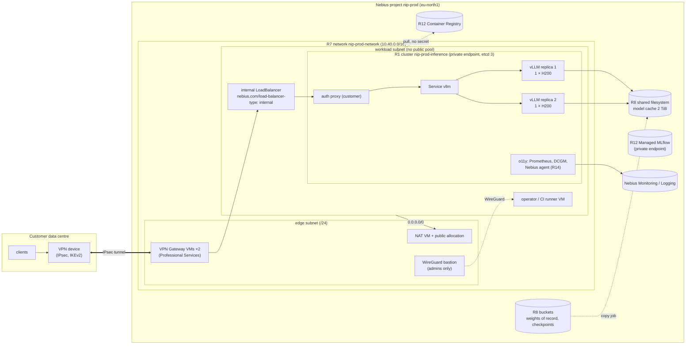

# S1 — Private LLM serving with VPN to on-prem

| | |
|---|---|
| Composes | [R7](../../terraform/stacks/network/README.md) network → [R8](../../terraform/stacks/data/README.md) data → [R12](../../terraform/stacks/ml-services/README.md) ML services → [R1](../../terraform/stacks/inference/README.md) inference (+ [`workloads/inference`](../../workloads/inference/README.md)) → [R14](../../recipes/observability/README.md) observability |
| Stage shape | prod (private API endpoint, on-demand GPUs, deletion protection); rehearsed in sandbox and staging first |
| Region (worked example) | `eu-north1` (H200, Managed MLflow and PostgreSQL offered) |
| Status | designed to the Solution definition of done; **not deployed**; the VPN gateway is not built in this repository |
| Dated | 2026-10-11. Prices are live calculator list prices, **an estimate, not a quote** |

## 1. Customer problem

An enterprise wants an open-weight LLM (a 70B-class model is the worked example) answering requests
from its own data centre, with no public endpoint anywhere on the path, on GPUs it controls, with its
own observability and an audit trail. Prompts may contain internal data, so traffic must stay on a
private path between on-prem and Nebius, and nodes must not hold public addresses.

## 2. First-call questions

| # | Question | Why it changes the design |
|---|---|---|
| 1 | Which model(s), licence, precision (BF16, FP8), context length, concurrency? | GPUs per replica; R1 serves on **1-GPU presets only** (stack validation), so a 70B model is FP8 on 1 × H200 or BF16 on 1 × B300 |
| 2 | Target throughput (requests/s, tokens/s) and p95 latency? | replica count; nothing in this repository has measured either ([evidence](../../docs/evidence/README.md)) |
| 3 | On-prem CIDRs, VPN device and vendor, required tunnel throughput, BGP or static? | CIDR plan against R7's `10.40.0.0/16` default and the region pool; VPN Gateway sizing |
| 4 | Who operates the VPN gateway VMs and the cluster day 2? | Nebius VPN Gateway is a Professional Services open-source solution, not a managed service |
| 5 | Authentication in front of the model (mTLS, API keys, SSO proxy)? | R1 exposes a ClusterIP Service only; auth is a customer component |
| 6 | Availability target and maintenance windows? | replicas (N+1), HA etcd (prod has 3), SLA terms |
| 7 | Logging and retention requirements (prompts, responses, access logs)? | Nebius Logging keeps 14 days; longer needs an export |
| 8 | Certifications and data-processing terms needed? | residency questions in [S7](../S7-eu-data-residency/README.md) |
| 9 | Budget model: PAYG or commitment; who gets alerts? | reserved floor (capacity block group + addendum) vs on-demand |
| 10 | Experiment tracking or model registry needed next to serving? | R12 MLflow and Container Registry |

## 3. Design

### 3.1 Requirements and assumptions

| Kind | Item |
|---|---|
| Fact | R1 creates a Managed Kubernetes cluster with a 1-GPU node group on the managed driver image; prod sets `public_endpoint: false` and HA etcd ([stage policy](../../platform/stages.yaml)) |
| Fact | R7 builds a network whose workload subnet has no public pool, a NAT VM for egress and an optional WireGuard bastion; site-to-site VPN is a documented variant **not built** ([R7 runbook](../../runbooks/network.md#variant-site-to-site-vpn)) |
| Fact | Nebius VPN Gateway: open-source, VM-based IPsec (strongSwan, IKEv2), from Professional Services ([VPN Gateway](https://docs.nebius.com/vpc/nebius-vpn-gateway)) |
| Fact | A Service of type LoadBalancer gets a private IP with the annotation `nebius.com/load-balancer-type: internal` ([load balancers](https://docs.nebius.com/kubernetes/clusters/load-balancer#load-balancers-types)) |
| Fact | Default route table discards private destinations outside the network; on-prem needs a gateway VM and a route ([routing](https://docs.nebius.com/vpc/routing/overview)) |
| Assumption | Model: a 70B-class open-weight model in FP8 (70 GB of weights); 2 replicas for N+1 |
| Assumption | VPN Gateway runs as 2 × `cpu-d3 4vcpu-16gb` VMs (active/passive); its real sizing comes from Professional Services |
| Open | Whether traffic routed through a VPN VM in the edge subnet reaches an internal load balancer in the workload subnet: the load-balancer page says a private load balancer is reached from the same region **and subnet** ([load balancers](https://docs.nebius.com/kubernetes/clusters/load-balancer)) |
| Open | Serving throughput per replica on the chosen model and preset (needs `make validate-cluster WITH_LOAD=1`) |

### 3.2 Architecture diagram



### 3.3 Component and dependency mapping

| Component | Recipe / path | Key inputs | Depends on | Docs |
|---|---|---|---|---|
| Network, NAT, bastion, security groups | R7 `terraform/stacks/network` | `cidr` (non-overlapping with on-prem), `enable_nat = true`, `enable_bastion`, `allowed_cidrs` | foundation project (R2) | [custom NAT](https://docs.nebius.com/vpc/routing/custom-nat-gateway), [security groups](https://docs.nebius.com/vpc/security-groups/overview) |
| VPN Gateway | not in this repository: [`nebius-ps-services/vpngw`](https://github.com/nebius/nebius-ps-services/tree/main/services/vpngw) into R7's edge subnet; on-prem prefixes added to the workload security group by a reviewed R7 change | peer config, remote prefixes | R7 | [VPN Gateway](https://docs.nebius.com/vpc/nebius-vpn-gateway) |
| Data plane | R8 `terraform/stacks/data` | `filesystem_size_gib = 2048` (prod sizing), `dataset_storage_class` region default | R7 | [lifecycles](https://docs.nebius.com/object-storage/objects/lifecycles) |
| Registry, node pull identity, MLflow | R12 `terraform/stacks/ml-services` | `enable_mlflow = true`, `public_access` false in prod | R7 `subnet_id` | [images in MK8s](https://docs.nebius.com/kubernetes/workloads/images-container-registry), [MLflow](https://docs.nebius.com/mlflow/quickstart) |
| Serving cluster | R1 `terraform/stacks/inference` | `gpu_platform = "gpu-h200-sxm"`, `gpu_node_count = 2`, `cpu_node_count = 3`, `subnet_id`, `security_group_ids`, `service_cidr`, `existing_filesystem_id`, `node_service_account_id` | R7, R8, R12 | [MK8s GPU set-up](https://docs.nebius.com/kubernetes/gpu/set-up) |
| Model server | `workloads/inference` prod overlay pattern (`qwen2.5-7b-prod`): one replica per GPU node, RollingUpdate, PDB | a new overlay for the customer model (not in the repository) | R1 | — |
| Observability | R14 `recipes/observability` (read side) + `modules/o11y` installed by R1 | `alertmanager_config_secret` for a real receiver | R1 | [observability](https://docs.nebius.com/observability) |
| Finance controls | R9 `recipes/finance` | budget on the prod project; no spot cap (no preemptible in prod) | — | [budgets](https://docs.nebius.com/signup-billing/budgets) |

Apply order: R7 → R8 → R12 → R1 ([architecture](../../docs/architecture.md#stage--stack--foundation)).

### 3.4 Alternatives and tradeoffs

| Option | Gains | Loses | ADR |
|---|---|---|---|
| **A. This design** (R1 on MK8s, VPN Gateway, internal LB) | full runtime control, private path, own observability | most operating scope: cluster, VPN VMs, upgrades | [ADR-0001](../../docs/decisions/0001-kubernetes-vs-serverless.md) option 1 |
| B. Token Factory dedicated endpoint in a fixed region | no GPUs or cluster to run | public HTTPS API with a bearer key, no private path documented; template models only ([S3](../S3-llm-api-token-factory/README.md)) | ADR-0001 option 2 |
| C. R10 GPU VM behind the VPN | smallest footprint | one VM, no HA; R10 has no prod root (`max_gpu_nodes.gpu-vm = 0` in prod) | — |
| D. WireGuard only (R7 bastion) instead of IPsec | already built in R7 | built for people, not site-to-site; no BGP | — |
| E. BF16 70B on 1 × B300 in `uk-south1` / `eu-west2` | no quantisation; MLflow offered there | B300 regions lack Standard Object Storage; UK is not EU | — |

### 3.5 Security and operational risks

Checklist: [`docs/security.md`](../../docs/security.md#security-acceptance-checklist).

| Control | How in this design |
|---|---|
| No public IPs on nodes | R7 workload subnet has no public pool ([disable public addresses](https://docs.nebius.com/vpc/addressing/disable-public-addresses)) |
| Private Kubernetes API | prod `public_endpoint: false`; reachable only from a VM in the cluster subnet ([connect](https://docs.nebius.com/kubernetes/connect)), so operators and CI run on a VM in the workload subnet ([R7](../../terraform/stacks/network/README.md#outputs-and-composition)) |
| Default security group allows all | R7 adds DENY at priority 400, intended to precede the default ALLOW at 500; groups combine by computed effective priority (`.cache/nebius-docs/vpc/security-groups/overview.md:88-94`), unpublished for the default group, so confirm `.status.effective_priority` on the live rules |
| Model endpoint | ClusterIP + internal LoadBalancer; auth proxy in front (customer component) |
| Secrets | SecretStash for MLflow/PostgreSQL passwords and the Grafana password (write-only, never in state) ([credentials](../../docs/credentials.md#secretstash)) |
| Encryption at rest | Network SSD, filesystems and buckets always encrypted with Nebius-managed keys; no customer-managed keys documented ([encryption](https://docs.nebius.com/security/encryption)) |
| Audit | tenant Audit Logs (preview) + MK8s audit logs (prod stage policy) ([Audit Logs](https://docs.nebius.com/audit-logs)) |
| Blast radius | each change is one stack ([change management](../../docs/change-management.md#kinds-of-change-and-their-blast-radius)); a node-group template change replaces every node |

### 3.6 Terraform/Helm implementation plan

Plan only; nothing here applies. Per stage, through `make … STAGE=<stage> STACK=<stack>` ([deploy](../../runbooks/deploy.md)):

| Step | Stack | Inputs that differ from the stage default |
|---|---|---|
| 1 | `network` | `cidr` agreed with on-prem; `enable_bastion = true`, `allowed_cidrs = [<admin ranges>]` |
| 2 | VPN Gateway (outside this repo) | deploy into the edge subnet; reviewed R7 change adding on-prem prefixes to the workload group |
| 3 | `data` | prod sizing (`filesystem_size_gib = 2048`) |
| 4 | `ml-services` | `enable_mlflow = true`, `secret_id` for the admin password |
| 5 | `inference` | `gpu_platform = "gpu-h200-sxm"`, `gpu_node_count = 2`, `cpu_node_count = 3`, R7/R8/R12 outputs as `TF_VAR_*`, `service_cidr` set before the first apply |
| 6 | workloads | new overlay from `qwen2.5-7b-prod`: model, FP8 weights, `--max-model-len`; Service annotated `nebius.com/load-balancer-type: internal` (a customer change to the base Service, reviewed) |

### 3.7 PoC acceptance tests

| Criterion | Threshold | Method / command | Owner |
|---|---|---|---|
| Nodes, GPU, storage up | all pass | `make validate-cluster` steps 0–3 ([tests](../../tests/README.md)) | platform |
| No public IP on nodes, egress through NAT | pass | `tests/validate/network.sh` | platform |
| Model answers from on-prem through the tunnel | HTTP 200 on `/v1/chat/completions` from an on-prem host | `curl` from the customer side; record in evidence | customer + platform |
| Throughput and p95 latency | customer target from question 2 | `make validate-cluster WITH_LOAD=1` ([load method](../../tests/load/README.md)) | platform |
| Replica loss | service keeps answering with one replica | `kubectl delete pod` on one replica during load ([rollback drill](../../runbooks/rollback.md)) | platform |
| Security checklist | every row green or accepted | [`docs/security.md`](../../docs/security.md#security-acceptance-checklist) | security |
| Teardown proof (sandbox rehearsal) | `make leftovers` prints nothing | [teardown](../../runbooks/teardown.md) | platform |

### 3.8 Cost assumptions and missing commercial inputs

See [section 6](#6-cost-model). Missing: the commitment (reserved) rate, VPN Gateway sizing and any
Professional Services fee, internet egress pricing for VMs (docs silent), support tier.

### 3.9 Handoff and rollback runbook

| Moment | Runbook |
|---|---|
| Model or engine change goes wrong | `kubectl rollout undo` ([rollback](../../runbooks/rollback.md)) |
| Platform or node group change | [rollback → platform/infrastructure](../../runbooks/rollback.md#infrastructure); [upgrade](../../runbooks/upgrade.md) |
| GPU alerts, idle GPUs, metrics missing | [fleet alerts](../../runbooks/fleet-alerts.md), [incident](../../runbooks/incident.md) |
| Alert receiver for prod | [alerting](../../runbooks/alerting.md) |
| Decommission | prod is not destroyed with `make` ([teardown → Prod](../../runbooks/teardown.md#prod)) |

Handoff: the application team owns the overlay, the auth proxy and model pins; the platform team owns
R7/R8/R12/R1 and the VPN VMs unless Professional Services operates them
([ownership map](../../docs/architecture.md#ownership-map)).

## 4. Sizing worked example

Arithmetic from [compute-and-capacity](../../docs/solutions/compute-and-capacity.md#sizing-arithmetic); confirm with a load test.

| Step | Value |
|---|---|
| FP8 weights, 70B | 70 × 1 B = **70 GB** |
| Usable GPU memory, 1 × H200 at vLLM `--gpu-memory-utilization 0.9` | 141 × 0.9 ≈ 127 GB |
| Left for KV cache (before activations and CUDA context) | 127 − 70 ≈ **57 GB** |
| KV per token (assumed GQA: 80 layers, 8 KV heads, head dim 128, BF16 KV) | 2 × 80 × 8 × 128 × 2 = 327,680 B |
| Tokens of KV that fit | 57 × 10⁹ ÷ 327,680 ≈ 174,000 tokens ≈ **21 sequences × 8,192 tokens** |
| Replicas | 2 (N+1 for one replica down); more only after the load test shows the per-replica rate |
| Model cache | 70 GB on the 2 TiB R8 filesystem; one download serves every replica ([ADR-0004](../../docs/decisions/0004-storage-design.md)) |
| BF16 alternative | 140 GB weights: does not fit 1 × H200; fits 1 × B300 (288 GB) with ~120 GB left for KV |

## 5. Quota checklist

Names as the quota API returned them on 2026-10-11 ([solutions index](../README.md#quota-names-observed-live)); limits are read in the
console (the API omits them: [evidence](../../docs/evidence/2026-10-11-portal-live-read-only.md#quotas)). Defaults from
[Compute quotas](https://docs.nebius.com/compute/resources/quotas-limits) and [regions](../../docs/solutions/regions.md#default-quotas-that-change-the-first-day-plan).

| Quota (API name) | Need (prod, eu-north1) | Default | Action |
|---|---|---|---|
| `compute.instance.gpu.h200` | 2 | 32 | ok |
| `compute.instance.non-gpu.vcpu` | 40 (3 × 8 CPU nodes + NAT, bastion, 2 VPN VMs × 4) | **0** in `eu-north1` | **request** |
| `compute.instance.count` | 9 VMs (2 GPU, 3 CPU, 4 edge) | 12 regular GPU VMs, 12 non-GPU VMs (which rows map to this name: confirm in the console) | check |
| `compute.disk.size.network-ssd` | 1,633 GiB (2 × 512 + 3 × 128 + 25 + 4 × 50) | 4 TiB | ok |
| `compute.disk.count` | 10 | 32 | ok |
| `compute.filesystem.size.network-ssd` / `compute.filesystem.count` | 2,048 GiB / 1 | 4 TiB | ok |
| `mk8s.cluster.count` | 1 | 2 | ok |
| `vpc.ipv4-address.public.count` | 3 (NAT, bastion, VPN) | **3** | at the limit: request before adding anything public |
| `vpc.allocation.count` | node /32s, pod /24s, LB, NAT, VPN | 1000 | ok |
| `vpc.network.count`, `vpc.subnet.count`, `vpc.pool.count`, `vpc.routetable.count`, `vpc.route.count` | 1, 2, 1, 1, 1 (+ on-prem routes) | per [VPC quotas](https://docs.nebius.com/vpc/resources/quotas-limits) | check |
| `storage.bucket.count`, `storage.bucket.size.standard` | 3 (R8 ×2, MLflow artifacts), weights + checkpoints | 200 buckets; Standard 10 TiB | ok |
| `registry.count` | 1 | 10 | ok |
| `msp.mlflow.count`, `msp.mlflow.cpu`, `msp.mlflow.ram`, `msp.mlflow.disk.size.network-ssd` | 1, 8, 32 GiB, 200 GiB | 10, 80, 320 GiB, 1.95 TiB | ok |
| `mysterybox.secret.count` | MLflow, Grafana, auth-proxy secrets | not checked | check |

## 6. Cost model

Live billing calculator, `eu-north1`, **2026-10-11T09:09:19Z**, USD list prices, footprint
[`footprint.json`](footprint.json) (one prod month, 730 h). **An estimate, not a quote.**

```bash
nebius iam get-access-token >/dev/null
python3 recipes/finance/price.py solutions/S1-private-llm-serving-vpn/footprint.json \
  --project "$NEBIUS_PROJECT_ID" --contract --advice --tenant "$NEBIUS_TENANT_ID"   # an eu-north1 project
```

| Line | Per hour | Per month (730 h) |
|---|---|---|
| 2 × `gpu-h200-sxm 1gpu-16vcpu-200gb` | 10.8000 | 7,884.00 |
| 3 × `cpu-d3 8vcpu-32gb` | 0.7920 | 578.16 |
| NAT + bastion + 2 VPN VMs (`cpu-d3 4vcpu-16gb` × 4) | 0.5280 | 385.44 |
| Disks (GPU boot 2 × 512, CPU boot 3 × 128, Prometheus 25, edge 4 × 50 GiB) | 0.1587 | 115.89 |
| Shared filesystem 2,048 GiB | 0.2244 | 163.84 |
| **On-demand total** | **12.5032** | **9,127.34** |

| Capacity type | Applies? | Figure |
|---|---|---|
| On-demand | yes (prod default) | $12.5032/h, $9,127.34 a month |
| Preemptible | **no**: prod refuses preemptible serving (`allow_preemptible_serving: false`, [ADR-0007](../../docs/decisions/0007-capacity-on-demand-vs-preemptible.md)). For reference the calculator's H200 1-GPU spot price at 09:11:54Z was $0.79/h ([S8 rate card](../S8-batch-inference/README.md#6-cost-model)) | — |
| Reserved (`AUTO` reservation for the 2-GPU floor) | yes | the `--contract` offer returned the list price (this account has no commitment); the rate comes from the commitment addendum ([commitments](https://docs.nebius.com/signup-billing/billing-models/committed-usage)). Reserved is cheaper when utilisation of the committed hours > contract ÷ on-demand rate ([R9 method](../../recipes/finance/README.md#pricing-and-tco-method)) |

Capacity advisor at the same time (tenant view, not a guarantee): `eu-north1` `fabric-7`
`gpu-h200-sxm 1gpu-16vcpu-200gb`: on-demand HIGH (32 of 32 launchable), preemptible HIGH (7 of 8),
reserved LIMIT_REACHED (no capacity block group in the tenant).

Not priced by the calculator (pricing pages read 2026-10-11, list): Managed MLflow `medium`
$0.48/h + 200 GiB disk, about $364 a month ([R12](../../terraform/stacks/ml-services/README.md#quotas-and-cost));
Object Storage Standard $0.0147 per GiB-month plus requests
([Object Storage pricing](https://docs.nebius.com/object-storage/resources/pricing)); Container
Registry and Virtual Networks free ([VPC pricing](https://docs.nebius.com/vpc/resources/pricing)).
Unknown: VM internet egress price (docs silent), VPN Gateway sizing, Professional Services fees.

## 7. Risks and mitigations

| Risk | Mitigation |
|---|---|
| Internal LB unreachable from the VPN VM's subnet (open question 3.1) | test in sandbox first; fallback: VPN VM with an interface in the workload subnet, if Nebius confirms it is supported |
| VPN VM is a single point of failure | VPN Gateway active/passive pair; alert on tunnel state (customer monitoring) |
| CIDR overlap with on-prem | agree `cidr` before R7's first apply; network resources attached to workloads cannot be reconfigured ([VPC overview](https://docs.nebius.com/vpc/overview#customized-networking-infrastructure)) |
| On-demand capacity absent at restart of a stopped node | N+1 replicas; `AUTO` reservation for the floor ([reservations](https://docs.nebius.com/compute/virtual-machines/reservations)) |
| `eu-north1` non-GPU vCPU quota is 0 | request before step 1 ([capacity request](../../runbooks/capacity-request.md)) |
| Public IP quota exactly used (3 of 3) | request before adding a second VPN peer or public LB |
| FP8 quality differs from BF16 | evaluate on customer prompts; Option E for BF16 |
| Preview services (Audit Logs, Monitoring, Logging) have no service level | keep in-cluster Prometheus and Alertmanager for paging ([R14](../../recipes/observability/README.md#decision-table)) |

## 8. Delivery steps

1. Discovery note answering section 2; CIDR plan signed off.
2. Quotas requested ([capacity request](../../runbooks/capacity-request.md)); spend approval with this footprint re-priced on the day ([finance runbook](../../runbooks/finance.md#before-a-new-run-price-it)).
3. Sandbox rehearsal: R7 → R8 → R12 → R1 with the 1.5B overlay ([deploy](../../runbooks/deploy.md)); `network.sh`; teardown and `make leftovers`.
4. Professional Services deploys VPN Gateway into the staging edge subnet; test the internal LB from on-prem.
5. Staging: same stacks at staging sizing, customer overlay, load test, rollback drill; evidence file.
6. Prod: release tag, required reviewers ([change management](../../docs/change-management.md)); prod alert receiver ([alerting](../../runbooks/alerting.md)); budget on the prod project ([R9 budgets](../../recipes/finance/README.md#budgets)).
7. Handoff (section 3.9); monthly close ([finance](../../runbooks/finance.md#monthly-close)).

## 9. Portal demo path (Nebius Estate)

| Page | What it shows for S1 |
|---|---|
| Estate Explorer (`/estate`) | network, subnets, NAT and VPN VMs, cluster, node groups, filesystem, buckets and their explicit relationships; public-IP view lists only the NAT, bastion and VPN allocations |
| GPU & Capacity (`/capacity`) | H200 quota, node-group bounds, stage caps (prod inference 8), capacity advice |
| Fleet (`/fleet`) and Alerts (`/alerts`) | GPU telemetry of the two serving GPUs; GPU idle/hot/Xid rules |
| Workloads (`/workloads`) | the vLLM deployment, its requests and events (needs a configured cluster) |
| Logs (`/logs`) | control-plane and container logs of the cluster |
| Commercial Scenarios (`/commercial`) | live list prices for the footprint next to a rate book |
| Costs (`/costs`), Budgets & credits (`/budgets`) | FOCUS rows by `nip-stack`, budget signal for the prod project |
| Evidence & Runbooks (`/evidence`) | what is proven and what is not (section 10) |

## 10. Proven vs not

| Claim | Status | Evidence |
|---|---|---|
| Managed driver image + device plugin hand a GPU to a pod | proven (prior upstream run, B300; this repository's sandbox, L40S) | [B300 smoke](../../docs/evidence/2026-10-08-mk8s-b300-gpu-smoke.md), [sandbox populate](../../docs/evidence/2026-10-11-sandbox-inference-populate.md) |
| Model weights load from the shared-filesystem cache | proven for a 1.5B model on L40S | [sandbox populate](../../docs/evidence/2026-10-11-sandbox-inference-populate.md) |
| vLLM serves requests on this repository's manifests | proven once: Qwen2.5-1.5B on 1 L40S, Ready in 110 s after two manifest fixes found live, 5 sequential requests ~0.55 s each, one client | [sandbox serving](../../docs/evidence/2026-10-11-sandbox-inference-serving.md) |
| Portal discovers the cluster read-only | proven | [portal connectors](../../docs/evidence/2026-10-11-sandbox-inference-portal-connectors.md) |
| R7 perimeter | planned live 2026-10-11, not applied (the NAT VM needs non-GPU vCPU quota) | [live plans](../../docs/evidence/2026-10-11-sandbox-live-plans.md) |
| R8 data plane | applied in sandbox 2026-10-11 and 2026-10-12, torn down; shared filesystem fio 2,066 MiB/s write, 1,757 MiB/s read (one short run); no transfer, restore drill not done | [data acceptance](../../docs/evidence/2026-10-12-sandbox-data-acceptance.md) |
| R12 services | applied in sandbox twice, torn down; 2026-10-12: registry push and pull, node pull with no pull secret, PostgreSQL `select 1` over `verify-full`; MLflow client check failed (cause unknown) | [ML services acceptance](../../docs/evidence/2026-10-12-sandbox-ml-services-acceptance.md) |
| VPN Gateway, internal LB over the tunnel | not built, not run | — |
| 70B FP8 fits one H200 with ~21 × 8k sequences of KV | arithmetic only | section 4 |
| Any throughput, latency or availability figure | **none** | — |
| Prices in section 6 | observed live 2026-10-11T09:09:19Z, list, not a quote | section 6 |

## Open questions for the account team

1. Is an internal load balancer reachable from a VPN gateway VM in another subnet of the same network?
2. VPN Gateway sizing, HA model and whether Professional Services operates it; any fee.
3. Commitment rate for 2 × H200 (or B300) for 12 months, and minimum term of a capacity block group.
4. Internet egress pricing for VMs (docs silent).
5. Region scope of certifications needed by the customer.
