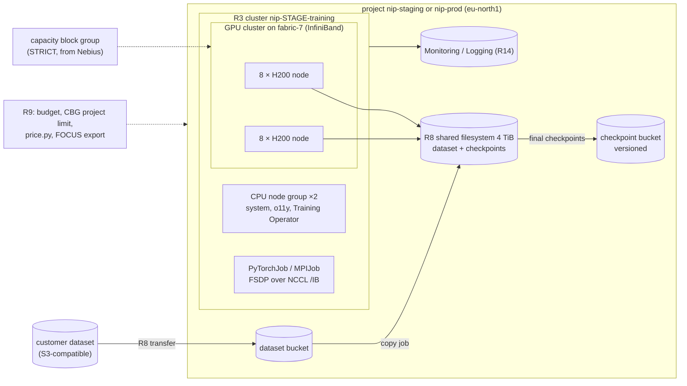

# S2 — Multi-node fine-tune of a 70B model for two weeks

| | |
|---|---|
| Composes | [R8](../../terraform/stacks/data/README.md) data → [R3](../../terraform/stacks/training/README.md) training (+ [`workloads/training`](../../workloads/training/README.md)) · [R9](../../recipes/finance/README.md) finance and governance · [R14](../../recipes/observability/README.md) observability |
| Stage shape | one two-week run: staging (on-demand allowed) or prod (STRICT reservation required for training GPUs) |
| Region (worked example) | `eu-north1`, H200 on `fabric-7`; alternative `eu-west2`, B300 |
| Status | designed to the Solution definition of done; **not deployed**; multi-node InfiniBand never measured in this repository |
| Dated | 2026-10-11. Prices are live calculator list prices, **an estimate, not a quote** |

## 1. Customer problem

A startup wants a full fine-tune of a 70B open-weight model on its own dataset, finished inside a
two-week window that starts on a date it has promised to investors. It needs 16 GPUs talking over
InfiniBand for 336 hours, checkpoints it can resume from, and a firm number for the bill.

## 2. First-call questions

| # | Question | Why it changes the design |
|---|---|---|
| 1 | Full fine-tune or LoRA/QLoRA? | full ≈ 16 B/param (1.1 TB of state) needs 2 × 8-GPU H200 nodes; LoRA often fits one 8-GPU node ([sizing](../../docs/solutions/compute-and-capacity.md#training-memory-per-parameter)) |
| 2 | Dataset size, token count, format, current location | filesystem size and transfer plan (R8) |
| 3 | Measured or expected tokens/s per GPU on their stack | duration; Nebius publishes no MFU figures, nothing here measured one |
| 4 | Fixed start date? Can the window slip? | on-demand vs capacity block group (reservation) |
| 5 | Checkpoint size and interval; resume tested? | filesystem bandwidth, rework after a failure |
| 6 | Framework (FSDP, DeepSpeed, Megatron) and launcher (torchrun, MPI) | R3 ships PyTorchJob/MPIJob via the Kubeflow Training Operator |
| 7 | Who operates the cluster during the run? | managed by the customer vs Nebius |
| 8 | Budget ceiling and who gets alerts | R9 budget, approval |
| 9 | Licence of the base model and the output | contract, not infrastructure |
| 10 | Is Token Factory post-training (SFT, LoRA) acceptable instead? | removes the cluster ([post-training](https://docs.tokenfactory.nebius.com/post-training/overview)) |

## 3. Design

### 3.1 Requirements and assumptions

| Kind | Item |
|---|---|
| Fact | R3 builds an MK8s cluster with 8-GPU nodes in an InfiniBand GPU cluster on the region's fabric, plan-only by default (`gpu_node_count = 0`) ([R3](../../terraform/stacks/training/README.md)) |
| Fact | Only the 8-GPU presets join a GPU cluster ([types](https://docs.nebius.com/compute/virtual-machines/types#presets-compatible-with-gpu-clusters)); all VMs of a GPU cluster are in one project |
| Fact | Prod requires a STRICT reservation whenever training GPU nodes > 0; staging allows on-demand, cap 8 nodes ([stage policy](../../platform/stages.yaml)) |
| Fact | A capacity block group reserves GPUs of one platform on one fabric in dated intervals and does not count against GPU quotas ([capacity block groups](https://docs.nebius.com/overview/limits/capacity-block-groups)) |
| Fact | Filesystem bandwidth scales per 4 TiB: up to 3.70 GiB/s read, 1.89 GiB/s write ([storage](../../docs/solutions/storage-and-data.md#shared-filesystems)) |
| Assumption | Full fine-tune, BF16 mixed precision with Adam, FSDP/ZeRO-3 across 16 GPUs; 336 h wall clock as the customer's window |
| Open | Tokens/s per GPU (decides whether 336 h is enough) |
| Open | Whether a capacity block group of 16 H200 on `fabric-7` exists for the window (advisor: reserved LIMIT_REACHED, section 6) |

### 3.2 Architecture diagram



### 3.3 Component and dependency mapping

| Component | Recipe / path | Key inputs | Docs |
|---|---|---|---|
| Dataset and checkpoint plane | R8 `terraform/stacks/data` | `transfer` from the customer source, `filesystem_size_gib = 4096`, `checkpoint_noncurrent_days` | [transfers](https://docs.nebius.com/object-storage/transfer/overview) |
| Training cluster | R3 `terraform/stacks/training` | `gpu_platform = "gpu-h200-sxm"`, `gpu_node_count = 2`, `gpu_reservation = { policy = "STRICT", reservation_ids = [...] }` (prod), `existing_filesystem_id` | [GPU clusters](https://docs.nebius.com/compute/clusters/gpu), [MK8s reservations](https://docs.nebius.com/kubernetes/node-groups/reservations) |
| Jobs | `workloads/training` (NCCL MPIJob, DDP PyTorchJob) + Training Operator install script | — | [NCCL test](https://docs.nebius.com/kubernetes/gpu/nccl-test) |
| Finance | R9 `recipes/finance` + `terraform/stacks/governance` | `capacity_limits` (sandbox/staging `limit = 0`, prod = 16), budget on the project | [project limits](https://docs.nebius.com/overview/limits/project-limits) |
| Observability | R14 + `modules/o11y` | DCGM rules, `metrics.sh` | [VM GPU metrics](https://docs.nebius.com/compute/monitoring/virtual-machines#gpu-monitoring-metrics) |

### 3.4 Alternatives and tradeoffs

| Option | Gains | Loses | ADR |
|---|---|---|---|
| **A. 2 × 8 H200 on R3, reserved** | fixed start date; GPUs survive a stop | prepaid term; capacity block group needs sales | [ADR-0007](../../docs/decisions/0007-capacity-on-demand-vs-preemptible.md) |
| B. Same on on-demand (staging) | no commitment | advisor shows on-demand LOW for this preset; no guarantee at start or after a stop | ADR-0007 |
| C. 2 × 8 B300 in `eu-west2` | 2,304 GB per node: one node already holds the 1.1 TB state | list $9.50 vs $5.40 per GPU-hour; B300 regions lack Standard Object Storage | — |
| D. R4 Soperator with the same GPUs | researchers keep `sbatch` | another operator and K8s window ([ADR-0008](../../docs/decisions/0008-slurm-scheduler-and-soperator.md)) | ADR-0008 |
| E. Token Factory post-training | no cluster at all | only supported base models; no own training loop | — |
| F. Preemptible | 15.8 % of the on-demand rate at pricing time | a preemption stops one node and with it every rank; repo policy allows preemptible GPUs in sandbox only ([S4](../S4-burst-training-preemptible/README.md)) | ADR-0007 |

### 3.5 Security and operational risks

| Item | Design answer |
|---|---|
| NCCL pods run privileged with `IPC_LOCK` | dedicated namespace with PSS `privileged`, no other workloads ([security](../../docs/security.md#security-acceptance-checklist), [ADR-0002](../../docs/decisions/0002-inference-vs-training-topology.md)) |
| Dataset credentials | transfer keys from SecretStash (`transfer_secret_id`), write-only ([R8](../../terraform/stacks/data/README.md#inputs-that-matter)) |
| Checkpoint loss | filesystem first, then the versioned bucket; prod filesystem `forbid_deletion` |
| Reserved capacity leak to other stages | R9 project limits: `limit = 0` in sandbox and staging ([R9](../../recipes/finance/README.md#project-limits-on-capacity-block-groups)) |
| Node replacement mid-run | MK8s health checks cordon a faulty GPU node, then **wait until its GPU workloads finish or are stopped** before draining and restarting it (`.cache/nebius-docs/kubernetes/maintenance/health-checks.md:33-40`; [health checks](https://docs.nebius.com/kubernetes/maintenance/health-checks)): a two-week job keeps the faulty node until the job is stopped. Watch `NebiusGPUError`, stop the job, let recovery run, resume from the last checkpoint |

### 3.6 Terraform/Helm implementation plan

| Step | Command | Expect |
|---|---|---|
| 1 | `make plan apply STAGE=<stage> STACK=data` with `transfer` set | buckets, 4 TiB filesystem, one transfer iteration |
| 2 | `make plan apply STAGE=<stage> STACK=training` (`gpu_node_count = 0`) | CPU layer only, no GPU cluster |
| 3 | separate spend approval; `gpu_node_count = 2` (+ `gpu_reservation` in prod) | plan adds exactly 2 × 8-GPU nodes and 1 GPU cluster ([deploy → training](../../runbooks/deploy.md#training-stack-stacktraining)) |
| 4 | `workloads/training/install-training-operator.sh`; `tests/validate/run-training.sh` | NCCL multi-node passes ≥ 300 GB/s over `/IB` |
| 5 | customer job (PyTorchJob) with checkpoints to the filesystem | — |
| 6 | `gpu_node_count = 0`, apply; copy final checkpoints to the bucket; destroy | [teardown](../../runbooks/teardown.md) |

### 3.7 PoC acceptance tests

| Criterion | Threshold | Command |
|---|---|---|
| 16 GPUs visible, IB up | `nvidia.com/gpu` = 8 per node | `tests/validate/00-nodes.sh`, `01-gpu.sh` |
| Multi-node NCCL | average busbw ≥ 300 GB/s, transport `/IB`, same `gpu-cluster-id` | `tests/validate/03-nccl.sh multi-node-2x8` ([tests](../../tests/README.md#training-stackstraining-testsvalidaterun-trainingsh)) |
| Filesystem write rate | measured before the long job | `tests/validate/03-storage.sh` |
| Resume from checkpoint | job restarts from step N after a pod delete | customer job; recorded in evidence |
| Short DDP run before the long one | completes | `workloads/training/ddp` |

### 3.8 Cost assumptions and missing commercial inputs

See [section 6](#6-cost-model). Missing: the capacity block group's dated interval and its addendum rate; whether a 16-GPU block on `fabric-7` exists for the start date.

### 3.9 Handoff and rollback runbook

The run is not rolled back: it is resumed. Failed node → MK8s cordons it and recovers it only once the job's GPU pods stop
(`.cache/nebius-docs/kubernetes/maintenance/health-checks.md:33-40`): stop the job, then it restarts from the
last checkpoint ([incident → NCCL](../../runbooks/incident.md#nccl--interconnect-training-env)).
Bad checkpoint → restore the previous noncurrent version ([data → restore](../../runbooks/data.md#restore-a-checkpoint-from-a-noncurrent-version)).
End of run → [teardown](../../runbooks/teardown.md); monthly close with the FOCUS rows of the stack (`nip-stack`) over the run's time window; MK8s node VMs do not carry `nip-run` (`docs/naming.md` §5, Rules)
([finance](../../runbooks/finance.md#monthly-close)).

## 4. Sizing worked example

| Step | Value |
|---|---|
| Training state, full fine-tune (≈ 16 B/param) | 70 × 16 = **1,120 GB** before activations |
| 2 × 8 H200 | 16 × 141 = 2,256 GB; sharded ≈ 70 GB of state per GPU, leaving ≈ 71 GB per GPU for activations |
| 1 × 8 H200 (alternative check) | 1,128 GB: does not fit the 1,120 GB state plus activations |
| GPU-hours | 2 × 8 × 24 × 14 = **5,376** |
| Checkpoint size (full state) | ≈ 1,120 GB ≈ 1,043 GiB |
| Write time to a 4 TiB filesystem (one unit, ≤ 1.89 GiB/s) | 1,043 ÷ 1.89 ≈ **552 s ≈ 9 min** per full checkpoint (upper bound of the published rate; measure with `03-storage.sh`) |
| Checkpoints held on 4 TiB | 3 full checkpoints (≈ 3.1 TiB) plus the dataset must fit: raise the filesystem (and its quota) for more |
| Rework per failure | up to one checkpoint interval + restart; at a 2 h interval, ≤ 2 h × 16 GPUs = 32 GPU-hours |

## 5. Quota checklist

Names from the live quota listing ([solutions index](../README.md#quota-names-observed-live)); limits in the console.

| Quota (API name) | Need (eu-north1) | Default | Action |
|---|---|---|---|
| `compute.instance.gpu.h200` | 16 on-demand; 0 if drawn from a capacity block group | 32 | ok (reserved GPUs do not count) |
| `compute.gpucluster.count` | 1 | 5 | ok |
| `compute.instance.count` | 4 (2 GPU + 2 CPU) | 12 regular GPU VMs | ok |
| `compute.instance.non-gpu.vcpu` | 16 | **0** in `eu-north1` | **request** |
| `compute.disk.size.network-ssd` | 2,327 GiB (2 × 1,023 + 2 × 128 + 25) | 4 TiB | ok |
| `compute.filesystem.size.network-ssd` | 4,096 GiB | 4 TiB | **at the limit**: request more for extra checkpoints |
| `mk8s.cluster.count` | 1 | 2 | ok |
| `storage.bucket.count`, `storage.bucket.size.standard` | 2; dataset + final checkpoints (≈ 1 TiB each) | Standard 10 TiB | check against dataset size |
| `storage.transfer.count` | 1 | not checked | check |
| capacity block group (prod) | 16 × H200 on `fabric-7`, dated interval | via a Nebius manager | **request**; project limits via R9 |

B300 alternative (`eu-west2`): `compute.instance.gpu.b300` (default 32), filesystem 5 TiB, and
`storage.bucket.size.enhanced-throughput` (default 1 TiB; Standard is not offered there).

## 6. Cost model

Live billing calculator, **2026-10-11**, USD list prices, **an estimate, not a quote**.
Footprints: [`footprint.json`](footprint.json) (`eu-north1`, priced 09:09:54Z) and
[`footprint-b300.json`](footprint-b300.json) (`eu-west2`, priced 09:09:39Z); hours = 336 (the resources exist for the whole run).

```bash
python3 recipes/finance/price.py solutions/S2-fine-tune-70b-two-weeks/footprint.json \
  --project "$NEBIUS_PROJECT_ID" --contract --advice --tenant "$NEBIUS_TENANT_ID"   # an eu-north1 project
python3 recipes/finance/price.py solutions/S2-fine-tune-70b-two-weeks/footprint-b300.json \
  --project <an eu-west2 project> --contract --advice --tenant "$NEBIUS_TENANT_ID"
```

| Scenario | GPU line per hour | Whole footprint per hour | Per 14-day run |
|---|---|---|---|
| H200 on-demand | 86.4000 (16 × $5.40) | 87.6031 | **29,434.65** |
| H200 preemptible (spot at 09:09:54Z) | 12.6400 (16 × $0.79) | 13.8431 | 4,651.29 (15.8 % of on-demand; not applicable: see 3.4 F) |
| B300 on-demand | 152.0000 (16 × $9.50) | 153.2032 | 51,476.28 |
| B300 preemptible (spot at 09:09:39Z) | 16.0000 (16 × $1.00) | 17.2032 | 5,780.28 |
| Reserved (either) | contract offer returned the list price (no commitment on this account) | — | from the addendum; paid for every hour of the interval |

Non-GPU lines (H200 footprint): CPU nodes $0.528/h, disks $0.2262/h, 4 TiB filesystem $0.4489/h.

Capacity advisor at pricing time (not a guarantee): `eu-north1` `fabric-7` H200 8-GPU: on-demand **LOW**
(limit 4 VMs), preemptible MEDIUM (2 of 8), reserved LIMIT_REACHED. `eu-west2` B300 8-GPU: on-demand
**LOW** (limit 4), preemptible MEDIUM (3 of 8), reserved LIMIT_REACHED. With on-demand LOW for both,
a dated start needs a capacity block group.

Not priced by the calculator: Object Storage for the dataset and checkpoints (Standard $0.0147 per
GiB-month in `eu-north1`; [pricing](https://docs.nebius.com/object-storage/resources/pricing)); the
transfer itself is free, the source cloud bills its egress ([transfers](https://docs.nebius.com/object-storage/transfer/overview)).

## 7. Risks and mitigations

| Risk | Mitigation |
|---|---|
| No capacity on the start date | capacity block group with STRICT policy; advisor checked weekly before the date ([capacity request](../../runbooks/capacity-request.md)) |
| NCCL falls back to sockets or RoCE | `03-nccl.sh` refuses anything but `/IB`; stop and fix GPU-cluster membership ([ADR-0002](../../docs/decisions/0002-inference-vs-training-topology.md)) |
| Filesystem too small or slow for checkpoints | measure with `03-storage.sh`; raise size (bandwidth scales with it) and quota |
| Run does not finish in 336 h | measure tokens/s in the first hours; extend the reservation early (subject to capacity) |
| Quota auto-reduced while the stage idled | re-check on the day of the GPU apply ([automatic reduction](https://docs.nebius.com/overview/quotas#automatic-quota-reduction)) |
| Budget alert arrives late | budgets notify only and lag hours; the hard caps are quota and project limits ([cost](../../docs/cost.md#spend-controls)) |

## 8. Delivery steps

1. Discovery (section 2); choose full vs LoRA, region and platform.
2. Price on the day with `price.py`; written spend approval with TTL ([finance runbook](../../runbooks/finance.md#before-a-new-run-price-it)).
3. Request quota and the capacity block group ([capacity request](../../runbooks/capacity-request.md)); set R9 project limits.
4. R8 data and transfer ([data runbook](../../runbooks/data.md)); stage the dataset on the filesystem.
5. R3 with GPUs ([deploy → training](../../runbooks/deploy.md#training-stack-stacktraining)); `run-training.sh`; evidence file.
6. Customer job; watch Fleet and Alerts; checkpoints to the bucket.
7. Release GPUs (`gpu_node_count = 0`), teardown, FOCUS reconciliation by `nip-stack` over the run window (node VMs carry no `nip-run`).

## 9. Portal demo path (Nebius Estate)

| Page | What it shows for S2 |
|---|---|
| Provisioning (`/provisioning`) | the "training capacity" change: validates `gpu_node_count` against the stage cap, previews the tfvars diff and estimate, produces a patch (nothing applied) |
| GPU & Capacity (`/capacity`) | H200 quota, reservations and capacity advice (when the identity may read them), GPU clusters |
| Fleet (`/fleet`), Alerts (`/alerts`) | per-GPU utilisation of the 16 GPUs; idle-GPU and Xid rules |
| Commercial Scenarios (`/commercial`) | list price of the footprint next to a negotiated rate book |
| Costs (`/costs`) | FOCUS rows for `nip-stack=training` over the run window (node VMs carry no `nip-run`) |
| Evidence & Runbooks (`/evidence`) | NCCL result once recorded |

## 10. Proven vs not

| Claim | Status | Evidence |
|---|---|---|
| Driver image + NCCL initialise on a Blackwell GPU | proven, single GPU, upstream recipe | [B300 smoke](../../docs/evidence/2026-10-08-mk8s-b300-gpu-smoke.md) |
| Multi-node InfiniBand bandwidth | **not measured** in this repository | [evidence index](../../docs/evidence/README.md) |
| R3 stack applied | not applied; planned live 2026-10-11 (non-GPU vCPU quota 0) | [live plans](../../docs/evidence/2026-10-11-sandbox-live-plans.md) |
| 70B full fine-tune fits 2 × 8 H200 | arithmetic only | section 4 |
| Training duration or tokens/s | **none** | — |
| Prices in section 6 | observed live 2026-10-11, list, not a quote | section 6 |

## Open questions for the account team

1. Is a capacity block group of 16 × H200 on `fabric-7` (or 16 × B300 in `eu-west2`) available for the customer's dates, and at what addendum rate and minimum term?
2. Can the interval be extended mid-run if the job is late, and how far ahead must that be asked?
3. Lead time for the non-GPU vCPU and filesystem quota requests.
4. Does Token Factory post-training support the customer's base model (option E)?
