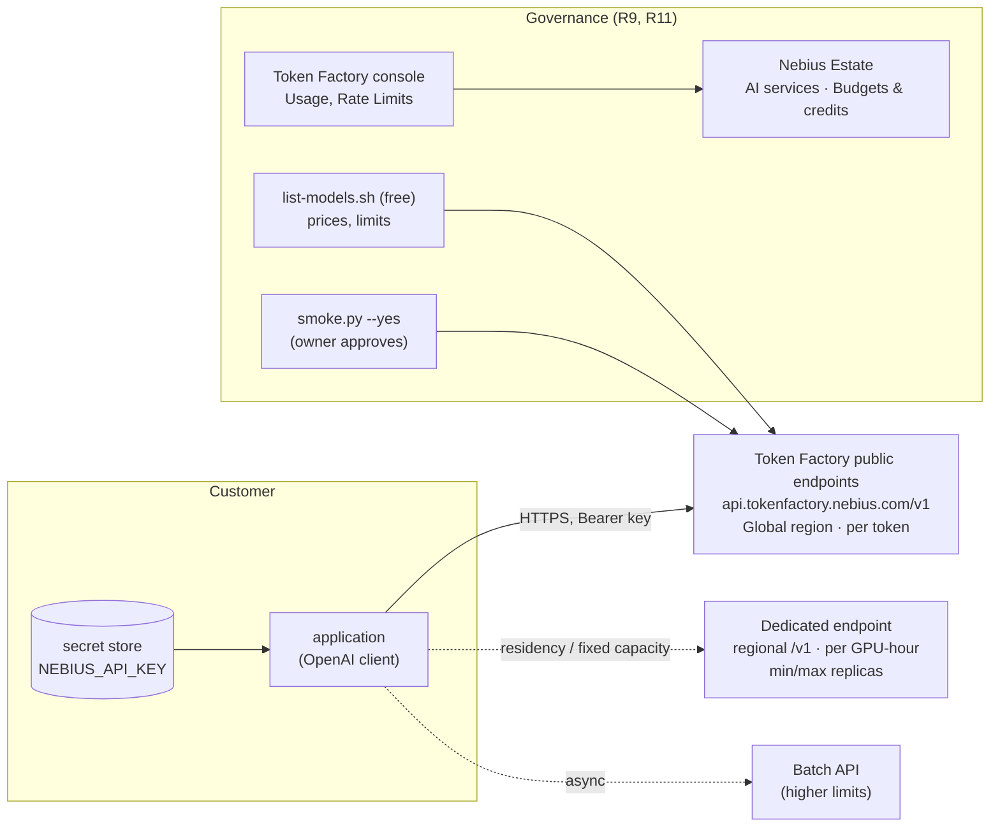

# S3 — LLM API without managing GPUs (Token Factory)

| | |
|---|---|
| Composes | [R11](../../recipes/token-factory/README.md) Token Factory · [R9](../../recipes/finance/README.md) finance (pricing method, budgets, the self-host comparison) |
| Stage shape | no Nebius AI Cloud infrastructure; one API key per environment |
| Region | public endpoints: "Global"; dedicated endpoints: `eu-north1`, `eu-west1` or `us-central1` |
| Status | designed to the Solution definition of done; R11 smoke test 2026-10-11 and a 600-request concurrency sweep 2026-10-12 (E2E p99 passes the 10 s bar at 8 and 32 concurrent, fails at 1); dedicated endpoints not created |
| Dated | 2026-10-11. Token prices from the live model listing, compute prices from the live calculator, **an estimate, not a quote** |

## 1. Customer problem

A product team wants an LLM behind its application this quarter. It has no GPU or Kubernetes
skills, no wish to operate inference, and wants to pay for what it uses. It needs to know which
model to call, how far the rate limits stretch, what it costs per month at its volume, and at
what volume running its own GPUs would become cheaper.

## 2. First-call questions

| # | Question | Why it changes the design |
|---|---|---|
| 1 | Which model, or which task and quality bar? | model id from the live catalog (`list-models.sh`), not from doc examples |
| 2 | Tokens per day (input and output) and peak requests/tokens per minute | monthly bill; whether public rate limits suffice |
| 3 | Latency target; streaming? | Fast flavour (`-fast`) vs base |
| 4 | Must processing stay in one region or country? | public endpoints are "Global" and can move without notice: residency needs a dedicated endpoint |
| 5 | Fine-tuned or custom weights? | dedicated endpoint (custom weights in beta) or self-host |
| 6 | Private networking required? | Token Factory is a public HTTPS API; private path → self-host ([S1](../S1-private-llm-serving-vpn/README.md)) |
| 7 | Async or batch work? | Batch API has higher limits ([S8](../S8-batch-inference/README.md)) |
| 8 | Data handling terms (retention, training use of prompts)? | not stated in the pages read: open question |
| 9 | Billing owner and payment method | Token Factory has its own billing account; a failed card charge suspends it |

## 3. Design

### 3.1 Requirements and assumptions

| Kind | Item |
|---|---|
| Fact | OpenAI-compatible API at `https://api.tokenfactory.nebius.com/v1/`, bearer key ([R11 client configuration](../../recipes/token-factory/README.md#client-configuration); answered live in the [smoke evidence](../../docs/evidence/2026-10-11-token-factory-smoke.md)) |
| Fact | Public endpoints bill per token; dedicated endpoints per GPU-hour, per-minute granularity, while ready ([R11 cost model](../../recipes/token-factory/README.md#cost-model); read from docs.tokenfactory.nebius.com, which is not in the offline docs cache (`.cache/nebius-docs`), so unverified offline) |
| Fact | Public rate limits are dynamic in 15-minute windows, ceiling 20 × base; HTTP 429 beyond ([R11 rate limits](../../recipes/token-factory/README.md#rate-limits); read from docs.tokenfactory.nebius.com, which is not in the offline docs cache (`.cache/nebius-docs`), so unverified offline) |
| Fact | 25 models listed on 2026-10-11T09:12:58Z with per-model price fields and per-model RPM/TPM (section 6) |
| Fact | The smoke test answered HTTP 200 in 947 ms for one 31-token request ([evidence](../../docs/evidence/2026-10-11-token-factory-smoke.md)) |
| Assumption | The price fields are USD per token (the schema states no unit: [R11](../../recipes/token-factory/README.md#cost-model)) |
| Assumption | Worked workload: 300 M input + 60 M output tokens a month (section 4) |
| Open | Batch API price, dedicated-endpoint GPU-hour rate, data-retention terms, whether Token Factory spend reaches AI Cloud budgets and the FOCUS export |

### 3.2 Architecture diagram



### 3.3 Component and dependency mapping

| Component | Where | Notes |
|---|---|---|
| API key | Token Factory console → API keys; stored in `.env`/secret store, rotated ([credential rotation](../../runbooks/credential-rotation.md)) | shown once |
| Model catalog and prices | R11 `list-models.sh --verbose` | free, read-only |
| Smoke test | R11 `smoke.py --yes` | completion capped at 16 tokens, default 8 (`recipes/token-factory/smoke.py:36,51`); the 2026-10-11 run used 31 in total, 23 prompt + 8 completion ([evidence](../../docs/evidence/2026-10-11-token-factory-smoke.md)); owner approves |
| Dedicated endpoint (optional) | console or `/v0/dedicated_endpoints` API; not scripted in R11 ([R11](../../recipes/token-factory/README.md#dedicated-endpoints)) | starts per-GPU-hour billing when ready |
| Cost comparison | R9 `price.py` on [`footprint.json`](footprint.json) (the R10 self-host counterpart) | section 6 |
| Spend tracking | Token Factory → Organisation → Usage; portal Budgets & credits (entered by hand) | no usage API ([evidence](../../docs/evidence/2026-10-11-token-factory-smoke.md)) |

### 3.4 Alternatives and tradeoffs

| Option | Gains | Loses | ADR |
|---|---|---|---|
| **A. Public endpoints** | nothing to operate; per-token billing | no region guarantee; rate limits; model deprecations (ten removed 2026-08-31, per docs.tokenfactory.nebius.com; not in the offline cache) | [ADR-0001](../../docs/decisions/0001-kubernetes-vs-serverless.md) managed side |
| B. Dedicated endpoint | fixed region, capacity, custom weights | per GPU-hour while running; capacity released on any stop; no SLA unless contracted | ADR-0001 |
| C. Serverless AI endpoint with own container ([R6](../../recipes/serverless/README.md)) | any model or engine | Compute prices per second; autoscaling not documented | ADR-0001 option 2 |
| D. Self-host on one GPU VM ([R10](../../terraform/stacks/gpu-vm/README.md), sandbox and staging only: prod `max_gpu_nodes.gpu-vm` is 0, `platform/stages.yaml:48`) or MK8s ([R1](../../terraform/stacks/inference/README.md)) | private network, own runtime | operate it; fixed hourly cost whether busy or not | ADR-0001 option 1 |

### 3.5 Security and operational risks

| Item | Design answer |
|---|---|
| Key leak | server-side only, never in client code; rotation runbook; Nebius may revoke a compromised key ([R11 risks](../../recipes/token-factory/README.md#risks)) |
| Data residency | public endpoints are not region-bound ([public serverless](https://docs.tokenfactory.nebius.com/public-serverless)); use a dedicated endpoint or self-host for residency ([S7](../S7-eu-data-residency/README.md)) |
| Prompt data handling | terms not stated in the pages read: ask before sending customer data |
| Account suspension | a failed card charge suspends the account and every endpoint |
| Model removal | pin ids in config, re-run `list-models.sh` before each release |

### 3.6 Terraform/Helm implementation plan

None: Token Factory has no Terraform resources in this repository and creates nothing in a Nebius AI
Cloud project. The implementation is client configuration ([R11](../../recipes/token-factory/README.md#client-configuration))
and, for option D, the R10 stack ([gpu-vm runbook](../../runbooks/gpu-vm.md)).

### 3.7 PoC acceptance tests

| Criterion | Threshold | Command |
|---|---|---|
| Key and client path | HTTP 200 | `python3 recipes/token-factory/smoke.py --yes --json` (done once: [evidence](../../docs/evidence/2026-10-11-token-factory-smoke.md)) |
| Model available | the chosen id in the listing | `recipes/token-factory/list-models.sh` |
| Quality | customer's evaluation set passes | customer harness against the chosen id |
| Latency and rate under load | customer's p95 and RPM at peak, no sustained 429 | a ramped load test from the customer side (not in this repository); headers `x-ratelimit-remaining-*` recorded |
| Cost | first-week usage within the estimate ± 20 % | Token Factory Usage page vs section 6 |

### 3.8 Cost assumptions and missing commercial inputs

See [section 6](#6-cost-model). Missing: Batch API pricing, dedicated-endpoint GPU-hour rate per
template, Enterprise tier terms, confirmation of the price unit.

### 3.9 Handoff and rollback runbook

Rollback is a configuration change: switch the model id back, or fall back to another listed model.
Key rotation and smoke test: [Token Factory runbook](../../runbooks/token-factory.md). Dedicated endpoint:
stop with `enabled: false` (capacity released) or delete ([R11 teardown](../../recipes/token-factory/README.md#teardown)).

## 4. Sizing worked example

Arithmetic with the prices listed at 2026-10-11T09:12:58Z, assuming USD per token.

| Workload: 300 M input + 60 M output tokens a month (≈ 10 M + 2 M a day) | Input price ($/M) | Output price ($/M) | Monthly |
|---|---|---|---|
| `nvidia/Nemotron-3_5-Lightning` | 0.06 | 0.24 | 300 × 0.06 + 60 × 0.24 = **$32.40** |
| `Qwen/Qwen3-30B-A3B-Instruct-2507` | 0.10 | 0.30 | 30 + 18 = **$48.00** |
| `openai/gpt-oss-120b` | 0.15 | 0.60 | 45 + 36 = **$81.00** |
| `deepseek-ai/DeepSeek-V4-Pro` | 1.75 | 3.50 | 525 + 210 = **$735.00** |
| `moonshotai/Kimi-K3` | 3.00 | 15.00 | 900 + 900 = **$1,800.00** |

Rate-limit check (per-model base limits from the listing; the console's Rate Limits page is the
authority): `openai/gpt-oss-120b` lists 600 RPM and 500,000 TPM. 12 M tokens a day spread over 10
busy hours is 20,000 tokens a minute, 4 % of the listed TPM; a 10 × peak still fits.

Self-host break-even (`gpt-oss-120b` at a 5:1 input:output mix, blended (5 × 0.15 + 0.60) ÷ 6 =
$0.225 per M tokens): the R10 counterpart costs $4,056.10 a month on-demand (section 6), equal to
4,056.10 ÷ 0.225 ≈ **18,000 M tokens a month** (≈ 6,900 tokens/s around the clock). Whether one
H200 sustains that on this model is **not measured**; below that volume, per-token is cheaper on
this arithmetic. R10 uses the price of one GPU VM as a proxy: prod refuses R10 GPU nodes
(`max_gpu_nodes.gpu-vm: 0`, `platform/stages.yaml:48`), so a production self-host runs on R1, whose
GPU node bills at the same Compute rate but adds CPU nodes (the control plane is free), so its
break-even is higher than this figure.

## 5. Quota checklist

| Item | Name | Need | Action |
|---|---|---|---|
| Public-endpoint rate limits | console **Rate Limits** (per user, per model); response headers `x-ratelimit-limit-*` | peak RPM/TPM from question 2 | Enterprise tier above 20 × base |
| Nebius AI Cloud quotas | none for public endpoints | — | — |
| Dedicated endpoint | runs on AI Cloud on-demand capacity; whether it counts against a customer-visible quota is not stated ([R11 quotas](../../recipes/token-factory/README.md#quotas)) | template × replicas | ask |
| Self-host counterpart (R10, `eu-north1`) | `compute.instance.gpu.h200` 1; `compute.instance.non-gpu.vcpu` 4 (NAT VM; default **0**); `compute.disk.size.network-ssd` 250 GiB; `vpc.ipv4-address.public.count` 1 (NAT) | — | request vCPU first |

## 6. Cost model

**Per token** (public endpoints): prices from `recipes/token-factory/list-models.sh --verbose` at
**2026-10-11T09:12:58Z** (25 models; selection in section 4). Read-only and free; re-run before quoting.

**Self-host counterpart** (option D, for the break-even): live billing calculator, `eu-north1`,
**2026-10-11T09:10:09Z**, footprint [`footprint.json`](footprint.json) (one R10 H200 VM and the R7 NAT VM for 730 h).

```bash
recipes/token-factory/list-models.sh --verbose
python3 recipes/finance/price.py solutions/S3-llm-api-token-factory/footprint.json \
  --project "$NEBIUS_PROJECT_ID" --contract --advice --tenant "$NEBIUS_TENANT_ID"
```

| Scenario | Per hour | Per month (730 h) |
|---|---|---|
| Public endpoints, worked workload | per token | $32.40 – $1,800.00 by model (section 4) |
| Self-host on-demand (1 × `gpu-h200-sxm 1gpu-16vcpu-200gb` $5.40 + NAT `cpu-d3 4vcpu-16gb` $0.132 + disks $0.0243) | 5.5563 | **4,056.10** |
| Self-host preemptible (spot at pricing time; GPU line $0.79) | 0.9463 | 690.80 (sandbox only by stage policy; serving SLOs need on-demand) |
| Self-host reserved | contract offer returned the list price; addendum rate needed | — |
| Dedicated endpoint | per GPU-hour while ready; no rate in the docs pages read | **open question** |

Capacity advisor at pricing time: `eu-north1` `fabric-7` H200 1-GPU: on-demand HIGH (32 of 32),
preemptible HIGH (7 of 8), reserved LIMIT_REACHED. Token Factory has a separate billing account: a
$1 trial credit valid 30 days, real-time debits ([R11 cost model](../../recipes/token-factory/README.md#cost-model)).

## 7. Risks and mitigations

| Risk | Mitigation |
|---|---|
| Model deprecated on public endpoints | pin ids; test the documented replacement; dedicated endpoints were unaffected by the 2026-08-31 removals |
| HTTP 429 on bursts | ramp gradually, honour `Retry-After`, Batch API, Enterprise or dedicated |
| Region moves without notice | dedicated endpoint for residency-sensitive traffic |
| Doc examples name unserved models | take ids from `list-models.sh` only (three doc example ids were not served on 2026-10-11) |
| Price unit not stated | confirm on the Token Factory pricing page before quoting |
| Spend not visible in AI Cloud budgets | track in Token Factory Usage; mirror it in the portal Budgets page |

## 8. Delivery steps

1. Discovery (section 2); shortlist models from the live listing.
2. Create a key per environment; store it ([Token Factory runbook](../../runbooks/token-factory.md#key-handling)).
3. `list-models.sh --verbose`; owner-approved `smoke.py --yes` per environment.
4. Customer evaluation and a ramped load test; record 429s and latency.
5. Decide public vs dedicated vs self-host with section 4's arithmetic and the customer's measured volumes.
6. Production: key rotation schedule, usage review monthly, `list-models.sh` before each release.

## 9. Portal demo path (Nebius Estate)

| Page | What it shows for S3 |
|---|---|
| AI services (`/ai-services`) | Token Factory key health and the model list, checked by the backend (no key reaches the browser) |
| Budgets & credits (`/budgets`) | Token Factory spend entered by hand next to AI Cloud budgets (usage and balance are console-only) |
| Commercial Scenarios (`/commercial`) | the R10 self-host counterpart priced live, for the break-even conversation |
| Evidence & Runbooks (`/evidence`) | the R11 smoke-test evidence |

## 10. Proven vs not

| Claim | Status | Evidence |
|---|---|---|
| Key, base URL and OpenAI client path work | proven (one request, HTTP 200) | [Token Factory smoke](../../docs/evidence/2026-10-11-token-factory-smoke.md) |
| Model list and price fields | observed live 2026-10-11 | R11 [evidence](../../recipes/token-factory/README.md#evidence); section 6 |
| Latency of 947 ms | one sample of one short request; **not a percentile, not TTFT** | same evidence file |
| Throughput and latency percentiles (R11 sweep, `Qwen/Qwen3-30B-A3B-Instruct-2507`, from the operator host) | measured 2026-10-12: 600/600 answered; 30, 463 and 1,195 output tok/s at 1, 8 and 32 concurrent; E2E p99 14.1 s at 1 (**fails** the 10 s bar), 3.95 s and 4.35 s (pass); one sweep, one vantage | [Token Factory bench](../../docs/evidence/2026-10-12-token-factory-bench.md) |
| Behaviour at the rate limit | **not measured** | — |
| Dedicated endpoints | not created, not priced | — |
| Self-host break-even volume | arithmetic only; single-H200 throughput unmeasured | section 4 |

## Open questions for the account team

1. Unit and currency of `pricing.prompt` / `pricing.completion`; the Token Factory price list of record.
2. Batch API pricing and limits.
3. Dedicated-endpoint GPU-hour rate per template, and whether reserved capacity can back it.
4. Prompt and output retention, and whether prompts are used for training.
5. Do Token Factory charges reach Nebius AI Cloud budgets or the FOCUS export?
