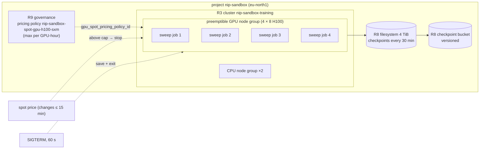

# S4 — Burst training on preemptible capacity

| | |
|---|---|
| Composes | [R9](../../recipes/finance/README.md) governance (spot price cap, budget) → [R8](../../terraform/stacks/data/README.md) data (checkpoints) → [R3](../../terraform/stacks/training/README.md) training with a preemptible GPU node group |
| Stage shape | **sandbox only** today: the stage policy allows preemptible GPU nodes only where `allow_preemptible_serving: true` (sandbox); training cap 4 nodes |
| Region (worked example) | `eu-north1`, H100 (four InfiniBand fabrics) |
| Status | designed to the Solution definition of done; **not deployed**; preemption handling never exercised in this repository |
| Dated | 2026-10-11. Prices are live calculator list and spot prices, **an estimate, not a quote** |

## 1. Customer problem

A research team runs hyper-parameter sweeps, ablations and small fine-tunes in bursts: a few days of
heavy use, then quiet weeks. It wants the GPUs as cheaply as possible, accepts that jobs may be
interrupted, and needs a hard ceiling on what an hour can cost.

## 2. First-call questions

| # | Question | Why it changes the design |
|---|---|---|
| 1 | Can every job checkpoint and resume? How often, how long does a save take? | preemption gives `SIGTERM` 60 s before stop; rework = work since the last checkpoint |
| 2 | Independent single-node jobs, or multi-node jobs over InfiniBand? | one preempted node stops every rank of a multi-node job |
| 3 | Maximum price per GPU-hour they will pay | R9 pricing policy (spot cap) |
| 4 | Deadline for the burst? | spot has no availability guarantee: a deadline argues for on-demand or a reservation |
| 5 | GPU type and memory per job | 1-GPU vs 8-GPU presets; H100 vs H200 |
| 6 | Where do results and checkpoints go? | R8 filesystem + versioned bucket |
| 7 | Do they need Kubernetes, or would Serverless AI jobs do? | option C (no cluster) |
| 8 | Who is alerted when the spot price stops jobs? | budget and alert routing |

## 3. Design

### 3.1 Requirements and assumptions

| Kind | Item |
|---|---|
| Fact | Preemptible VMs: `SIGTERM` 60 s before stop, volumes kept, dynamic public IP lost; type cannot change after create ([preemptible VMs](https://docs.nebius.com/compute/virtual-machines/preemptible)) |
| Fact | Spot price changes as often as every 15 min, also while running; at most one cent below PAYG on-demand; a pricing policy stops resources above its max ([spot pricing](https://docs.nebius.com/signup-billing/pricing-policy)) |
| Fact | Preemptible VMs cannot use reservations ([VM reservations](https://docs.nebius.com/compute/virtual-machines/reservations)) |
| Fact | Default preemptible GPU VM quota: 8 per region ([Compute quotas](https://docs.nebius.com/compute/resources/quotas-limits)) |
| Fact | This repository allows preemptible GPU nodes only in sandbox (`modules/stage-policy`, [ADR-0007](../../docs/decisions/0007-capacity-on-demand-vs-preemptible.md)); sandbox training cap is 4 nodes = 32 GPUs ([stage policy](../../platform/stages.yaml)) |
| Fact | R3 sends no reservation for a preemptible group and sets `spot_pricing_policy` or `follows_spot_price` (ADR-0007) |
| Assumption | Burst: 4 × 8 H100 for 72 h; jobs are single-node (8 GPUs each), checkpoint every 30 min |
| Open | Whether preemptible VMs may join an InfiniBand GPU cluster: the docs do not say; the capacity advisor reports preemptible availability per fabric (section 6), which suggests it but does not prove it |
| Open | Whether preemptible GPUs count against `compute.instance.gpu.h100` as well as `compute.instance.preemptible.count`. `compute.instance.preemptible.count`: observed 2026-10-11 (usage 1 of 8 while a preemptible L40S ran); not documented ([connectors evidence](../../docs/evidence/2026-10-11-sandbox-inference-portal-connectors.md), Quota semantics). The GPU-quota half stays open |

### 3.2 Architecture diagram



### 3.3 Component and dependency mapping

| Component | Recipe / path | Key inputs | Docs |
|---|---|---|---|
| Spot cap | R9 `terraform/stacks/governance` | `spot_price_caps = { "gpu-h100-sxm" = "<max per GPU-hour>" }` → `pricing_policy_ids` | [pricing policy resource](https://docs.nebius.com/terraform-provider/reference/resources/billing_v1_pricing_policy) |
| Budget | R9 console steps | sandbox budget = 1 × the approved run budget, 50 % and 100 % alerts | [budgets](https://docs.nebius.com/signup-billing/budgets#how-to-create-a-budget) |
| Checkpoint plane | R8 `terraform/stacks/data` | `filesystem_size_gib = 4096`, checkpoint bucket | [versioning](https://docs.nebius.com/object-storage/buckets/versioning) |
| Training cluster | R3 `terraform/stacks/training` | `gpu_preemptible = true`, `gpu_spot_pricing_policy_id`, `gpu_node_count = 4`, `enable_gpu_cluster = false` for single-node jobs, `existing_filesystem_id` | [MK8s node groups](https://docs.nebius.com/kubernetes/node-groups/manage) |
| Optional queueing | [R16](../../workloads/kueue/README.md) Kueue: jobs wait in a queue instead of half-scheduling | needs a GPU cluster (`enable_gpu_cluster = true`) for its topology flavor | [topology-aware scheduling](https://docs.nebius.com/kubernetes/gpu/topology-aware-scheduling) |

### 3.4 Alternatives and tradeoffs

| Option | Gains | Loses | ADR |
|---|---|---|---|
| **A. R3 preemptible node group, single-node jobs** | Kubernetes tooling, shared filesystem, spot price | sandbox-only by policy; no availability guarantee | [ADR-0007](../../docs/decisions/0007-capacity-on-demand-vs-preemptible.md) |
| B. Same, multi-node jobs over InfiniBand | larger jobs | one preemption stops all ranks; IB membership for preemptible VMs unconfirmed | ADR-0007, [ADR-0002](../../docs/decisions/0002-inference-vs-training-topology.md) |
| C. Serverless AI jobs on preemptible VMs | no cluster; `--restart-policy on-failure` | per-job containers; jobs end with `ERROR`/`NotEnoughResources` after 30 min of provisioning ([lifecycle](https://docs.nebius.com/serverless/lifecycle#job-statuses)) | [ADR-0001](../../docs/decisions/0001-kubernetes-vs-serverless.md) |
| D. On-demand for the burst | predictable | 5.5 × the hourly price observed (section 6) | — |
| E. New "burst" stage with preemptible training allowed outside sandbox | keeps sandbox disposable | a policy change and a new ADR (preemptible outside sandbox) | proposes an ADR from [the template](../../docs/decisions/0000-template.md) |

### 3.5 Security and operational risks

| Item | Design answer |
|---|---|
| Preemption looks like node failure | alerts must tell them apart (node condition or event), per ADR-0007; `GpuNodeNotReady` will fire |
| Uncapped spend | pricing policy cap; without one a preemptible node follows the spot price uncapped ([R9](../../recipes/finance/README.md#spot-price-cap-pricing-policy)) |
| Blocked policy | a cap below the current spot price blocks start: the job never runs, which is a signal, not a failure |
| Deleting the policy | can stop the VMs that use it: destroy clusters first ([R9 teardown](../../recipes/finance/README.md#teardown)) |
| Sandbox TTL | every resource carries `nip-ttl-expires`; `make leftovers` after the burst |

### 3.6 Terraform/Helm implementation plan

| Step | Command | Expect |
|---|---|---|
| 1 | `make plan apply STAGE=sandbox STACK=governance` with `spot_price_caps` | `nip-sandbox-spot-gpu-h100-sxm` |
| 2 | `make plan apply STAGE=sandbox STACK=data` | filesystem + buckets |
| 3 | `make plan apply STAGE=sandbox STACK=training` with `gpu_preemptible = true`, `gpu_spot_pricing_policy_id`, `gpu_node_count = 4`, TTL labels | 4 preemptible 8-GPU nodes, no reservation |
| 4 | jobs with a `SIGTERM` handler that saves and exits within 60 s; `backoffLimit` / restart from the last checkpoint | — |
| 5 | `gpu_node_count = 0`, apply; destroy; `make leftovers STAGE=sandbox` | nothing left |

### 3.7 PoC acceptance tests

| Criterion | Threshold | Method |
|---|---|---|
| Preemptible nodes join and get GPUs | 8 allocatable GPUs per node | `tests/validate/00-nodes.sh`, `01-gpu.sh` |
| Job survives a stop | resumes from the last checkpoint, loses ≤ one interval | stop one node VM in the sandbox (owner-approved), watch the job resume; record in evidence |
| `SIGTERM` handler | checkpoint written within 60 s | job log on a stop |
| Cap honoured | effective hourly price ≤ cap in the FOCUS rows of the run | [finance runbook](../../runbooks/finance.md#monthly-close) |
| Teardown | `make leftovers STAGE=sandbox` prints nothing | [teardown](../../runbooks/teardown.md) |

### 3.8 Cost assumptions and missing commercial inputs

See [section 6](#6-cost-model). Missing: the customer's maximum price; spot price history for the
platform (console **Billing → Pricing → Pricing history**); reserved does not apply to preemptible.

### 3.9 Handoff and rollback runbook

A preempted node is not rolled back: the node group restarts it when capacity returns, or the job
waits. To stop all spend at once: `gpu_node_count = 0` and apply, or lower the cap below the spot
price (resources stop) ([R9 pricing policies](../../recipes/finance/README.md#spot-price-cap-pricing-policy)).
Teardown: [teardown](../../runbooks/teardown.md); cost check: [finance](../../runbooks/finance.md).

## 4. Sizing worked example

| Step | Value |
|---|---|
| Burst | 4 nodes × 8 H100 × 72 h = **2,304 GPU-hours** |
| On-demand vs spot per GPU-hour at pricing time | $4.50 vs $0.79 |
| Break-even rework share | spot × (1 + r) < on-demand → r < 4.50 ÷ 0.79 − 1 ≈ **4.7** (470 % rework before on-demand is cheaper, at that spot price) |
| Rework per preemption | ≤ 30 min checkpoint interval + restart; for one 8-GPU node ≈ 0.5 h × 8 = 4 GPU-hours |
| Example: 10 preemptions in the burst | 10 × 4 = 40 GPU-hours ≈ 1.7 % rework |
| Spot cap example | a cap of $1.50 per GPU-hour bounds the GPU line at 4 × 8 × 1.50 = $48/h; fewer nodes may start under a lower cap ([capacity advisor note](../../recipes/finance/README.md#spot-price-cap-pricing-policy)) |
| Checkpoint write | an 8-GPU job's state (customer's model) ÷ ≤ 1.89 GiB/s per 4 TiB of filesystem must finish well inside 60 s for a save on `SIGTERM`; otherwise rely on periodic checkpoints |

## 5. Quota checklist

Names from the live quota listing ([solutions index](../README.md#quota-names-observed-live)); limits in the console.

| Quota (API name) | Need (sandbox, eu-north1) | Default | Action |
|---|---|---|---|
| `compute.instance.preemptible.count` | 4 | 8 | ok |
| `compute.instance.gpu.h100` | 32 (if preemptible GPUs count here: open) | 32 | at the limit |
| `compute.instance.non-gpu.vcpu` | 16 | **0** in `eu-north1` | **request** |
| `compute.disk.size.network-ssd` | 4,348 GiB (4 × 1,023 + 2 × 128) | **4 TiB** | **request**, or lower `gpu_boot_disk_size_gib` |
| `compute.filesystem.size.network-ssd` | 4,096 GiB | 4 TiB | at the limit |
| `compute.gpucluster.count` | 0 (single-node jobs); 1 for option B | 5 | ok |
| `mk8s.cluster.count` | 1 | 2 | ok |
| `storage.bucket.count` | 2 | 200 | ok |

Stage cap: `max_gpu_nodes.training = 4` in sandbox; 5+ nodes need a policy change.

## 6. Cost model

Live billing calculator, `eu-north1`, **2026-10-11T09:10:21Z**, USD, footprint
[`footprint.json`](footprint.json) (4 × 8 H100 for 72 h, 2 CPU nodes, disks, 4 TiB filesystem). **An estimate, not a quote.**

```bash
python3 recipes/finance/price.py solutions/S4-burst-training-preemptible/footprint.json \
  --project "$NEBIUS_PROJECT_ID" --advice --tenant "$NEBIUS_TENANT_ID"
```

| Scenario | GPU line per hour | Whole footprint per hour | Per 72 h burst |
|---|---|---|---|
| On-demand | 144.0000 (32 × $4.50) | 145.3996 | **10,468.77** |
| Preemptible (spot at 09:10:21Z) | 25.2800 (32 × $0.79) | 26.6796 | **1,920.93** (18.3 % of on-demand per hour) |
| Preemptible at a $1.50 cap (worst case) | 48.0000 | 49.3996 | 3,556.77 (arithmetic: cap × GPUs + the same non-GPU lines) |
| Reserved | **does not apply**: preemptible VMs cannot use reservations | — | — |

Non-GPU lines: CPU nodes $0.528/h, disks $0.4227/h, filesystem $0.4489/h; they bill at on-demand
rates in every scenario. Spot moves every 15 minutes: the preemptible row is the price at one moment.

Capacity advisor at pricing time (not a guarantee), `gpu-h100-sxm 8gpu-128vcpu-1600gb` in `eu-north1`:

| Fabric | On-demand | Preemptible |
|---|---|---|
| `fabric-2` | LOW (limit 4) | HIGH (7 of 8) |
| `fabric-3` (repository default) | MEDIUM (1 of 4) | MEDIUM (3 of 8) |
| `fabric-4` | HIGH (4 of 4) | HIGH (7 of 8) |
| `fabric-6` | LOW (limit 4) | MEDIUM (5 of 8) |

The fabric matters: for a GPU-cluster variant, `infiniband_fabric = "fabric-4"` showed the most
headroom at that moment.

## 7. Risks and mitigations

| Risk | Mitigation |
|---|---|
| No preemptible capacity during the burst | check the advisor per fabric before the burst; fall back to on-demand for the deadline-critical part |
| Spot price above the cap stops everything | cap with headroom over the observed spot price; budget alert at 50 % |
| Multi-node job loses all ranks on one preemption | single-node jobs (option A); multi-node only with frequent checkpoints |
| Checkpoint slower than 60 s | periodic checkpoints; size the filesystem for bandwidth |
| Quota auto-reduced between bursts | re-check on the day ([automatic reduction](https://docs.nebius.com/overview/quotas#automatic-quota-reduction)) |
| Recorded benchmarks on preemptible | forbidden by ADR-0007: numbers from a preemptible run are not evidence |

## 8. Delivery steps

1. Discovery (section 2): checkpoint behaviour, cap, deadline.
2. Price on the day; written spend approval with a TTL ([finance](../../runbooks/finance.md#before-a-new-run-price-it)).
3. Quota requests (vCPU, Network SSD) ([capacity request](../../runbooks/capacity-request.md)).
4. R9 governance with the cap; sandbox budget ([R9 budgets](../../recipes/finance/README.md#budgets)).
5. R8 data; R3 with the preemptible node group ([deploy → training](../../runbooks/deploy.md#training-stack-stacktraining)).
6. Preemption drill (one node, owner-approved) and evidence file.
7. Burst; then `gpu_node_count = 0`, destroy, `make leftovers`, FOCUS check of the effective price.

## 9. Portal demo path (Nebius Estate)

| Page | What it shows for S4 |
|---|---|
| GPU & Capacity (`/capacity`) | preemptible quota, capacity advice per fabric, stage caps |
| Commercial Scenarios (`/commercial`) | live on-demand and spot prices side by side |
| Estate Explorer (`/estate`) | TTL-expired view: anything from the burst past `nip-ttl-expires` |
| Fleet (`/fleet`), Alerts (`/alerts`) | GPU utilisation; idle GPUs left after jobs end |
| Costs (`/costs`) | effective hourly price of the run from FOCUS rows |

## 10. Proven vs not

| Claim | Status | Evidence |
|---|---|---|
| A preemptible GPU node group is accepted by the API and hands its GPU to pods | proven (1 preemptible B300 upstream; 1 preemptible L40S in this repository's sandbox) | [B300 smoke](../../docs/evidence/2026-10-08-mk8s-b300-gpu-smoke.md), [sandbox populate](../../docs/evidence/2026-10-11-sandbox-inference-populate.md) |
| Preemptible price $0.79/h (H100 1-GPU preset, spot at one moment) and $0.7492/h (L40S 1-GPU preset, a fixed preemptible price: L40S is not on the spot-priced list, `.cache/nebius-docs/compute/resources/pricing.md:29`) | observed live 2026-10-11 | section 6; [sandbox populate](../../docs/evidence/2026-10-11-sandbox-inference-populate.md) (L40S $0.7492/h) |
| Pricing policy (spot cap) through Terraform | applied once in sandbox 2026-10-11 (one H100 cap, `STATE_ACTIVE`), destroyed; L40S takes no spot cap | [governance](../../docs/evidence/2026-10-11-sandbox-governance-live.md) |
| Job resume after a preemption | **not exercised** | — |
| Preemptible nodes in an InfiniBand GPU cluster | **unknown** | — |
| Prices in section 6 | observed live, list and spot, not a quote | section 6 |

## Open questions for the account team

1. Can preemptible VMs join an InfiniBand GPU cluster, and how does a preemption interact with the cluster?
2. Do preemptible GPUs count against the per-platform GPU quota as well as the preemptible VM count?
3. Typical spot price range and preemption frequency for H100 in `eu-north1` (history beyond the console).
4. Can preemptible capacity be raised above 8 VMs per region for bursts?
