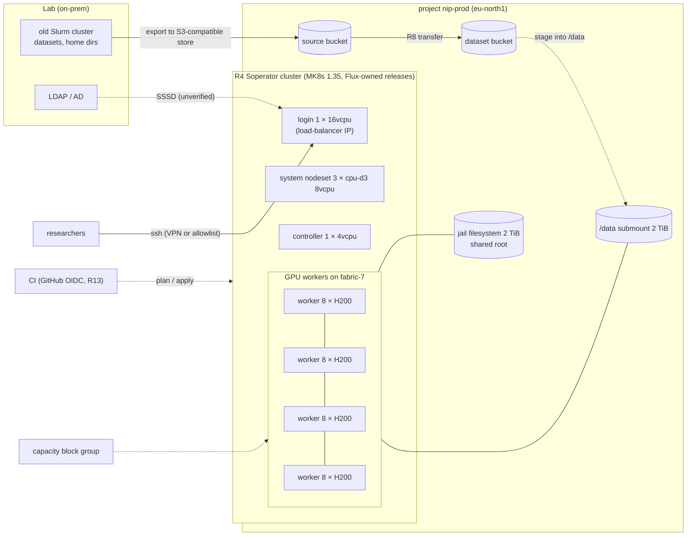

# S5 — Slurm migration

| | |
|---|---|
| Composes | [R13](../../terraform/modules/foundation/ci-federation/README.md) identity and CI federation → [R8](../../terraform/stacks/data/README.md) data (ingest) → [R4](../../terraform/stacks/soperator/README.md) Soperator (Slurm on Managed Kubernetes) |
| Stage shape | lab profile in sandbox, then prod `stage.tfvars` (2 TiB jail and `/data`, deletion protection, backups) plus a GPU nodeset |
| Region (worked example) | `eu-north1`, H200 on `fabric-7` |
| Status | designed to the Solution definition of done; **not deployed**; Soperator 4.1.13 ran `sbatch` on a CPU worker only |
| Dated | 2026-10-11. Prices are live calculator list prices, **an estimate, not a quote** |

## 1. Customer problem

A research lab runs an on-prem Slurm cluster that is full and ageing. Researchers know `sbatch`,
`srun`, partitions and fair-share and will not learn Kubernetes. The lab wants 32 GPUs on
InfiniBand, its datasets moved, its users and groups preserved, and Slurm kept as the interface.

## 2. First-call questions

| # | Question | Why it changes the design |
|---|---|---|
| 1 | Slurm version, plugins (accounting, QoS, MIG, Pyxis/Enroot), `slurm.conf` must-haves | Soperator exposes only some settings ([compatibility](../../docs/soperator-compatibility.md)) |
| 2 | Partitions and fair-share: how many user partitions? | self-deployed 4.1.13 supports one user partition; Managed Soperator configures more |
| 3 | Identity: LDAP/AD/FreeIPA, UID/GID mapping | 4.1.13 docs conflict on LDAP; SSSD available but unverified |
| 4 | Number of users, concurrent jobs, typical job size (GPUs, nodes, hours) | GPU nodeset size; reservation |
| 5 | Dataset size, file count, current location | R8 transfer → `/data` submount; inode limits |
| 6 | Container runtime (Pyxis/Enroot, Apptainer) | supported by Soperator ([why Soperator](https://docs.nebius.com/slurm-soperator/overview/why-slurm-soperator)) |
| 7 | Should Nebius operate Slurm (Managed Soperator or Pro Solution)? | changes ownership and capacity type |
| 8 | Steady load or project bursts? | capacity block group vs PAYG |
| 9 | How do users reach the login node (VPN, allowlist)? | login node has a public IP in the recipe ([ADR-0008](../../docs/decisions/0008-slurm-scheduler-and-soperator.md)) |

## 3. Design

### 3.1 Requirements and assumptions

| Kind | Item |
|---|---|
| Fact | R4 wraps the upstream recipe at `soperator-v4.1.13-2` (Soperator 4.1.13, Kubernetes 1.35; the release supports 1.32–1.35) ([R4](../../terraform/stacks/soperator/README.md)) |
| Fact | The recipe creates its own cluster and filesystems; it does not consume R7/R8 at this tag |
| Fact | Managed Service for Soperator: GPU workers require capacity block groups; not offered in `us-north1`, `uk-south2`; adds service nodes (at least 48 non-GPU vCPU) ([ADR-0008 notes](../../docs/decisions/0008-slurm-scheduler-and-soperator.md#notes)) |
| Fact | Soperator runs NCCL health checks as jobs and drains slow nodes ([why Soperator](https://docs.nebius.com/slurm-soperator/overview/why-slurm-soperator)) |
| Fact | Attaching an existing filesystem as the jail overwrites it; customer data goes in submounts ([compatibility](../../docs/soperator-compatibility.md#recipe-specific-notes-tag-soperator-v4113-2)) |
| Assumption | 4 × 8 H200 GPU workers (32 GPUs) running all month; prod shape from `terraform/live/prod/soperator/stage.tfvars` |
| Open | LDAP/SSSD against the customer's directory; several user partitions; GPU worker boot disk size (1,023 GiB assumed, as R3) |

### 3.2 Architecture diagram



### 3.3 Component and dependency mapping

| Component | Recipe / path | Key inputs | Docs |
|---|---|---|---|
| Identities | R13 `modules/foundation/ci-federation` (`ci_federation`, `team_groups`) | GitHub OIDC subjects per stage; project-scoped team groups | [workload identity federation](https://docs.nebius.com/iam/wif), [custom groups](https://docs.nebius.com/iam/authorization/groups#custom-groups) |
| Dataset ingest | R8 `terraform/stacks/data` | `transfer` from the lab's S3-compatible export | [transfers](https://docs.nebius.com/object-storage/transfer/overview) |
| Slurm | R4 `terraform/stacks/soperator` | `profiles/lab.tfvars` + `stage.tfvars`; a GPU nodeset (customer decision, recorded in evidence); `slurm_login_ssh_root_public_keys` via `TF_VAR_` | [Soperator](https://docs.nebius.com/slurm-soperator), [deploy options](https://docs.nebius.com/slurm-soperator/deploy/overview) |
| Users | `soperator-createuser` on the login node ([soperator jobs](../../runbooks/soperator-jobs.md)) | per-user SSH keys | [users](https://docs.nebius.com/slurm-soperator/users/manage#how-to-create-a-user) |
| Reserved capacity | capacity block group via a Nebius manager; R9 project limits | — | [capacity block groups](https://docs.nebius.com/overview/limits/capacity-block-groups) |

### 3.4 Alternatives and tradeoffs

| Option | Gains | Loses | ADR |
|---|---|---|---|
| **A. Self-deployed R4 (this repository)** | PAYG or reserved; repository controls the pins | operate it; 4.1.13 limits (one user partition, LDAP conflict, scale-down ghosts) | [ADR-0008](../../docs/decisions/0008-slurm-scheduler-and-soperator.md) option 2 |
| B. Managed Service for Soperator | console-deployed, several partitions with priority tiers | GPU workers only with a capacity block group; service nodes ≥ 48 vCPU; no published service level | ADR-0008 notes |
| C. Pro Solution for Soperator | Nebius experts deploy; reserved capacity and discounted pricing by contract | sales process | ADR-0008 |
| D. Kubernetes-native batch (R3 + [R16](../../workloads/kueue/README.md) Kueue) | no extra operator | researchers lose `sbatch` | ADR-0008 option 1 |
| E. Ephemeral nodes share a reservation with an MK8s inference group | reserved GPUs move between training and serving | Soperator ≥ 3.0, enabled by Nebius ([ephemeral nodes](https://docs.nebius.com/slurm-soperator/capacity/ephemeral-nodes)) | — |

### 3.5 Security and operational risks

| Item | Design answer |
|---|---|
| Login node has a public IP; root SSH keys | named operators only; prefer VPN or Tailscale (`tailscale_enabled`) ([ADR-0008](../../docs/decisions/0008-slurm-scheduler-and-soperator.md)) |
| AppArmor off in the lab profile | fix the profile load and switch it back on before prod ([compatibility](../../docs/soperator-compatibility.md#recipe-specific-notes-tag-soperator-v4113-2)) |
| Soperator namespaces have no NetworkPolicy | accepted in [security](../../docs/security.md#security-acceptance-checklist); dedicated cluster |
| Stage policy guards do not apply to R4 | Soperator `stage.tfvars` is reviewed by hand ([architecture](../../docs/architecture.md#stage--stack--foundation)) |
| CI with static keys | R13 federation removes the private key ([identity runbook](../../runbooks/identity.md)) |
| Jail overwrite | never attach an existing filesystem as the jail; data in submounts |

### 3.6 Terraform/Helm implementation plan

| Step | Command | Expect |
|---|---|---|
| 1 | foundation with `ci_federation` and `team_groups` (admin) ([identity runbook](../../runbooks/identity.md#turn-on-federation-in-the-foundation)) | federated credentials, no keys |
| 2 | `make plan apply STAGE=<stage> STACK=data` with `transfer` | dataset bucket filled |
| 3 | `make soperator-plan STAGE=sandbox` → review → `make ttl-teardown STAGE=sandbox STACK=soperator TTL=<UTC> CONFIRM=yes` → `make soperator-apply CONFIRM=yes STAGE=sandbox` | lab shape: 6 VMs, 3 filesystems, no GPU cluster ([R4](../../terraform/stacks/soperator/README.md#run-and-validate)) |
| 4 | add a GPU nodeset (2 workers) in a reviewed `stage.tfvars` change; spend approval | GPU cluster + 2 × 8 H200 |
| 5 | prod: `make soperator-plan STAGE=prod MR_URL=<merge request>`; 4 workers on a capacity block group | prod shape |
| 6 | users, data staged into `/data`, NCCL across workers | section 3.7 |

### 3.7 PoC acceptance tests

| Criterion | Threshold | Command |
|---|---|---|
| Slurm up | `sinfo` shows the GPU nodeset idle | [soperator jobs](../../runbooks/soperator-jobs.md) step 1 |
| `sbatch` end to end | job COMPLETED as a non-root user | same, step 0–1 |
| NCCL across workers | ≥ 300 GB/s average busbw over `/IB` | same, step 2 ([tests bar](../../tests/README.md#training-stackstraining-testsvalidaterun-trainingsh)) |
| Identity | a directory user logs in with its UID/GID | SSSD test against the customer directory (not yet done anywhere) |
| Worker failure and scale-down | node drained and replaced; ghost nodes removed | same runbook, steps 3–5 |
| Backups | jail backup job runs (`backups_enabled = "auto"`) | [backup-restore](../../runbooks/backup-restore.md#soperator-jail-and-submounts) |

### 3.8 Cost assumptions and missing commercial inputs

See [section 6](#6-cost-model). Missing: capacity block group rate and term (required for Managed
Soperator GPU workers), Pro Solution terms, support tier.

### 3.9 Handoff and rollback runbook

Flux owns the Soperator releases: never edit them outside the recipe ([ADR-0006](../../docs/decisions/0006-reconciler-ownership.md)).
Upgrades follow Soperator tags inside the Kubernetes window ([upgrade](../../runbooks/upgrade.md)).
Teardown: [teardown → Soperator](../../runbooks/teardown.md#soperator-stackssoperator). Restore:
[backup-restore](../../runbooks/backup-restore.md). Users keep `sbatch`; the platform team keeps the
recipe pins, quotas and the reservation calendar ([capacity](../../docs/capacity.md#capacity-calendar-fill-in-per-tenant)).

## 4. Sizing worked example

| Step | Value |
|---|---|
| GPU workers | 4 × `8gpu-128vcpu-1600gb` = 32 H200 on one GPU cluster (`fabric-7`) |
| GPU-hours a month | 32 × 730 = **23,360** |
| Service nodes (self-deployed) | 3 × 8 vCPU system + 4 controller + 16 login = **44 vCPU** |
| Service nodes (Managed Soperator) | at least 48 non-GPU vCPU per cluster ([ADR-0008 notes](../../docs/decisions/0008-slurm-scheduler-and-soperator.md#notes)) |
| Filesystems | jail 2,048 + `/data` 2,048 + spool 128 = **4,224 GiB** |
| `/data` bandwidth | 2 TiB sits inside one 4 TiB unit: up to 3.70 GiB/s read for all 32 GPUs; size `/data` to 8 TiB+ for more ([storage](../../docs/solutions/storage-and-data.md#shared-filesystems)) |
| Inodes | above 256 GiB: size ÷ 64 KiB → 2 TiB ≈ 33.5 M files on `/data` |
| Network SSD | 4 × 1,023 + 4 × 128 + 256 = **4,860 GiB** (+ 279 GiB IO M3 spool) |

## 5. Quota checklist

Names from the live quota listing ([solutions index](../README.md#quota-names-observed-live)); limits in the console.

| Quota (API name) | Need (prod, eu-north1) | Default | Action |
|---|---|---|---|
| `compute.instance.gpu.h200` | 32 on PAYG; 0 from a capacity block group | 32 | at the limit on PAYG |
| `compute.gpucluster.count` | 1 | 5 | ok |
| `compute.instance.non-gpu.vcpu` | 44 | **0** in `eu-north1` | **request** |
| `compute.instance.count` | 9 (4 GPU + 5 CPU) | 12 / 12 | ok |
| `compute.disk.size.network-ssd` | 4,860 GiB | **4 TiB** | **request** |
| `compute.disk.size.network-ssd-io-m3` | 279 GiB (controller spool PVC) | 4 TiB | ok (an IO M3 quota of 0 fails the apply: [capacity](../../docs/capacity.md#stackssoperator-lab-profile-every-stage)) |
| `compute.filesystem.size.network-ssd` | 4,224 GiB | **4 TiB** | **request** |
| `mk8s.cluster.count` | 1 (a stage running inference + training + Soperator needs 3) | 2 | check |
| `vpc.ipv4-address.public.count` | 1 (login load balancer) | 3 | ok |
| `storage.bucket.count`, `storage.transfer.count` | 1–2, 1 | — | ok |

## 6. Cost model

Live billing calculator, `eu-north1`, **2026-10-11T09:10:35Z**, USD list, footprint
[`footprint.json`](footprint.json) (prod shape for 730 h). **An estimate, not a quote.**

```bash
python3 recipes/finance/price.py solutions/S5-slurm-migration/footprint.json \
  --project "$NEBIUS_PROJECT_ID" --contract --advice --tenant "$NEBIUS_TENANT_ID"
```

| Line | Per hour | Per month (730 h) |
|---|---|---|
| 4 GPU workers, on-demand (32 × $5.40) | 172.8000 | 126,144.00 |
| 4 GPU workers, preemptible (spot at 09:10:35Z, 32 × $0.79) | 25.2800 | 18,454.40 |
| System 3 × `8vcpu-32gb`, controller `4vcpu-16gb`, login `16vcpu-64gb` | 1.4520 | 1,059.96 |
| Disks (worker boot 4 × 1,023, CPU boot 4 × 128, login 256 GiB SSD; spool 279 GiB IO M3) | 0.5176 | 377.85 |
| Filesystems (jail 2,048, `/data` 2,048, spool 128 GiB) | 0.4628 | 337.92 |
| **On-demand total** | **175.2325** | **127,919.73** |
| Preemptible total (GPU workers at spot) | 27.7125 | 20,230.13 |

| Capacity type | Applies? | Note |
|---|---|---|
| On-demand | self-deployed R4 only | advisor: `fabric-7` H200 8-GPU on-demand **LOW** (limit 4 VMs) at pricing time |
| Preemptible | lab and sweeps only | Soperator nodesets can be preemptible per ADR-0007; Slurm sees a preemption as a node loss; Managed Soperator GPU workers need reservations |
| Reserved | **expected for prod** | `--contract` returned list prices (no commitment on this account); rate and term from the addendum; break-even utilisation = contract ÷ on-demand ([R9](../../recipes/finance/README.md#pricing-and-tco-method)) |

Observed earlier for the lab profile (no GPU): ≈ $1.89/h ([cost shape](../../docs/cost.md#cost-shape-per-recipe)).
Not priced by the calculator: Object Storage for the ingested data; the transfer itself is free.

## 7. Risks and mitigations

| Risk | Mitigation |
|---|---|
| Directory integration fails (LDAP conflict at 4.1.13) | test SSSD in sandbox against the customer directory before commitment; fall back to `soperator-createuser` with mapped UIDs |
| Researchers need several partitions | Managed Soperator (option B) or wait for a release with multi-partition support |
| Kubernetes window closes (1.35 is the newest Soperator 4.1.13 accepts) | track the next Soperator tag ([capacity → version window](../../docs/capacity.md#kubernetes-version-window)) |
| Scale-down leaves ghost nodes | `scontrol` cleanup step in the runbook |
| Capacity for 32 GPUs at once | capacity block group; advisor shows on-demand LOW |
| Interrupted apply leaves a half-built cluster | never kill an apply ([incident → run safety](../../runbooks/incident.md#terraform-run-safety)) |

## 8. Delivery steps

1. Discovery (section 2); choose option A, B or C with the lab.
2. R13 federation and team groups ([identity runbook](../../runbooks/identity.md)).
3. Quotas and the capacity block group ([capacity request](../../runbooks/capacity-request.md)).
4. Sandbox lab profile; `sbatch` on a CPU worker; SSSD test ([soperator jobs](../../runbooks/soperator-jobs.md)).
5. R8 ingest of the lab's data ([data runbook](../../runbooks/data.md#ingest-object-storage-data-transfer)).
6. Prod with GPU workers; NCCL across workers; users created; data in `/data`; evidence file.
7. Cut-over: freeze the old cluster, final sync, users switch login host.

## 9. Portal demo path (Nebius Estate)

| Page | What it shows for S5 |
|---|---|
| Provisioning (`/provisioning`) | the "Soperator lab" preview: validate, tfvars diff, estimate, patch (nothing applied) |
| Workloads (`/workloads`) | the Soperator cluster's pods; Slurm state is shown as unavailable (the portal does not read Slurm) |
| GPU & Capacity (`/capacity`) | GPU workers, quotas, GPU cluster, reservations when readable |
| Fleet (`/fleet`) | per-GPU telemetry of the workers |
| Commercial Scenarios (`/commercial`) | list vs negotiated rate book for the 32 GPUs |
| Evidence & Runbooks (`/evidence`) | the CPU-worker `sbatch` evidence and what is unmeasured |

## 10. Proven vs not

| Claim | Status | Evidence |
|---|---|---|
| Soperator 4.1.13 from the pinned recipe runs `sbatch` to COMPLETED | proven on a CPU worker (prior upstream run) | [Soperator CPU run](../../docs/evidence/2026-10-08-soperator-4.1.13-cpu.md) |
| Lab profile cost ≈ $1.89/h | observed (prior run) | [costs](../../docs/evidence/costs.md) |
| GPU workers, NCCL over InfiniBand under Slurm | **not run** | — |
| SSSD/LDAP | **not tested** | [compatibility](../../docs/soperator-compatibility.md) |
| This repository's live Soperator roots | not applied; planned live 2026-10-11 | [live plans](../../docs/evidence/2026-10-11-sandbox-live-plans.md) |
| Prices in section 6 | observed live 2026-10-11, list, not a quote | section 6 |

## Open questions for the account team

1. Capacity block group for 32 × H200 on `fabric-7`: availability, rate, minimum term.
2. Managed Soperator: service level, supported Slurm settings, partition limits, identity integration.
3. Pro Solution scope and pricing.
4. Is a CPU-only nodeset supported (the 4.1.13 docs disagree)?
5. Can ephemeral nodes be enabled for the customer's tenant?
