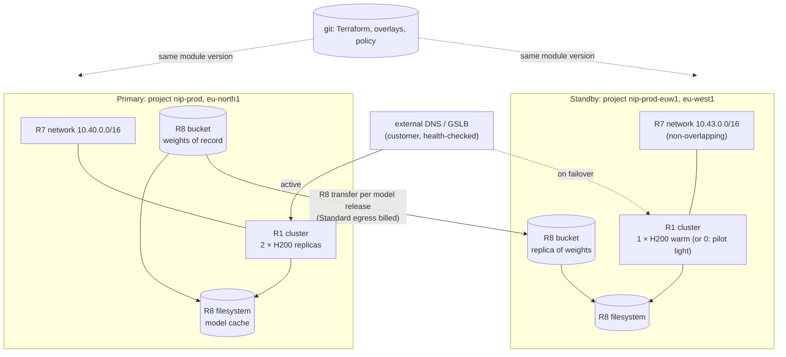

# S6 — Multi-region serving and disaster recovery

| | |
|---|---|
| Composes | per region: [R7](../../terraform/stacks/network/README.md) network → [R8](../../terraform/stacks/data/README.md) data → [R1](../../terraform/stacks/inference/README.md) inference; R8 transfers copy weights between regions |
| Stage shape | prod in two regions; each region is its own project, state and live roots |
| Regions (worked example) | primary `eu-north1`, standby `eu-west1` (both H200, both EU) |
| Status | designed to the Solution definition of done; **not deployed**; region loss is outside the repository's current DR scope ([DR](../../docs/dr.md#objectives-targets-not-measurements)), so this design proposes extending it |
| Dated | 2026-10-11. Prices are live calculator list prices, **an estimate, not a quote** |

## 1. Customer problem

A customer serves a model to its users from one region and must survive the loss of that region: a
written recovery time objective (RTO), a recovery point objective (RPO) for model and configuration,
and a cost for the standby it can defend. It wants to know what Nebius gives it for this and what it
must build itself.

## 2. First-call questions

| # | Question | Why it changes the design |
|---|---|---|
| 1 | RTO and RPO per asset (model weights, configuration, user data, logs) | warm vs pilot-light standby |
| 2 | Active/active or active/standby? | traffic split and both regions sized for full load, or not |
| 3 | Which region pairs are legally acceptable (EU only, same country)? | H200 pairs: `eu-north1` + `eu-west1` (EU) or `us-central1`; B300: `uk-south1`, `eu-west2`, `us-north1` ([regions](../../docs/solutions/regions.md#gpu-platforms-per-region)) |
| 4 | Acceptable cold start: weight download and warm-up | standby replicas running or not |
| 5 | DNS provider and failover mechanism | no global load balancer in the docs: DNS is external |
| 6 | How do clients reach the service (public, VPN)? | one VPN per region in a private design ([S1](../S1-private-llm-serving-vpn/README.md)) |
| 7 | Stateful pieces besides weights (vector DB, PostgreSQL, MLflow)? | per-service replication; MLflow is not offered in `eu-west1` |
| 8 | How often must failover be drilled? | evidence cadence |

## 3. Design

### 3.1 Requirements and assumptions

| Kind | Item |
|---|---|
| Fact | Projects are regional; each resource is hosted in one region ([regions](https://docs.nebius.com/overview/regions)) |
| Fact | Global load balancing, cross-region managed replication of buckets or filesystems, and cross-region private networking: **docs silent** ([use cases → DR](../../docs/solutions/use-cases.md#6-multi-region-dr-for-serving)) |
| Fact | Object Storage transfers copy between Nebius buckets and S3-compatible endpoints; the transfer is free, requests and egress are billed ([transfers](https://docs.nebius.com/object-storage/transfer/overview)); egress to another region is charged per class, Enhanced Throughput egress is free ([pricing](https://docs.nebius.com/object-storage/resources/pricing#egress-traffic)) |
| Fact | Filesystems and GPU clusters are regional; the repository's DR covers one region only ([DR](../../docs/dr.md)) |
| Fact | `eu-west1` defaults: H200 GPU quota 8, filesystem quota 2 TiB, no Managed MLflow ([regions](../../docs/solutions/regions.md#default-quotas-that-change-the-first-day-plan)) |
| Assumption | Active/warm-standby: 2 serving replicas in the primary, 1 warm replica in the standby; pilot light (no GPU) as the cheaper variant |
| Assumption | Weights of record in the primary's dataset bucket; one-way R8 transfer to the standby on every model release |
| Fact | An Object Storage transfer can take a Nebius bucket as source and destination, including from another region; egress from the source is billed except when both buckets are in the same region (`.cache/nebius-docs/object-storage/transfer/overview.md:7,50-52`); not run by this repository |
| Open | RTO: GPU node start in the standby (pilot light) and model load time are not measured |

### 3.2 Architecture diagram



### 3.3 Component and dependency mapping

| Component | Per region | Key inputs | Notes |
|---|---|---|---|
| Foundation (R2) | project, state bucket, identities per region | a second set of foundation objects | [DR](../../docs/dr.md#objectives-targets-not-measurements): "a second region is a second set of live roots with its own foundation objects" |
| Network | R7 | non-overlapping `cidr` per region (e.g. `10.40/16`, `10.43/16`) | regional; no peering documented |
| Data | R8 | primary: dataset bucket; standby: `transfer` with the primary bucket as source | [transfers](https://docs.nebius.com/object-storage/transfer/overview) |
| Serving | R1 + `workloads/inference` prod overlay | primary `gpu_node_count = 2`; standby `1` (warm) or `0` (pilot light) | [MK8s autoscaling](https://docs.nebius.com/kubernetes/node-groups/autoscaling) for scale-up after failover |
| Failover | external DNS with health checks on each region's endpoint | TTL sets part of the RTO | not provided by Nebius docs |
| Observability | R14 per project | alerts in both regions | metrics and logs are per project ([R14](../../recipes/observability/README.md)) |

### 3.4 Alternatives and tradeoffs

| Option | RTO driver | Monthly cost (section 6) | Note |
|---|---|---|---|
| A. Active/active (2 + 2 replicas) | DNS TTL only | 2 × primary | both regions sized for full load |
| **B. Warm standby (2 + 1)** | DNS TTL + scale-up of the standby | primary + $4,765.58 | one replica absorbs traffic while more start |
| C. Pilot light (2 + 0 GPUs) | DNS TTL + GPU node create (capacity not guaranteed) + model load | primary + $787.24 | cheapest; at failover time on-demand capacity is a risk |
| D. Rebuild from git in another region | full stack apply + model load | primary only | hours; the repository's DR targets 4 h for a same-region rebuild ([DR](../../docs/dr.md#objectives-targets-not-measurements)) |
| E. Token Factory dedicated endpoint as the standby | dedicated endpoint start; capacity released on stop | per GPU-hour while running | template models only ([S3](../S3-llm-api-token-factory/README.md)) |

Touches [ADR-0002](../../docs/decisions/0002-inference-vs-training-topology.md) and the
single-region scope of [`docs/dr.md`](../../docs/dr.md): this design needs a new ADR (multi-region
serving and the second set of live roots) from [the template](../../docs/decisions/0000-template.md).

### 3.5 Security and operational risks

| Item | Design answer |
|---|---|
| Configuration drift between regions | same module version and overlay per release; `make plan` in both regions in one change ([drift](../../runbooks/drift.md)) |
| Secrets are regional | SecretStash secrets cannot be read from another region ([SecretStash](https://docs.nebius.com/mysterybox/overview)): create them per region |
| Two sets of identities and state | foundation per region; state bucket per project ([ADR-0005](../../docs/decisions/0005-terraform-state-boundaries.md)) |
| Failover by mistake | health checks with hysteresis; manual approval for fail-back |
| Data leaving the EU | pair EU regions only ([S7](../S7-eu-data-residency/README.md)) |

### 3.6 Terraform/Helm implementation plan

| Step | What | Gap in the repository |
|---|---|---|
| 1 | foundation objects for the standby project | none (foundation takes a project per stage) |
| 2 | live roots for the standby region | **`scripts/render-live-roots.py` renders one live root per stage and stack**; a second region needs its own stage name (e.g. `prod-euw1`) in `platform/stages.yaml` or a region axis: an integrator change |
| 3 | R7, R8 (with `transfer` from the primary bucket), R1 in the standby | none |
| 4 | prod overlay in both regions | none |
| 5 | DNS records and health checks | outside the repository |

### 3.7 PoC acceptance tests

| Criterion | Threshold | Method |
|---|---|---|
| Both regions validate | all steps pass | `make validate-cluster` per region |
| Weights replicate | object count and size equal after a transfer | R8 transfer status; `tests/validate/data.sh` for the staging copy |
| Failover drill | measured RTO ≤ target | stop the primary Service (not the cluster), flip DNS, time until the standby answers; record in `docs/evidence/<date>-prod-dr-drill.md` ([drill checklist](../../runbooks/backup-restore.md#drill-checklist-record-in-docsevidencedate-stage-dr-drillmd)) |
| Fail-back | primary serves again, standby back to warm | same drill |

### 3.8 Cost assumptions and missing commercial inputs

See [section 6](#6-cost-model). Missing: reservation per region (a standby reservation is paid whether used or not), cross-region egress volume, DNS provider cost.

### 3.9 Handoff and rollback runbook

Failover and fail-back are operator decisions recorded in the incident log ([incident](../../runbooks/incident.md)).
Per-region rollback is the single-region one ([rollback](../../runbooks/rollback.md)); state and
filesystem restore per region ([backup-restore](../../runbooks/backup-restore.md)).

## 4. Sizing worked example

| Item | Value |
|---|---|
| Model | 70B-class FP8, 70 GB weights (as [S1](../S1-private-llm-serving-vpn/README.md#4-sizing-worked-example)) |
| Weights replicated per release | 70 GB ≈ 65.2 GiB × $0.015/GiB Standard egress ≈ **$0.98** per copy (pricing page, list) |
| Standby filesystem | 1,024 GiB (inside `eu-west1`'s 2 TiB default) |
| RPO for weights | 0 after the release transfer completes; a release is not live in the standby until its transfer finishes |
| RTO, warm | DNS TTL + time for the standby to scale from 1 to 2 replicas (GPU node create + model load: **not measured**) |
| RTO, pilot light | DNS TTL + GPU node create (advisor `eu-west1` H200 1-GPU on-demand MEDIUM at pricing time) + model load: **not measured** |
| One observed load time | 2.98 GiB of weights in 18 s on an L40S ([evidence](../../docs/evidence/2026-10-11-sandbox-inference-populate.md)); not transferable to a 70 GB model |

## 5. Quota checklist

Names from the live quota listing ([solutions index](../README.md#quota-names-observed-live)).

| Quota (API name) | Primary `eu-north1` | Standby `eu-west1` | Defaults |
|---|---|---|---|
| `compute.instance.gpu.h200` | 2 | 1 warm (2 after failover) | 32 / **8** |
| `compute.instance.non-gpu.vcpu` | 28 | 28 | **0** / 200: request in `eu-north1` |
| `compute.instance.count` | 6 | 5 (6 after failover) | 12 / 12 |
| `compute.disk.size.network-ssd` | 1,458 GiB | 946 GiB | 4 TiB / **2 TiB** |
| `compute.filesystem.size.network-ssd` | 1,024 GiB | 1,024 GiB | 4 TiB / **2 TiB** |
| `mk8s.cluster.count` | 1 | 1 | 2 / 2 |
| `vpc.ipv4-address.public.count` | 1 (NAT) | 1 (NAT) | 3 / 3 |
| `storage.bucket.count`, `storage.bucket.size.standard` | 2 | 2 | Standard 10 TiB in both |
| `storage.transfer.count` | — | 1 | — |

## 6. Cost model

Live billing calculator, **2026-10-11**, USD list, **an estimate, not a quote**. Footprints:
[`footprint.json`](footprint.json) (primary, `eu-north1`, priced 09:11:13Z) and
[`footprint-standby.json`](footprint-standby.json) (warm standby, `eu-west1`, priced 09:10:58Z). Each
file is priced with a project in its own region (the calculator prices in the project's region).

```bash
python3 recipes/finance/price.py solutions/S6-multi-region-dr/footprint.json --project <eu-north1 project>
python3 recipes/finance/price.py solutions/S6-multi-region-dr/footprint-standby.json --project <eu-west1 project>
```

| Region | GPU line | Per hour | Per month (730 h) |
|---|---|---|---|
| Primary `eu-north1` (2 × H200 1-GPU, 3 CPU nodes, disks, 1 TiB filesystem, NAT) | 10.8000 | 11.9780 | **8,743.92** |
| Standby `eu-west1`, warm (1 × H200 1-GPU, same rest) | 5.4000 | 6.5282 | **4,765.58** |
| Standby, pilot light (warm minus the GPU node and its boot disk; arithmetic from the same lines) | 0 | 1.0784 | **787.24** |
| Active/active (2 + 2) | — | ≈ 23.96 | ≈ 17,487.84 (2 × primary) |

| Capacity type | Applies? | Note |
|---|---|---|
| On-demand | yes | H200 1-GPU list $5.40/h in both regions at pricing time |
| Preemptible | **no** for serving in prod (ADR-0007) | — |
| Reserved | primary floor (`AUTO`); standby reservation only if the RTO cannot accept on-demand risk | contract offer returned list prices; rate from the addendum |

Capacity advisor at pricing time (not a guarantee): `eu-north1` `fabric-7` H200 1-GPU on-demand HIGH
(32 of 32); `eu-west1` `fabric-5` H200 1-GPU on-demand MEDIUM (19 of 32), preemptible HIGH (8 of 8),
reserved LIMIT_REACHED in both.

Not priced by the calculator: Object Storage per region; cross-region egress ($0.015/GiB from
Standard, free from Enhanced Throughput: [pricing](https://docs.nebius.com/object-storage/resources/pricing#egress-traffic)).

## 7. Risks and mitigations

| Risk | Mitigation |
|---|---|
| No GPU capacity in the standby at failover | warm standby (B) or a standby reservation; advisor check in every drill |
| Standby drifts from primary | one change applies both regions; plan diff in both before release |
| Transfer not finished when the primary fails | release gate: standby transfer complete before traffic moves to the new model |
| Quotas in the standby start at defaults (H200 8, filesystem 2 TiB) | request alongside the primary |
| Region-specific services missing (MLflow in `eu-west1`) | keep tracking in the primary; no EU H200 pair offers MLflow in both regions (`eu-west1` lacks it, `eu-west2` has B300 only) |
| DR never drilled | quarterly drill with evidence ([maintenance](../../runbooks/maintenance.md)) |

## 8. Delivery steps

1. Discovery (section 2); agree RTO/RPO and the pair.
2. Propose the ADR and the live-root change for a second region (integrator).
3. Quotas in both projects; price both footprints on the day.
4. Primary as [S1](../S1-private-llm-serving-vpn/README.md) or a public variant; standby R7 → R8 → R1.
5. First transfer of weights; validate the standby.
6. DNS health checks; failover drill with evidence.
7. Release process: every model release ends with the standby transfer.

## 9. Portal demo path (Nebius Estate)

| Page | What it shows for S6 |
|---|---|
| Overview (`/`) | both projects' sourced numbers side by side (the portal reads projects in several regions) |
| Estate Explorer (`/estate`) | per-region resources; transfers and buckets |
| GPU & Capacity (`/capacity`) | H200 quota and advice per region; the standby's lower default |
| Fleet (`/fleet`) | warm-standby GPU idle (expected): the idle-GPU rule fires by design, acknowledge it |
| Commercial Scenarios (`/commercial`) | both footprints at list prices |
| Evidence & Runbooks (`/evidence`) | the DR drill once recorded |

## 10. Proven vs not

| Claim | Status | Evidence |
|---|---|---|
| The portal reads projects in nine regions with one read-only identity | proven | [portal live read-only](../../docs/evidence/2026-10-11-portal-live-read-only.md) |
| R1 | applied six times in the `eu-north1` sandbox (2026-10-11/12), torn down; never applied in the standby region `eu-west1` | [evidence index](../../docs/evidence/README.md) |
| R7 perimeter | planned live 2026-10-11, not applied | [live plans](../../docs/evidence/2026-10-11-sandbox-live-plans.md) |
| R8 data plane | applied in the `eu-north1` sandbox twice, torn down; no Object Storage transfer configured | [data acceptance](../../docs/evidence/2026-10-12-sandbox-data-acceptance.md) |
| Cross-region transfer of weights | **not run** | — |
| RTO / RPO | **targets only**; never drilled | [DR](../../docs/dr.md) |
| Prices in section 6 | observed live 2026-10-11, list, not a quote | section 6 |

## Open questions for the account team

1. Any managed cross-region replication, global load balancing or cross-region private connectivity on the roadmap?
2. *(Answered by the docs: yes, and egress is billed unless both buckets share a region, `.cache/nebius-docs/object-storage/transfer/overview.md:7,50-52`.)* Confirm the egress rate for the expected volume.
3. Standby reservations: can a capacity block group be held at a lower rate or shared across regions?
4. Raising `eu-west1` H200 and filesystem quotas: lead time.
