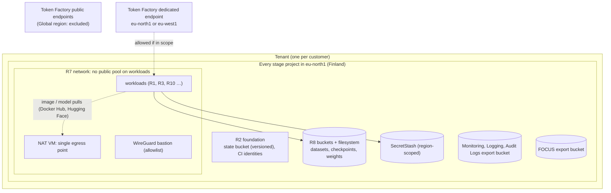

# S7 — EU data residency

| | |
|---|---|
| Composes | [R2](../../terraform/README.md) foundation and lifecycle (projects, state, identities per stage) → [R7](../../terraform/stacks/network/README.md) private perimeter → [R8](../../terraform/stacks/data/README.md) data plane; any workload recipe on top, pinned to an EU region |
| Stage shape | every stage project in one EU region; nothing created outside it |
| Regions (worked example) | `eu-north1` (Finland: H100, H200, L40S) or `eu-west2` (France: B300) |
| Status | designed to the Solution definition of done; **not deployed**; residency of Nebius-side metadata is an open question |
| Dated | 2026-10-11. Prices are live calculator list prices, **an estimate, not a quote** |

## 1. Customer problem

A European customer (health, finance or public sector) must keep training data, model weights,
prompts, outputs, logs and backups in the EU, prove it to an auditor, and still use GPUs. It needs to
know which regions qualify, which Nebius services break residency, what the controls are, and what
residency costs on top of the workload.

## 2. First-call questions

| # | Question | Why it changes the design |
|---|---|---|
| 1 | "EU" or a specific country? Is the UK acceptable? | `uk-south1`/`uk-south2` are in the UK, not the EU; `eu-north2` (Iceland) is private |
| 2 | Which data classes are in scope (training data, prompts, outputs, logs, metadata, billing)? | Nebius-side metadata location is not documented |
| 3 | Which certifications and contract terms (GDPR DPA, ISO, SOC 2) are required, per region? | trust centre lists certifications without per-region scope |
| 4 | GPU type needed? | B300 only in `eu-west2` (EU); H100/H200/L40S in `eu-north1`; RTX PRO 6000 in `eu-south1` |
| 5 | Managed services needed (MLflow, PostgreSQL, Serverless AI)? | `eu-south1` has none of them; `eu-west1` lacks MLflow |
| 6 | Hosted LLM APIs in scope? | Token Factory public endpoints are "Global" |
| 7 | Support access to customer data: allowed from where? | not documented: ask Nebius |
| 8 | Backups and DR: must the second copy also be in the EU? | EU pairs only ([S6](../S6-multi-region-dr/README.md)) |
| 9 | Egress to the internet allowed (image and model pulls)? | R7 NAT is the single egress point; allowlisting destinations is not built |

## 3. Design

### 3.1 Requirements and assumptions

| Kind | Item |
|---|---|
| Fact | Each resource is hosted in a region, "the geographical location of the underlying physical infrastructure"; a project is created per region ([regions](https://docs.nebius.com/overview/regions)) |
| Fact | EU regions: `eu-north1` Finland, `eu-south1` Madrid, `eu-west1` France, `eu-west2` France; `eu-north2` Iceland is private ([regions guide](../../docs/solutions/regions.md#regions-and-locations)) |
| Fact | SecretStash secrets are project-scoped and not readable from another region ([SecretStash](https://docs.nebius.com/mysterybox/overview)) |
| Fact | Shared filesystems attach only within their project ([storage types](https://docs.nebius.com/compute/storage/types#shared-filesystems)) |
| Fact | Audit Logs export is one-time per time range to a bucket in the same region ([export](https://docs.nebius.com/audit-logs/events/export#how-to-export-events)) |
| Fact | Token Factory public endpoints: processing location can change at any time; dedicated endpoints have a fixed, user-selected region ([public serverless](https://docs.tokenfactory.nebius.com/public-serverless)) |
| Fact | Encryption at rest with Nebius-managed keys; no customer-managed keys for disks, filesystems or buckets ([encryption](https://docs.nebius.com/security/encryption)) |
| Fact | Deleted disks and filesystems: immediately; objects: within 4 days ([data deletion](https://docs.nebius.com/overview/data-deletion)) |
| Open | Where control-plane, IAM, billing, monitoring and support data live; per-region certification scope ([gaps](../../docs/solutions/gaps-and-discrepancies.md#docs-silent)) |
| Assumption | Region `eu-north1`; one GPU node as the example workload; the customer accepts Nebius-managed keys with optional client-side envelope encryption (KMS) |

### 3.2 Architecture diagram



### 3.3 Component and dependency mapping

| Control | Recipe / mechanism | Residency effect |
|---|---|---|
| Region pinning | every live root sets `region`; stacks refuse a region missing from [`platform/regions.yaml`](../../platform/regions.yaml) | resources only in the chosen region |
| Projects per stage | R2 foundation ([ADR-0009](../../docs/decisions/0009-environment-and-promotion-model.md)) | one project per stage, all in the EU region |
| Terraform state | R2 state bucket in the stage project ([store state](https://docs.nebius.com/terraform-provider/store-terraform-state)) | state stays in-region |
| Perimeter | R7: no public IPs on workloads, NAT egress, bastion allowlist | one auditable egress address (`nat_public_ip`) |
| Data | R8 buckets and filesystem in the region; Standard class in `eu-north1`, Enhanced Throughput only in `eu-west2` | data at rest in-region |
| Secrets | SecretStash per project | not readable cross-region |
| Logs and audit | Monitoring/Logging per project; Audit Logs export to an in-region bucket | export location chosen by the customer |
| Billing export | R9 periodic FOCUS export to an in-region bucket ([R9](../../recipes/finance/README.md#usage-export-focus)) | billing detail copy in-region |
| Application encryption | KMS envelope encryption of objects or checkpoints (optional) | keys in-region ([KMS](https://docs.nebius.com/kms)) |

### 3.4 Alternatives and tradeoffs

| Option | Gains | Loses |
|---|---|---|
| **A. `eu-north1`** | H100, H200, L40S; MLflow, PostgreSQL, Serverless AI; Standard Object Storage | no B300 |
| B. `eu-west2` | B300 (largest memory per GPU); MLflow, PostgreSQL | Enhanced Throughput only (1 TiB default quota); higher GPU price |
| C. `eu-west1` | H200; PostgreSQL | no MLflow; H200 quota 8 and filesystem 2 TiB by default |
| D. `eu-south1` | RTX PRO 6000 | no InfiniBand, Serverless AI, MLflow, PostgreSQL |
| E. Token Factory dedicated endpoint (`eu-north1`, `eu-west1`) | no GPUs to run | processing region fixed, but Nebius-side handling terms still open |

No ADR is contradicted: residency is a region choice inside the existing stage × stack model.

### 3.5 Security and operational risks

| Item | Design answer |
|---|---|
| A root planned in a non-EU region by mistake | review of `region` in every live root; a conftest rule refusing non-EU regions is proposed, not built |
| Data copied out by a transfer or `rclone` | transfers and copy jobs only to in-region buckets; reviewed in R8 inputs |
| Egress to the internet | NAT is the only path; destination allowlisting is not built (customer firewall or proxy) |
| Audit evidence | Audit Logs (preview, free) need `admin` or `auditlogs.audit-event-viewer` to read ([security](../../docs/security.md#security-acceptance-checklist)) |
| Deletion on exit | delete projects' resources; objects purge within 4 days; a suspended tenant's data is deleted after 60 days |

### 3.6 Terraform/Helm implementation plan

| Step | Stack | Residency-specific input |
|---|---|---|
| 1 | foundation | projects and state buckets in `eu-north1` |
| 2 | `network` | `cidr` per stage; `allowed_cidrs` for the bastion |
| 3 | `data` | `dataset_storage_class` region default; transfer sources inside the EU only |
| 4 | workload stacks | `region = "eu-north1"`; R7/R8 outputs |
| 5 | console | Audit Logs export bucket and FOCUS export bucket in the same region |

### 3.7 PoC acceptance tests

| Criterion | Method |
|---|---|
| Every resource of every stage in the EU region | portal Estate Explorer filtered by region; `scripts/leftovers.sh --stage <s>` lists by label, any non-EU resource is a failure |
| No public IP on workloads, egress through NAT | `tests/validate/network.sh` |
| State, buckets, secrets, exports in-region | Estate Explorer + bucket list per project |
| Audit Logs export lands in the in-region bucket | one export run; recorded in evidence |
| Security checklist | [`docs/security.md`](../../docs/security.md#security-acceptance-checklist) |

### 3.8 Cost assumptions and missing commercial inputs

See [section 6](#6-cost-model). Residency carries no separate line item in the pricing pages read;
its cost is the perimeter VMs and the choice of region and platform.

### 3.9 Handoff and rollback runbook

Residency is preserved by review: the [change management](../../docs/change-management.md) path
plans every stage from git. Teardown: [teardown](../../runbooks/teardown.md); network:
[network runbook](../../runbooks/network.md); data: [data runbook](../../runbooks/data.md).

## 4. Sizing worked example

Residency adds a fixed perimeter per stage project: one NAT VM and one bastion (`cpu-d3 4vcpu-16gb`,
50 GiB each), and the data plane. With prod sizing (2,048 GiB filesystem) and one GPU node as the
workload, the perimeter and data plane are $363.66 a month of the $4,305.66 total in `eu-north1`
(8.4 %); with a B300 node in `eu-west2` the same perimeter is 5.0 % of $7,298.66 (section 6).

## 5. Quota checklist

Names from the live quota listing ([solutions index](../README.md#quota-names-observed-live)).

| Quota (API name) | `eu-north1` need | Default | `eu-west2` note |
|---|---|---|---|
| `compute.instance.non-gpu.vcpu` | 8 (NAT + bastion) | **0** | 200 |
| `compute.instance.gpu.h200` (`compute.instance.gpu.b300` in `eu-west2`) | 1 | 32 | B300 32 |
| `vpc.ipv4-address.public.count` | 2 | 3 | 3 |
| `compute.disk.size.network-ssd` | 100 GiB + workload | 4 TiB | 5 TiB |
| `compute.filesystem.size.network-ssd` | 2,048 GiB | 4 TiB | 5 TiB |
| `storage.bucket.count` | R2 state + R8 ×2 + audit + FOCUS exports | 200 | 200 |
| `storage.bucket.size.standard` / `storage.bucket.size.enhanced-throughput` | datasets, checkpoints | Standard 10 TiB | Enhanced Throughput only, **1 TiB** |
| `mysterybox.secret.count` | per stage | — | — |

## 6. Cost model

Live billing calculator, **2026-10-11**, USD list, **an estimate, not a quote**. Footprints:
[`footprint.json`](footprint.json) (`eu-north1`, priced 09:11:41Z) and
[`footprint-eu-west2.json`](footprint-eu-west2.json) (`eu-west2`, priced 09:11:28Z), 730 h.

```bash
python3 recipes/finance/price.py solutions/S7-eu-data-residency/footprint.json --project <eu-north1 project>
python3 recipes/finance/price.py solutions/S7-eu-data-residency/footprint-eu-west2.json --project <eu-west2 project>
```

| Line | `eu-north1` per month | `eu-west2` per month |
|---|---|---|
| GPU node (1 × H200 1-GPU at $5.40/h; 1 × B300 1-GPU at $9.50/h) | 3,942.00 | 6,935.00 |
| NAT + bastion VMs | 192.72 | 192.72 |
| Edge boot disks 2 × 50 GiB | 7.10 | 7.10 |
| Filesystem 2,048 GiB | 163.84 | 163.84 |
| **On-demand total** | **4,305.66** ($5.8982/h) | **7,298.66** ($9.9982/h) |

Understated: neither footprint prices the GPU node's boot disk. At the 512 GiB that S1 and S6 price
(their `footprint*.json` `gpu-boot-disks`) and the Network SSD list price of $0.071 per GiB per 730 h
(`.cache/nebius-docs/compute/resources/pricing.md:377`), that adds about **$36.35 a month** per region
(arithmetic, not a calculator run).

| Capacity type | Applies? | Note |
|---|---|---|
| On-demand | yes | — |
| Preemptible | only for sandbox work, as any recipe | residency is unaffected by capacity type |
| Reserved | yes for steady workloads | `--contract` returned list prices; addendum rate needed |

Capacity advisor at pricing time: `eu-north1` H200 1-GPU on-demand HIGH (32 of 32); `eu-west2` B300
1-GPU on-demand **LOW** (limit 32), preemptible HIGH (8 of 8); reserved LIMIT_REACHED in both.

Not priced by the calculator: buckets (Standard $0.0147, Enhanced Throughput $0.11 per GiB-month;
[pricing](https://docs.nebius.com/object-storage/resources/pricing)); Audit Logs, SecretStash,
Monitoring and Logging are free while in preview ([PAYG](https://docs.nebius.com/signup-billing/billing-models/payg)).

## 7. Risks and mitigations

| Risk | Mitigation |
|---|---|
| Nebius-side metadata outside the EU (undocumented) | written answer from Nebius before contract; DPA ([DPA](https://docs.nebius.com/legal/dpa)) |
| Certification scope differs by region | confirm per region with the trust centre and account team |
| Token Factory public endpoints used by a developer | block at the egress proxy; policy in the customer's code review |
| Preview services (Audit Logs, Monitoring) change at GA | track the [service stages](https://docs.nebius.com/overview/services#service-and-application-stages) |
| B300 capacity in `eu-west2` (advisor LOW) | reservation, or H200 in `eu-north1` |
| No customer-managed keys | KMS envelope encryption in the application for sensitive objects |

## 8. Delivery steps

1. Discovery (section 2); written residency scope with the customer's DPO.
2. Open questions to Nebius (below) answered in writing.
3. Choose region and platform; price on the day.
4. Foundation and stage projects in the region; quotas.
5. R7 → R8 → workload per stage ([deploy](../../runbooks/deploy.md)); audit and FOCUS exports to in-region buckets.
6. Acceptance tests (section 3.7) with an evidence file for the auditor.

## 9. Portal demo path (Nebius Estate)

| Page | What it shows for S7 |
|---|---|
| Estate Explorer (`/estate`) | every resource with its region and project; public-IP view (only NAT and bastion) |
| Integrations & Coverage (`/integrations`) | every API call the read-only identity makes, and against which regional project |
| Logs (`/logs`) | per-project log buckets (in-region) |
| Costs (`/costs`) | FOCUS rows by region from the in-region export |

## 10. Proven vs not

| Claim | Status | Evidence |
|---|---|---|
| A read-only identity sees per-project resources in each region | proven | [portal live read-only](../../docs/evidence/2026-10-11-portal-live-read-only.md) |
| R7 perimeter (no public IPs, NAT egress) | planned live 2026-10-11, not applied (the NAT VM needs non-GPU vCPU quota) | [live plans](../../docs/evidence/2026-10-11-sandbox-live-plans.md) |
| R2 foundation applied | applied for sandbox 2026-10-11 (IAM only, kept); staging and prod not applied | [foundation](../../docs/evidence/2026-10-11-foundation-ci-federation-live.md) |
| Residency of Nebius-side metadata | **unknown** | — |
| Prices in section 6 | observed live 2026-10-11, list, not a quote | section 6 |

## Open questions for the account team

1. Where are control-plane, IAM, billing, monitoring, logging and support data stored and processed?
2. Certification scope (ISO 27001, SOC 2, others) per region.
3. Can Nebius support staff access customer data, from which locations, and under what process?
4. Token Factory dedicated endpoints: data handling and logging location.
5. Customer-managed keys (BYOK/CMEK) roadmap.
