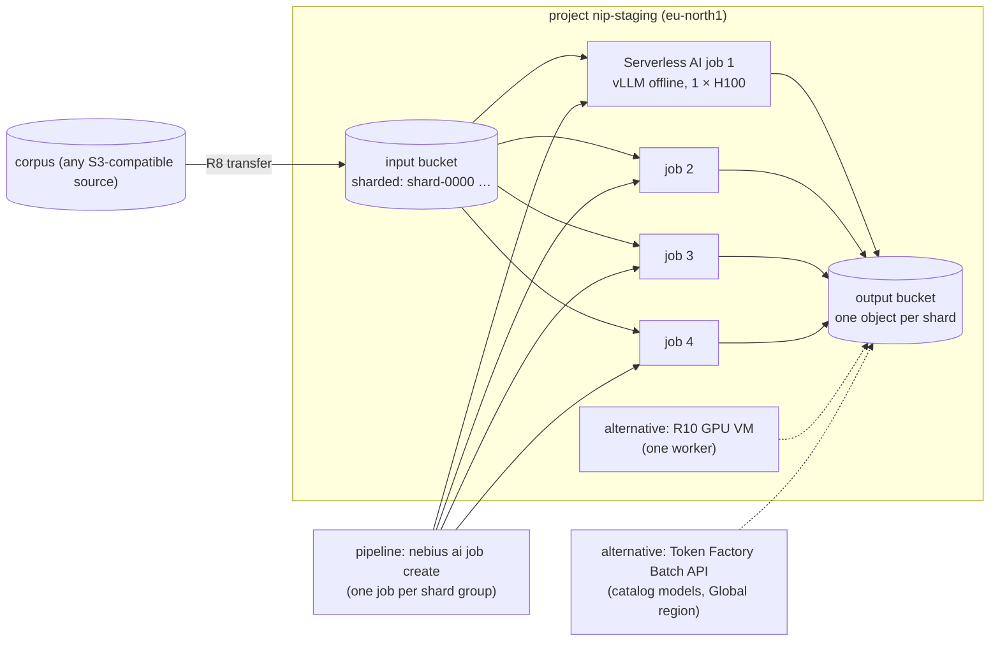

# S8 — Batch inference

| | |
|---|---|
| Composes | [R8](../../terraform/stacks/data/README.md) data (inputs and outputs) → [R6](../../recipes/serverless/README.md) Serverless AI jobs (parallel workers) or [R10](../../terraform/stacks/gpu-vm/README.md) one GPU VM; [R11](../../recipes/token-factory/README.md) Batch API as the no-GPU alternative |
| Stage shape | batch jobs run outside the stage serving policy: Serverless AI jobs in a sandbox or staging project; R10 has sandbox and staging roots only |
| Region (worked example) | `eu-north1` (Serverless AI, H100, H200, L40S) |
| Status | designed to the Solution definition of done; **not deployed**; no throughput measured, so GPU-hours are a formula until `job.sh` runs |
| Dated | 2026-10-11. Prices are live calculator list and spot prices, **an estimate, not a quote** |

## 1. Customer problem

A customer has a large corpus (documents, tickets, transcripts) to summarise, classify or embed with
an open model, once or every night. Nobody waits on a single request; what matters is the cost per
million tokens and finishing before a deadline. Interruptions are acceptable if work is not lost.

## 2. First-call questions

| # | Question | Why it changes the design |
|---|---|---|
| 1 | Corpus size: documents, input tokens, expected output tokens | GPU-hours = tokens ÷ throughput |
| 2 | Model and precision; must it be their own weights? | Token Factory Batch API (catalog models) vs own container |
| 3 | Deadline and frequency (one-off, nightly) | worker count; preemptible vs on-demand |
| 4 | Where is the corpus, and may outputs leave the region? | R8 transfer; Token Factory public endpoints are "Global" |
| 5 | Tolerance for interruptions; can work be sharded and retried? | preemptible workers with idempotent shards |
| 6 | Existing tokens/s measurement on their model | otherwise the first step is a measurement job |
| 7 | Who runs it: a pipeline, a person, a scheduler? | Serverless AI job CLI from CI vs a cluster |

## 3. Design

### 3.1 Requirements and assumptions

| Kind | Item |
|---|---|
| Fact | Serverless AI jobs run a container to completion on Compute container VMs, at Compute prices, with Compute quotas; regular or preemptible ([platforms](../../docs/solutions/platforms.md#serverless-ai), [pricing and quotas](https://docs.nebius.com/serverless/pricing-quotas)) |
| Fact | Jobs mount a bucket or filesystem with `--volume`; timeout 1–168 h; `ERROR` with `NotEnoughResources` after 30 min of provisioning; `--restart-policy on-failure` opt-in ([jobs](https://docs.nebius.com/serverless/jobs/manage#how-to-create-a-job), [lifecycle](https://docs.nebius.com/serverless/lifecycle#job-statuses)) |
| Fact | R6 `job.sh` runs `vllm bench throughput` as a serverless job with the pinned vLLM image and records req/s and output tokens/s ([R6](../../recipes/serverless/README.md#what-it-runs)) |
| Fact | R10 is one VM with a pinned vLLM server, sandbox and staging only ([R10](../../terraform/stacks/gpu-vm/README.md)) |
| Fact | Token Factory's Batch API has "significantly higher limits" than real-time ([R11 rate limits](../../recipes/token-factory/README.md#rate-limits)) |
| Fact | Enhanced Throughput buckets: no request or egress charges ([pricing](https://docs.nebius.com/object-storage/resources/pricing)) |
| Assumption | Worked corpus: 2 M documents × 1,000 input + 200 output tokens = 2.0 B input + 0.4 B output tokens; deadline 24 h |
| Assumption | 4 parallel workers on `gpu-h100-sxm 1gpu-16vcpu-200gb`, sharded input |
| Open | Tokens/s per worker on the customer's model (measured by step 2 of the delivery) |
| Open | Batch API price |

### 3.2 Architecture diagram



### 3.3 Component and dependency mapping

| Component | Recipe / path | Key inputs | Docs |
|---|---|---|---|
| Input and output buckets | R8 `terraform/stacks/data` | `transfer` from the source; `dataset_storage_class` (Enhanced Throughput avoids request charges) | [storage classes](https://docs.nebius.com/object-storage/storage-classes) |
| Throughput measurement | R6 `recipes/serverless/job.sh` | `PLATFORM`, `PRESET`, `MODEL`, `MODEL_REVISION` | [jobs](https://docs.nebius.com/serverless/jobs/manage) |
| Batch workers | Serverless AI jobs (one per shard group), same pinned image | `--volume <bucket>:/data`, preemptible or regular, `--restart-policy on-failure` | [auto-restarts](https://docs.nebius.com/serverless/jobs/auto-restarts) |
| Single-VM alternative | R10 `terraform/stacks/gpu-vm` | `existing_filesystem_id`; a batch client calling `127.0.0.1:8000` | [host a model on a VM](https://docs.nebius.com/compute/quickstart-host-model) |
| Spend control | R9 budget on the project; spot cap for preemptible VMs | — | [pricing policies](https://docs.nebius.com/signup-billing/pricing-policy#pricing-policies) |

### 3.4 Alternatives and tradeoffs

| Option | Gains | Loses | ADR |
|---|---|---|---|
| **A. Serverless AI jobs, sharded, preemptible** | no cluster; parallel; per-second billing; spot price | capacity wait (up to 30 min, then `ERROR`); no published service level | [ADR-0001](../../docs/decisions/0001-kubernetes-vs-serverless.md) |
| B. Same on regular VMs | no preemption | the H100 GPU line costs 5.7 × its spot price at pricing time ($4.50 vs $0.79) | — |
| C. R10 GPU VM | simplest, one VM, model cached on R8 filesystem | one worker; sandbox/staging only | — |
| D. R1 cluster with a preemptible node group and Jobs | Kubernetes tooling, many workers | a cluster to run; preemptible only in sandbox | [ADR-0007](../../docs/decisions/0007-capacity-on-demand-vs-preemptible.md) |
| E. Token Factory Batch API | no GPUs; higher limits | catalog models only; region "Global"; price not documented | — |

### 3.5 Security and operational risks

| Item | Design answer |
|---|---|
| Corpus contains personal data | keep buckets in-region ([S7](../S7-eu-data-residency/README.md)); no Token Factory public endpoints |
| Access keys for buckets | service-account access keys from SecretStash, injected as secret env vars, never in the job spec |
| Duplicate or lost shards on retry | idempotent shards: output object per input shard, skip if present |
| Jobs left running | timeout (default 24 h) on every job; jobs end on completion |
| Failed custom-image job deletes its VM | keep a `sleep` on failure for debugging only ([failure](https://docs.nebius.com/serverless/jobs/failure)) |

### 3.6 Terraform/Helm implementation plan

| Step | What | Command |
|---|---|---|
| 1 | buckets and transfer | `make plan apply STAGE=staging STACK=data` |
| 2 | measure throughput on one worker | `recipes/serverless/job.sh` with `PLATFORM=gpu-h100-sxm PRESET=1gpu-16vcpu-200gb` and the customer model |
| 3 | size workers (section 4) | arithmetic |
| 4 | run shard groups as jobs | `nebius ai job create … --volume …` per group (scripted in the customer pipeline; not in this repository) |
| 5 | verify outputs; delete jobs | object count per shard |

### 3.7 PoC acceptance tests

| Criterion | Threshold | Method |
|---|---|---|
| Measured throughput | recorded with versions | `job.sh` result JSON; `compare.py` evidence file ([R6](../../recipes/serverless/README.md#quotas-cost-run-validate)) |
| Completeness | outputs = input shards | object count in the output bucket |
| Deadline | corpus done within the window | wall time of the run |
| Cost | within the estimate ± 20 % | FOCUS rows of the project for the run |
| Preemption resilience | a stopped worker's shard group re-runs and finishes | restart policy; recorded once |

### 3.8 Cost assumptions and missing commercial inputs

See [section 6](#6-cost-model). Missing: measured tokens/s, Batch API price, spot price behaviour over the run.

### 3.9 Handoff and rollback runbook

Nothing to roll back: a failed shard is re-run. Delete finished jobs; keep the output bucket under a
lifecycle rule. Serverless debugging: [Serverless failure](https://docs.nebius.com/serverless/jobs/failure);
R10: [gpu-vm runbook](../../runbooks/gpu-vm.md); data: [data runbook](../../runbooks/data.md).

## 4. Sizing worked example

Throughput is the unknown; the arithmetic is fixed.

| Step | Formula / value |
|---|---|
| Work | 2.0 B input + 0.4 B output tokens |
| GPU-hours | output tokens ÷ (measured output tokens/s per GPU × 3,600), with prompt processing included in the measurement |
| Workers for a 24 h deadline | GPU-hours ÷ 24, rounded up |
| Example only (not a measurement): if one H100 produced X output tokens/s | GPU-hours = 400 M ÷ (3,600 X); at X = 1,000 that is 111 GPU-hours → 5 workers for 24 h. The priced footprint in section 6 is 4 workers × 24 h = 96 GPU-hours, which covers X ≈ 1,160; at X = 1,000 scale its cost by 5/4 |
| Cost per run, preemptible (spot at pricing time) | GPU-hours × $0.79 + disks + filesystem |
| Cost per run, on-demand | GPU-hours × $4.50 + the same |
| Per million output tokens | run cost ÷ 400 |

`X = 1,000` is a placeholder to show the arithmetic; replace it with the `job.sh` result before any
number reaches a customer ([evidence rules](../../docs/evidence/README.md)).

## 5. Quota checklist

Names from the live quota listing ([solutions index](../README.md#quota-names-observed-live)). Serverless AI has no quotas of its own: Compute quotas apply.

| Quota (API name) | Need (4 workers, `eu-north1`) | Default | Action |
|---|---|---|---|
| `compute.instance.preemptible.count` | 4 (preemptible workers) | 8 | ok |
| `compute.instance.gpu.h100` | 4 (regular workers) | 32 | ok |
| `compute.instance.count` | 4 (regular workers) | 12 | ok |
| `compute.disk.size.network-ssd` | 800 GiB (4 × 200 container disks) | 4 TiB | ok |
| `compute.filesystem.size.network-ssd` | 1,024 GiB (optional staging filesystem) | 4 TiB | ok |
| `storage.bucket.size.standard` (or `storage.bucket.size.enhanced-throughput`) | corpus + outputs | 10 TiB (Enhanced Throughput 1 TiB) | check |
| `vpc.ipv4-address.public.count` | 0, or 1 per job with an SSH key | 3 | do not add SSH keys at scale |
| `storage.transfer.count` | 1 | — | ok |

## 6. Cost model

Live billing calculator, `eu-north1`, USD, **an estimate, not a quote**. Footprints:
[`footprint.json`](footprint.json) (4 × H100 1-GPU workers for 24 h, priced **2026-10-11T09:12:10Z**) and
[`footprint-rates.json`](footprint-rates.json) (a rate card, one unit of each candidate for one hour, priced
**2026-10-11T09:11:54Z**; its scenario total is meaningless, read the lines).

```bash
python3 recipes/finance/price.py solutions/S8-batch-inference/footprint-rates.json --project "$NEBIUS_PROJECT_ID"
python3 recipes/finance/price.py solutions/S8-batch-inference/footprint.json --project "$NEBIUS_PROJECT_ID" --advice --tenant "$NEBIUS_TENANT_ID"
```

Rate card (per hour, one VM):

| Candidate | On-demand | Preemptible (H100/H200: spot at 09:11:54Z; L40S: fixed preemptible price, not spot-priced, `.cache/nebius-docs/compute/resources/pricing.md:29`) | Ratio |
|---|---|---|---|
| `gpu-l40s-a 1gpu-8vcpu-32gb` | 1.5484 | 0.7492 | 48 % |
| `gpu-h100-sxm 1gpu-16vcpu-200gb` | 4.5000 | 0.7900 | 18 % |
| `gpu-h200-sxm 1gpu-16vcpu-200gb` | 5.4000 | 0.7900 | 15 % |
| `gpu-h100-sxm 8gpu-128vcpu-1600gb` | 36.0000 | 6.3200 | 18 % |

Worked footprint (4 workers × 24 h):

| Scenario | Per hour | Per 24 h run |
|---|---|---|
| On-demand | 18.1900 | **436.56** |
| Preemptible (GPU lines at spot) | 3.3500 | **80.40** |
| Reserved | not sensible for a batch run; a commitment pays for every hour of its term | — |

Capacity advisor at pricing time: H100 1-GPU on-demand HIGH (32 of 32) and preemptible HIGH (7 of 8)
on every `eu-north1` fabric; L40S 1-GPU on-demand MEDIUM (8 of 32), preemptible HIGH (7 of 8).

Token Factory comparison (real-time list prices at 09:12:58Z; Batch API price not documented): the
worked corpus on `Qwen/Qwen3-30B-A3B-Instruct-2507` lists at 2,000 × $0.10 + 400 × $0.30 = **$320**;
on `nvidia/Nemotron-3_5-Lightning` at 2,000 × $0.06 + 400 × $0.24 = **$216**
([S3](../S3-llm-api-token-factory/README.md#6-cost-model)).

## 7. Risks and mitigations

| Risk | Mitigation |
|---|---|
| Throughput far below the placeholder | measure first (`job.sh`); size workers from the measurement |
| Preemptible capacity absent near the deadline | start early; switch late shards to regular VMs |
| Job `ERROR` after 30 min of provisioning | retry in another preset or region; on-demand fallback |
| Request charges on Standard buckets for many small objects | Enhanced Throughput class or larger shards |
| Output leaves the region via Token Factory | use self-hosted workers when residency applies |

## 8. Delivery steps

1. Discovery (section 2): corpus, model, deadline.
2. R8 buckets and transfer; shard the corpus ([data runbook](../../runbooks/data.md)).
3. One measurement job (`job.sh`) on the candidate preset; evidence file.
4. Size workers and price on the day; spend approval.
5. Run shard groups; monitor job states (`nebius ai job list`, portal AI services).
6. Verify completeness; delete jobs; FOCUS check per run.

## 9. Portal demo path (Nebius Estate)

| Page | What it shows for S8 |
|---|---|
| AI services (`/ai-services`) | Serverless AI endpoints and jobs, their states |
| Estate Explorer (`/estate`) | buckets and transfers of the run |
| Commercial Scenarios (`/commercial`) | the rate card candidates at live list prices |
| Costs (`/costs`) | the run's cost by service and resource from FOCUS rows |

## 10. Proven vs not

| Claim | Status | Evidence |
|---|---|---|
| A vLLM-on-B300 vs serverless comparison was attempted once | harness cost estimate only; no method or figure may be quoted | [costs](../../docs/evidence/costs.md#runs-with-a-cost-estimate-only) |
| `job.sh` / `compare.py` | not run | [R6](../../recipes/serverless/README.md#evidence) |
| Batch throughput, cost per million tokens | **none measured** | — |
| Rate card prices | observed live 2026-10-11, list and spot, not a quote | section 6 |

## Open questions for the account team

1. Token Factory Batch API: price and turnaround.
2. Serverless AI: is there a limit on concurrent jobs beyond Compute quotas?
3. Spot price behaviour for H100 1-GPU over a 24 h window (history).
