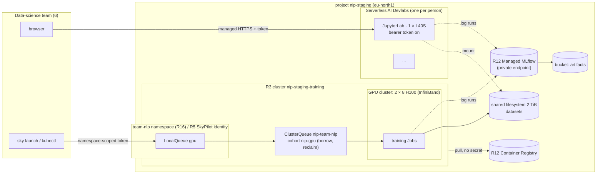

# S9 — Notebooks for a data-science team

| | |
|---|---|
| Composes | [R12](../../terraform/stacks/ml-services/README.md) registry, MLflow → [R5](../../recipes/team-platform/README.md) team namespace and SkyPilot → [R16](../../workloads/kueue/README.md) Kueue queues with topology-aware placement on an [R3](../../terraform/stacks/training/README.md) GPU cluster; interactive notebooks on Serverless AI Devlabs |
| Stage shape | staging-shaped team platform (on-demand GPUs, alerts on); notebooks per person |
| Region (worked example) | `eu-north1` (Serverless AI, MLflow, L40S, H100) |
| Status | designed to the Solution definition of done; **not deployed**; R12 applied in sandbox (registry and node pulls checked, MLflow check failed); R3 planned, not applied; R5 and R16 have no live run |
| Dated | 2026-10-11. Prices are live calculator list prices, **an estimate, not a quote** |

## 1. Customer problem

A data-science team of six wants notebooks with a GPU when they need one, a shared place to track
experiments and register models, and a way to send a bigger training job to a shared GPU pool without
waiting for someone to free a node by hand. The platform team wants each person's cost visible, idle
GPUs stopped, and no one able to take the whole pool.

## 2. First-call questions

| # | Question | Why it changes the design |
|---|---|---|
| 1 | Team size, working hours, time zones | Devlab hours; idle cost |
| 2 | Notebook GPU needs: small (L40S 48 GB) or large (H100/H200)? | Devlab preset |
| 3 | Size and frequency of training jobs; multi-node? | shared pool size; R16 topology (InfiniBand) |
| 4 | Experiment tracking today (MLflow, W&B)? Model registry? | R12 Managed MLflow |
| 5 | Data location and size; shared datasets? | filesystem vs bucket mounts |
| 6 | Isolation between people and teams (namespace, project, tenant)? | R5/R16 namespaces vs projects |
| 7 | Chargeback: per person, per team? | labels reach Compute only; Devlabs are not labelled by these recipes |
| 8 | SSO and access to notebooks from the internet? | Devlab URL is managed HTTPS; token auth is optional |

## 3. Design

### 3.1 Requirements and assumptions

| Kind | Item |
|---|---|
| Fact | Devlabs run a container image (custom or template such as JupyterLab) as an interactive environment on a Compute container VM; data under the workspace path persists across stop and restart; while stopped the container disk is still billed ([Devlabs](https://docs.nebius.com/serverless/devlabs/manage#how-to-create-a-devlab), [pricing and quotas](https://docs.nebius.com/serverless/pricing-quotas)) |
| Fact | Without bearer-token authentication anyone with a Devlab URL can reach it ([Devlabs](https://docs.nebius.com/serverless/devlabs/manage#how-to-create-a-devlab)) |
| Fact | An SSH key on a Devlab allocates a public address and spends public-IP quota (default 3 per region) ([pricing and quotas](https://docs.nebius.com/serverless/pricing-quotas)) |
| Fact | R16 queues admit jobs into team shares with cohort borrowing and reclaim, and place multi-node jobs in one GPU cluster; it needs R3 InfiniBand GPU nodes ([R16](../../workloads/kueue/README.md#outputs-and-composition)) |
| Fact | R5 gives a team namespace, a namespace-scoped `skypilot` identity and SkyPilot 0.12.2 as the submission tool; written for the R1 cluster ([R5](../../recipes/team-platform/README.md)) |
| Fact | R12 adds Container Registry, a node pull identity and Managed MLflow (`medium`, the only size) ([R12](../../terraform/stacks/ml-services/README.md)) |
| Assumption | 6 people, Devlabs on `gpu-l40s-a 1gpu-8vcpu-32gb`, 8 h × 22 days = 176 h each a month, 200 GiB container disk each; shared pool 2 × 8 H100 on one GPU cluster, all month |
| Open | Whether a Devlab in the stage network reaches MLflow's private endpoint (same network is expected; not tested) |
| Open | SkyPilot submitting into Kueue LocalQueues on the R3 cluster: R16 says it can; the R5 config targets R1 and needs a change |

### 3.2 Architecture diagram



### 3.3 Component and dependency mapping

| Component | Recipe / path | Key inputs | Docs |
|---|---|---|---|
| Registry, node identity, MLflow | R12 `terraform/stacks/ml-services` | `enable_mlflow = true`, `secret_id` | [MLflow quickstart](https://docs.nebius.com/mlflow/quickstart) |
| Shared GPU pool | R3 `terraform/stacks/training` | `gpu_platform = "gpu-h100-sxm"`, `gpu_node_count = 2`, `enable_gpu_cluster = true`, `node_service_account_id` | [GPU clusters](https://docs.nebius.com/compute/clusters/gpu) |
| Queues and placement | R16 `workloads/kueue` (`install.sh`, staging overlay) | team share = half the stage cap in the shipped overlay; one team here takes a nominal share and borrows the rest | [topology-aware scheduling](https://docs.nebius.com/kubernetes/gpu/topology-aware-scheduling) |
| Submission UX | R5 `recipes/team-platform` | `allowed_contexts` = the R3 cluster; GPU lines removed from the namespace ResourceQuota (Kueue is the cap); queue label on tasks | [SkyPilot on MK8s](https://docs.nebius.com/kubernetes/skypilot) |
| Notebooks | Serverless AI Devlabs (console or `nebius ai devlab create`), not scripted in this repository | template JupyterLab, `gpu-l40s-a`, token auth on, no SSH key, filesystem mount | [Devlabs quickstart](https://docs.nebius.com/serverless/quickstart/devlabs) |
| Observability | R14 + `modules/o11y` | idle-GPU rule | [R14](../../recipes/observability/README.md) |

### 3.4 Alternatives and tradeoffs

| Option | Gains | Loses |
|---|---|---|
| **A. Devlabs + shared R3/R16 pool + R12** | notebooks stop when idle; fair GPU sharing; tracked experiments | two surfaces (Devlabs and the cluster); Devlabs not managed by Terraform here |
| B. Standalone JupyterLab application | one-click app, 95 % service level ([applications](https://docs.nebius.com/applications); the SLA page is not in the offline docs cache, so unverified offline) | only `eu-north1` and `us-central1`; per-app billing |
| C. Notebooks as pods in the team namespace (JupyterHub on R1/R3) | one surface, Kubernetes RBAC | JupyterHub is not in this repository; idle GPUs held by pods |
| D. Managed SkyPilot API Server | no local kubeconfig, discovers clusters | does not give the per-namespace Role and quota split by itself ([R5](../../recipes/team-platform/README.md#quotas-cost-run-validate)) |
| E. Smaller pool: 1 × 8 H100 | half the pool cost | no multi-node jobs; R16 topology then trivially one node |

ADRs touched: [ADR-0004](../../docs/decisions/0004-storage-design.md) (shared filesystem as cache,
buckets as record), [ADR-0006](../../docs/decisions/0006-reconciler-ownership.md) (Kueue objects
applied with `kubectl`, not Terraform).

### 3.5 Security and operational risks

| Item | Design answer |
|---|---|
| Devlab URL reachable by anyone who has it | bearer-token authentication on every Devlab (token in SecretStash) |
| Public-IP quota spent by SSH keys | no SSH keys on Devlabs (3 public IPs per region by default) |
| Team escapes its namespace | R5 Role grants no write on RBAC objects; the operator kubeconfig is never shared ([R5](../../recipes/team-platform/README.md#one-workload-end-to-end)) |
| RWX filesystem readable across PVCs | namespaces and RBAC on PVC creation ([ADR-0004](../../docs/decisions/0004-storage-design.md)) |
| Borrowed GPUs reclaimed mid-job | jobs checkpoint; `reclaimWithinCohort: Any` is the guarantee of a share ([R16](../../workloads/kueue/README.md)) |
| MLflow public endpoint | private in staging and prod by stage policy ([R12](../../terraform/stacks/ml-services/README.md#what-it-builds)) |

### 3.6 Terraform/Helm implementation plan

| Step | Command | Expect |
|---|---|---|
| 1 | `make plan apply STAGE=staging STACK=ml-services` (`enable_mlflow = true`) | registry, node SA, MLflow |
| 2 | `make plan apply STAGE=staging STACK=data` | filesystem + buckets |
| 3 | `make plan apply STAGE=staging STACK=training` with `gpu_node_count = 2`, `node_service_account_id`, `existing_filesystem_id` | GPU cluster + 2 × 8 H100 |
| 4 | `workloads/kueue/install.sh`; `kubectl apply -k workloads/kueue/overlays/staging` | queues `Active` ([team scheduling](../../runbooks/team-scheduling.md#install-and-configure)) |
| 5 | R5 SkyPilot config pointed at the R3 context; tasks carry `kueue.x-k8s.io/queue-name: gpu` | a change to R5's files (integrator) |
| 6 | Devlabs per person (console/CLI), token on, filesystem mounted | — |

### 3.7 PoC acceptance tests

| Criterion | Method |
|---|---|
| Queues admit and place | R16 sample job admitted with both pods in one GPU cluster ([team scheduling → validate](../../runbooks/team-scheduling.md#validate)) |
| Borrow and reclaim | a second team's job borrows, then is reclaimed (same runbook) |
| SkyPilot task through the queue | `sky launch` lands in `team-nlp`, waits in the queue, runs |
| Notebook to MLflow | a Devlab logs a run to the private MLflow endpoint |
| Registry pulls without secrets | node pulls an image pushed to the registry ([ml-services → validate](../../runbooks/ml-services.md#validate)) |
| Idle cost | stopped Devlabs bill only their disks: FOCUS rows after a stop |

### 3.8 Cost assumptions and missing commercial inputs

See [section 6](#6-cost-model). Missing: the team's real working hours, the pool's real utilisation, reserved rate for the pool.

### 3.9 Handoff and rollback runbook

The platform team owns R3/R12/R16 objects and the shares; the data-science team owns Devlabs,
notebooks and jobs inside its namespace ([R5 boundary](../../recipes/team-platform/README.md#one-workload-end-to-end)).
Shares: [team scheduling → add a team or change a share](../../runbooks/team-scheduling.md#add-a-team-or-change-a-share).
MLflow restore and teardown: [ml-services](../../runbooks/ml-services.md). Kueue teardown:
[team scheduling → teardown](../../runbooks/team-scheduling.md#teardown).

## 4. Sizing worked example

| Item | Value |
|---|---|
| Devlab hours | 6 people × 8 h × 22 days = **1,056 GPU-hours** of L40S a month |
| Devlab disks | 6 × 200 GiB, billed all 730 h (running or stopped) |
| Pool | 2 × 8 H100 = 16 GPUs, 11,680 GPU-hours a month; R16 staging overlay gives each of two teams 32 nominal GPUs, so one team borrows within the cohort up to the 16 that exist |
| Pool per GPU-hour actually used | $4.50 list ÷ utilisation: at 40 % busy, $11.25 per used GPU-hour |
| Break-even for a smaller pool | if peak demand fits 8 GPUs, option E halves the pool line ($26,280 instead of $52,560 a month) |
| MLflow | one `medium` cluster (8 vCPU, 32 GiB, 200 GiB) for its whole life |

## 5. Quota checklist

Names from the live quota listing ([solutions index](../README.md#quota-names-observed-live)).

| Quota (API name) | Need (staging, `eu-north1`) | Default | Action |
|---|---|---|---|
| `compute.instance.gpu.l40s` | 6 | 32 | ok |
| `compute.instance.gpu.h100` | 16 | 32 | ok |
| `compute.gpucluster.count` | 1 | 5 | ok |
| `compute.instance.count` | 11 (6 Devlabs + 2 GPU + 3 CPU nodes) | 12 regular GPU VMs / 12 non-GPU VMs | close to the limit: check the mapping |
| `compute.instance.non-gpu.vcpu` | 24 | **0** in `eu-north1` | **request** |
| `compute.disk.size.network-ssd` | 3,655 GiB (6 × 200 + 2 × 1,023 + 3 × 128 + 25) | 4 TiB | close: request headroom |
| `compute.filesystem.size.network-ssd` | 2,048 GiB | 4 TiB | ok |
| `mk8s.cluster.count` | 1 | 2 | ok |
| `msp.mlflow.count`, `msp.mlflow.cpu`, `msp.mlflow.ram`, `msp.mlflow.disk.size.network-ssd` | 1, 8, 32 GiB, 200 GiB | 10, 80, 320 GiB, 1.95 TiB | ok |
| `registry.count` | 1 | 10 | ok |
| `vpc.ipv4-address.public.count` | 0 (no SSH keys on Devlabs) | 3 | keep at 0 |

## 6. Cost model

Live billing calculator, `eu-north1`, **2026-10-11T09:12:20Z**, USD list, footprint
[`footprint.json`](footprint.json). Hours per line are the month's hours that resource exists
(Devlabs 176 h each, everything else 730 h), so the "per run" figure is the monthly figure.
**An estimate, not a quote.**

```bash
python3 recipes/finance/price.py solutions/S9-data-science-notebooks/footprint.json \
  --project "$NEBIUS_PROJECT_ID" --contract --advice --tenant "$NEBIUS_TENANT_ID"
```

| Line | Per hour while running | Per month |
|---|---|---|
| 6 Devlabs, `gpu-l40s-a 1gpu-8vcpu-32gb` ($1.5484 each), 176 h | 9.2904 | 1,635.11 |
| 6 Devlab disks, 200 GiB, 730 h | 0.1167 | 85.17 |
| Pool 2 × `gpu-h100-sxm 8gpu-128vcpu-1600gb` ($36.00 each), 730 h | 72.0000 | 52,560.00 |
| Pool boot disks 2 × 1,023 GiB | 0.1989 | 145.21 |
| 3 × `cpu-d3 8vcpu-32gb` + boot disks | 0.8293 | 605.41 |
| Shared filesystem 2,048 GiB | 0.2244 | 163.84 |
| **On-demand total** | — | **55,194.74** |
| Managed MLflow `medium` (pricing page, not the calculator) | 0.48 + disk | ≈ 364 ([R12](../../terraform/stacks/ml-services/README.md#quotas-and-cost)) |

| Capacity type | Applies? | Note |
|---|---|---|
| On-demand | yes | as above |
| Preemptible | not for the pool in staging (stage policy); Devlabs: whether a Devlab can be preemptible is not stated on the Devlab page | the L40S spot price was $0.7492/h at 09:11:54Z ([S8 rate card](../S8-batch-inference/README.md#6-cost-model)) |
| Reserved | yes for the pool if it is busy most of the month | `--contract` returned list prices; addendum rate needed; break-even utilisation = contract ÷ on-demand |

Capacity advisor at pricing time: `gpu-h100-sxm 8gpu` on-demand HIGH (4 of 4) on `fabric-4`, MEDIUM on
`fabric-3` (the repository default), LOW on `fabric-2` and `fabric-6`; `gpu-l40s-a 1gpu` on-demand MEDIUM
(8 of 32). Set `infiniband_fabric` from the advisor on the day.

## 7. Risks and mitigations

| Risk | Mitigation |
|---|---|
| Pool idle most of the time (the largest line) | Fleet idle-GPU rule; option E; or scale `gpu_node_count` with the team calendar (a reviewed change each time) |
| Devlabs left running | stop at end of day; budget alert on the project; Fleet shows idle GPUs |
| Kueue does not see SkyPilot tasks | queue label on every task; validate in staging |
| MLflow unreachable from Devlabs | put Devlabs in the stage network and subnet; test first |
| Chargeback per person | Devlab names per person; FOCUS by resource; labels reach Compute only ([cost](../../docs/cost.md#required-labels)) |
| Non-GPU vCPU quota 0 in `eu-north1` | request before step 1 |

## 8. Delivery steps

1. Discovery (section 2); choose pool size (A or E).
2. Quotas; price on the day; spend approval.
3. R12 → R8 → R3 ([deploy](../../runbooks/deploy.md), [ml-services](../../runbooks/ml-services.md)).
4. R16 install and staging overlay ([team scheduling](../../runbooks/team-scheduling.md)).
5. R5 namespace identity and SkyPilot config for the R3 context.
6. Devlabs per person with token auth; MLflow connection test.
7. Acceptance (section 3.7); evidence file; handoff.

## 9. Portal demo path (Nebius Estate)

| Page | What it shows for S9 |
|---|---|
| Estate Explorer (`/estate`) | Devlabs, the cluster, MLflow, registry and filesystem in the project |
| Workloads (`/workloads`) | team namespace jobs, their requests and scheduling messages (pending in a queue vs running) |
| GPU & Capacity (`/capacity`) | pool GPUs present vs requested vs measured utilisation |
| Fleet (`/fleet`), Alerts (`/alerts`) | idle GPUs in the pool and on Devlabs |
| AI services (`/ai-services`) | Serverless AI endpoints and jobs; Devlabs themselves are inventoried in Estate Explorer (type DevLabs) |
| Costs (`/costs`), Budgets & credits (`/budgets`) | spend per resource and the team budget |

## 10. Proven vs not

| Claim | Status | Evidence |
|---|---|---|
| MK8s GPU node hands a GPU to pods; portal reads the cluster | proven (sandbox, L40S) | [sandbox populate](../../docs/evidence/2026-10-11-sandbox-inference-populate.md) |
| R16 Kueue queues and topology placement | not run (static checks only) | [R16](../../workloads/kueue/README.md#evidence) |
| R5 namespaces and SkyPilot | not run (manifests build in CI) | [R5](../../recipes/team-platform/README.md#evidence) |
| R12 registry pulls | proven 2026-10-12 in sandbox: push and pull, node pull with no pull secret | [ML services acceptance](../../docs/evidence/2026-10-12-sandbox-ml-services-acceptance.md) |
| R12 Managed MLflow | applied in sandbox 2026-10-11 and 2026-10-12; the client check failed (cause unknown) | [ML services acceptance](../../docs/evidence/2026-10-12-sandbox-ml-services-acceptance.md) |
| Devlabs | not created by this repository | — |
| Prices in section 6 | observed live 2026-10-11, list, not a quote | section 6 |

## Open questions for the account team

1. Can Devlabs run on preemptible capacity, and are they covered by any service level?
2. Can a Devlab reach Managed MLflow's private endpoint in the same network?
3. Reserved rate for a 2 × 8 H100 pool on `fabric-4`, 12 months.
4. Managed SkyPilot API Server price and whether it can target namespaces and Kueue queues.
