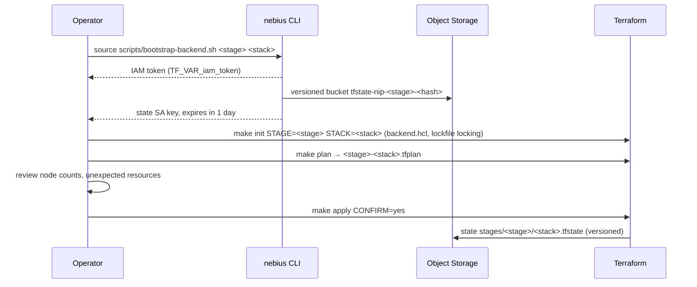

# Layer 1 — Infrastructure (Terraform)

Canonical home for the Terraform layout, remote state and authentication. Two axes
([ADR-0009](../docs/decisions/0009-environment-and-promotion-model.md)): a **stack** is a
stage-agnostic root module, a **stage** is a Nebius project with its own state, identities and
policy, and a **live root** per (stage, stack) wires the two together. Picture:
[`docs/architecture.md`](../docs/architecture.md#stage--stack--foundation).

This directory is recipe **R2** (foundation and lifecycle).
**Used by.** [S7](../solutions/S7-eu-data-residency/README.md) EU data residency; every live root needs its
state bucket and identities ([all solutions](../solutions/README.md)).

Status: `live/foundation` and `modules/stage-policy` are mocked-tested. The sandbox foundation
was applied on 2026-10-11 (IAM and adopted bootstrap resources; [evidence](../docs/evidence/2026-10-11-foundation-ci-federation-live.md)).
Staging and prod foundation applies remain unmeasured. Quota and cost: no compute; one versioned bucket per stage plus the foundation's own,
against a default of 200 buckets per tenant (`.cache/nebius-docs/object-storage/resources/quotas-limits.md:16`),
billed as Object Storage for the state objects and their non-current versions (no figure recorded).

## Layout

```
terraform/
  modules/
    network/              look up an existing subnet (by id or name); R7 builds its own
    mk8s-cluster/         Managed Kubernetes control plane (nebius_mk8s_v1_cluster)
    node-group/           CPU or GPU node group: drivers preset, spot pricing, reservation, rollout strategy, cloud-init mounts
    filestore/            shared filesystem (nebius_compute_v1_filesystem)
    filestore-csi/        csi-mounted-fs-path Helm chart (shared filesystem as a StorageClass)
    device-plugin/        NVIDIA device plugin + DCGM exporter (Marketplace)
    gpu-operator/         NVIDIA GPU Operator (Marketplace, opt-in, ADR-0003)
    network-operator/     NVIDIA Network Operator (Marketplace, opt-in, ADR-0003)
    gpu-cluster/          InfiniBand GPU cluster (nebius_compute_v1_gpu_cluster)
    o11y/                 Prometheus + Grafana and the Nebius observability agent (Marketplace)
    stage-policy/         the only home of stage rules: resolves platform/stages.yaml, returns violations
    foundation/
      state-bucket/       versioned state bucket with a non-current-version retention rule
      state-identity/     project group + service account + bucket-scoped storage.object-editor (or -viewer) permit (ADR-0005)
      ci-service-account/ CI service account: editor (apply) or viewer (plan) on the project; keys registered with the CLI
      ci-federation/      R13 GitHub OIDC federated credentials for the CI accounts + project-scoped team groups (off by default)
  stacks/                 root modules promoted across stages; all but soperator enforce platform/stages.yaml
    inference/            R1 Kubernetes inference (each stack has a README: builds, inputs, outputs, validate, teardown)
    training/             R3 distributed training
    soperator/            R4 wrapper for the upstream Soperator recipe at a pinned tag
    network/              R7 private network perimeter: subnet, security groups, NAT, WireGuard bastion
    data/                 R8 dataset and checkpoint buckets, shared filesystem, optional data transfer
    governance/           R9 spot price caps, project limits on capacity block groups, quota reads
    gpu-vm/               R10 one GPU VM serving vLLM, no Kubernetes
    ml-services/          R12 Container Registry + node pull identity, optional Managed MLflow and PostgreSQL
    nvl/                  R15 GB300 NVL72 racks: NVLink instance groups + fixed rack node groups (mocked only)
  live/
    foundation/           administrator-run root: projects (optional), state buckets, state and CI identities
    <stage>/<stack>/      sandbox | staging | prod × network | data | inference | training | gpu-vm | ml-services | governance
                          (no prod/gpu-vm: max_gpu_nodes.gpu-vm is 0 in prod; no nvl root anywhere while max_gpu_nodes.nvl is 0)
                          GENERATED: backend.tf, providers.tf, main.tf (module "stack"), variables.tf,
                          outputs.tf, tests/stage.tftest.hcl, the stack's lock file
                          HAND-MAINTAINED: <stage>.auto.tfvars (sizing only)
    <stage>/soperator/    stage.tfvars (hand-maintained) + README.generated.md
```

`scripts/render-live-roots.py` renders every live root from `platform/stages.yaml` and the
stack's variables; `make render-live-check` (in `make ci`) fails when they are stale. The stage
policy is enforced inside each stack as plan-time preconditions, so a prod root cannot be
planned with sandbox settings ([Stage policy](../platform/README.md#stage-policy)).

## Rules

1. Pin everything: Terraform `>= 1.11` (CI 1.16.5, which `terraform test` needs; the Soperator recipe needs 1.12), providers
   in `versions.tf`, and the committed `.terraform.lock.hcl` in every root
   ([`platform/versions.yaml`](../platform/versions.yaml)).
2. Always `make plan` (saved `<stage>-<stack>.tfplan`), review it, then `make apply CONFIRM=yes`
   of that plan. Never apply a plan older than 10 hours (`scripts/tf-run.sh` refuses it).
3. Read cluster IDs and endpoints from `terraform output`; never parse state in scripts.
4. A Helm or Marketplace release is owned by Terraform *or* a GitOps controller, never both
   ([ADR-0006](../docs/decisions/0006-reconciler-ownership.md)).
5. Promotion is the same module version applied in the next stage with that stage's tfvars.
   Sizes, capacity type, exposure and protection flags may differ; the module may not.

## Remote state

| Item | Value |
|---|---|
| Backend | S3-compatible Nebius Object Storage, `use_lockfile = true` (`backend.tf` rendered per live root) |
| Bucket | one versioned bucket per stage, `tfstate-nip-<stage>-<hash>`; non-current versions kept 90 days (foundation); labelled `nip-owner=platform`, `nip-layer=foundation` and, for a stage, `nip-stage` when the bootstrap creates it (the foundation's own bucket is never adopted by Terraform, so this is its only labelling; the bootstrap prints the label command for an older unlabelled bucket) |
| Key | `stages/<stage>/<stack>.tfstate` (foundation: its own bucket and key) |
| Identity | project-scoped group + service account whose only grant is `storage.object-editor` on that bucket; 1-day access key. With `ci = true` the foundation adds a read-only twin (`storage.object-viewer`) for the pipeline's plan job, which therefore plans without the lock ([change management](../docs/change-management.md#the-path)) |
| Created by | `source scripts/bootstrap-backend.sh <stage> <stack>` (finds the foundation's bucket and identity by name; run first, it prints `adopt_bootstrap` ids the foundation imports; creating a stage's bucket needs `NIP_BOOTSTRAP_NEW_STAGE=1`, and the stage is then bound to that project and region in the git-ignored `.nip-targets/<stage>`, so a later run aimed at another project stops before any cloud call); writes the git-ignored `backend.hcl` |
| Decision | [ADR-0005](../docs/decisions/0005-terraform-state-boundaries.md); recovery: [`runbooks/backup-restore.md`](../runbooks/backup-restore.md) |



## Foundation

`terraform/live/foundation` is applied once by an administrator, never by the CI identities it
creates. Its own state lives in a bucket bootstrapped by hand
(`source scripts/bootstrap-backend.sh foundation foundation`), because nothing can create the
first bucket for you. With `create_projects = false` (the default, for tenants that restrict
tenant-level IAM) every stage passes an existing `project_id` (`terraform.tfvars.example`).
Outputs give each stage's bucket name, `NIP_STATE_SA_ID` / `NIP_STATE_GROUP_ID` for the bootstrap
script, and the pipeline identities: `ci_identities.<stage>` (editor, the `<stage>` environment's
apply job) and `ci_plan_identities.<stage>` (viewer, the `<stage>-plan` environment). If
`bootstrap-backend.sh` ran first, paste the `adopt_bootstrap` entry it printed into the foundation's
tfvars; the foundation then imports that bucket, group and service account (`adopt.tf`).

## Evidence

| Date | What | Result |
|---|---|---|
| 2026-10-11 | the stage state bucket behind both sandbox applies of `live/sandbox/inference` ([first](../docs/evidence/2026-10-11-sandbox-inference-portal-connectors.md), [second](../docs/evidence/2026-10-11-sandbox-inference-populate.md)) | after the first teardown the state bucket was the only object left (Teardown row); the run's `default-subnet-<suffix>` finding fixed `scripts/bootstrap-backend.sh`, which no longer relies on `status.default` ("Findings fixed") |
| 2026-10-11 | first apply of `terraform/live/foundation` for the sandbox stage (IAM only: CI identities, R13 federated credentials; the bootstrap's bucket, state account and membership adopted) | applied after the membership fix (`adopt_bootstrap.membership_id`) ([evidence](../docs/evidence/2026-10-11-foundation-ci-federation-live.md)) |
| — | foundation for staging and prod (projects, buckets, CI identities) | **not yet run** |

## Authentication

| Context | Credential | How |
|---|---|---|
| Every live root | `iam_token`, an **ephemeral** variable | used during the run, never written to a plan file or the state; the same token serves the nebius, helm, kubernetes and kubectl providers |
| Local | user IAM token (~12 h) | `scripts/bootstrap-backend.sh` exports `TF_VAR_iam_token` from `nebius iam get-access-token` (the upstream `environment.sh` pattern) |
| Pipeline (`.github/workflows/terraform.yml`, shipped disabled) | the stage's CI service account | `source scripts/ci-token.sh` mints the token from `NIP_SA_ID`, `NIP_SA_KEY_ID`, `NIP_SA_KEY_FILE` (public half registered with `nebius iam auth-public-key create`, [`docs/credentials.md`](../docs/credentials.md#ci-service-account-keys)); refuses to run while `NEBIUS_IAM_TOKEN` is set, because a user token would take precedence |

Never put a key in `*.tf`. Lifetimes and rotation: [`runbooks/credential-rotation.md`](../runbooks/credential-rotation.md).
Static checks: `make help` lists the targets; CI runs `make ci` plus `soperator-check`, `scan` and `links` in the toolbox.

References: [node-group management](https://docs.nebius.com/kubernetes/node-groups/manage),
[sensitive values](https://docs.nebius.com/terraform-provider/sensitive-values),
[provider quickstart](https://docs.nebius.com/terraform-provider/install),
[state storage](https://docs.nebius.com/terraform-provider/store-terraform-state).
