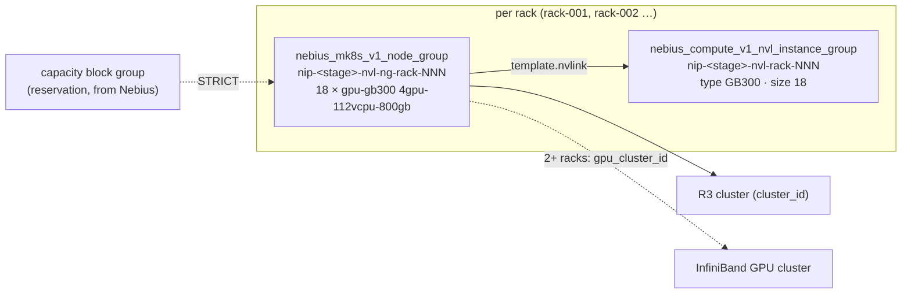

# `stacks/nvl` — Rack-scale GB300 NVL72 (R15)

**Purpose.** Add whole NVIDIA GB300 NVL72 racks to a Managed Kubernetes cluster: 18 nodes × 4 GPUs
that share one NVLink domain, so a model or a training job spans 72 GPUs at NVLink speed instead of
8 GPUs per node plus InfiniBand. Each rack is a Compute **NVLink instance group** of type `GB300`
and a fixed 18-node node group that joins it. **Mocked only:** GB300 capacity is not approved, so
this stack has never been planned against the real API and no stage may plan a rack today.

**Used by.** No solution yet: no S1–S9 scenario needs more than 8 GPUs in one NVLink domain ([all solutions](../../../solutions/README.md)).

| Use it when | Don't use it when |
|---|---|
| A model or job needs more than 8 GPUs in one NVLink domain (large-model inference, tensor/expert parallelism across a rack) | 8 GPUs per node are enough: R3 training with 8-GPU H100/H200/B200/B300 nodes over InfiniBand ([`stacks/training`](../training/README.md)) |
| A GB300 reservation (capacity block group) has been agreed with Nebius | No reservation yet: start the capacity conversation first ([runbook](../../../runbooks/nvl.md#before-you-start)) |

## What it builds

| Resource | Per rack | Notes |
|---|---|---|
| NVLink instance group | `nip-<stage>-nvl-rack-<nnn>` | `nebius_compute_v1_nvl_instance_group`, `type = "GB300"`, `size = 18` (the maximum number of instances in the group) |
| MK8s node group | `nip-<stage>-nvl-ng-rack-<nnn>` | `fixed_node_count = 18`; `gpu-gb300` / `4gpu-112vcpu-800gb`; `template.nvlink.nvl_instance_group_id` = the rack's group; reservation `STRICT` on `capacity_reservation_ids`; driver image `cuda13.0`; 1,024 GiB Network SSD boot disk; taint `nvidia.com/gpu=present:NoSchedule`; node labels `nip.nebius.io/gpu`, `nip.nebius.io/nvl`, `nip.nebius.io/nvl-rack`; rolling update `max_surge 0`, `max_unavailable 1` |
| — | — | `racks = 0` (the default) creates nothing |

The stack joins an existing cluster (R3's `cluster_id`) instead of creating one: the rack is a
node-group decision, and the cluster, network, storage and platform charts stay where they are
([`stacks/training`](../training/README.md)).

**Why these choices, with the docs behind them:**

- **NVLink instance group per rack.** The provider models the NVLink domain as
  `nebius_compute_v1_nvl_instance_group`: `size` is the maximum number of instances in it and `type`
  is `GB200` or `GB300` ([resource](https://docs.nebius.com/terraform-provider/reference/resources/compute_v1_nvl_instance_group#required),
  [optional](https://docs.nebius.com/terraform-provider/reference/resources/compute_v1_nvl_instance_group#optional)).
  A node group joins one through `template.nvlink.nvl_instance_group_id`
  ([node group nvlink](https://docs.nebius.com/terraform-provider/reference/resources/mk8s_v1_node_group#nested-schema-for-templatenvlink));
  a standalone VM would use the instance's `nvl_instance_group_id`
  ([instance](https://docs.nebius.com/terraform-provider/reference/resources/compute_v1_instance#optional)).
- **Fixed size, no surge.** The node count of a node group with NVLink cannot be changed
  ([`fixed_node_count`](https://docs.nebius.com/terraform-provider/reference/resources/mk8s_v1_node_group#optional)),
  and a rolling update surges by one node by default
  ([strategy](https://docs.nebius.com/terraform-provider/reference/resources/mk8s_v1_node_group#nested-schema-for-strategy)):
  a 19th node has no place in an 18-VM group, so nodes are replaced one at a time instead.
- **STRICT reservation.** Rack-scale capacity is reserved capacity. `STRICT` takes nodes only from
  the listed capacity block groups and fails the request otherwise; `AUTO` would fall back to the
  common pool ([reservations](https://docs.nebius.com/kubernetes/node-groups/reservations#how-to-add-reservations-to-node-groups)).
  A capacity block group reserves GPUs of one platform in one region and InfiniBand fabric, comes
  with a commitment addendum, and its GPUs do not count towards GPU quotas
  ([capacity block groups](https://docs.nebius.com/overview/limits/capacity-block-groups)).
- **Stage policy.** `platform/stages.yaml` gives `max_gpu_nodes.nvl` 0 in every stage and
  `require_strict_reservation.nvl: true`, enforced through `modules/stage-policy` like every other
  stack (`racks × 18` nodes counted against the cap). The stack adds its own rule: a rack needs
  `capacity_reservation_ids`. A rack is therefore possible only after a reviewed change raises the
  cap in multiples of 18 (`policy/stages.rego` refuses other values, and a cap without STRICT) **and**
  a reservation ID is passed. With the cap at 0 the renderer creates no `terraform/live/<stage>/nvl`
  root, as for `gpu-vm` in prod.
- **Driver image `cuda13.0`.** The managed driver image path, as the upstream GB300 path requires (it
  refuses a custom driver, MIG and the x86 NUMA presets on Grace nodes).
- **Two or more racks need a GPU cluster.** Upstream refuses a multi-rack plan without an InfiniBand
  fabric; a single rack may omit it. The docs list no fabric for `gpu-gb300`
  ([fabrics](https://docs.nebius.com/compute/clusters/gpu#infiniband-fabrics)), but a capacity block
  group is assigned to one, so the fabric comes with the reservation.

**What the docs do not say** (treat as assumptions until Nebius confirms in the reservation):
GB300 is not on the VM types, regions, quotas or pricing pages; the platform `gpu-gb300`, preset
`4gpu-112vcpu-800gb` and 18 nodes per rack come from a read-only `compute/v1/platforms` listing in
`eu-north1` (2026-10-11, [`platform/regions.yaml`](../../../platform/regions.yaml) header), the
upstream [`k8s-training/gb300.tf`](https://github.com/nebius/nebius-solutions-library/blob/main/k8s-training/gb300.tf)
(main, 2026-10-09) and the rack-scale service level, which counts 18 nodes per rack with 16
SLA-covered and 2 as maintenance buffer ([`docs/solutions/platforms.md`](../../../docs/solutions/platforms.md#published-service-levels)).
See [gaps](../../../docs/solutions/gaps-and-discrepancies.md).

## Inputs that matter

| Variable | Default | Meaning |
|---|---|---|
| `cluster_id` | — (required) | R3's `cluster_id` (`mk8scluster-…`) |
| `subnet_id` | — (required) | the cluster's subnet or R7's `subnet_id`; nodes get no public address |
| `racks` | `0` | whole racks, 0–8; each is 18 nodes, 72 GPUs |
| `capacity_reservation_ids` | `[]` | the GB300 capacity block groups, in draw order; required for any rack |
| `gpu_cluster_id` | `null` | InfiniBand between racks; required for 2+ racks |
| `k8s_version` | `null` (cluster's) | node-group version; within the stage window |
| `boot_disk_size_gib` | `1024` | Network SSD per node (upstream default); at least 256 |
| `node_service_account_id` | `null` | R12 node identity for registry pulls |
| `labels` | `nip-owner = platform` (plus the deprecated `nip-env = nvl`, [`docs/naming.md`](../../../docs/naming.md#5-labels)); the stack adds `nip-stack = nvl`, `nip-stage` and `nip-region` (`main.tf:14`), never passed by hand | `nip-run` always; `nip-ttl-expires` in sandbox |

## Outputs and composition

`racks` (per rack: NVLink group and node group IDs), `shape` (platform, preset, nodes and GPUs per
rack and in total), `stage`. Apply order: R7 network, R3 training (cluster), then this stack with
R3's `cluster_id`. Scheduling across the rack: Nebius sets `topology.nebius.com/tier-0` on nodes
with multi-node NVLink ([topology labels](https://docs.nebius.com/kubernetes/gpu/topology-aware-scheduling#how-to-view-topology-labels-in-your-cluster));
a Kueue Topology with a `tier-0` level and a flavor on `nip.nebius.io/nvl=true` places a 72-GPU job
in one rack ([R16](../../../workloads/kueue/README.md)); not built until a rack exists.

## Quotas and cost

**Quotas** ([Compute quotas](https://docs.nebius.com/compute/resources/quotas-limits#gpu-virtual-machines)),
per rack, at the defaults (eu-north1):

| Quota | Default | One rack | Note |
|---|---|---|---|
| GPUs of the platform | — | 72 | no GB300 row in the docs; reserved GPUs do not count towards GPU quotas ([capacity block groups](https://docs.nebius.com/overview/limits/capacity-block-groups)) |
| Regular VMs (GPU VMs) | 12 | 18 | **raise before the first rack**: the docs exempt only GPU-count quotas from reserved capacity |
| Disks | 32 ([storage](https://docs.nebius.com/compute/resources/quotas-limits#storage)) | 18 | two racks (36) pass the default |
| Network SSD capacity | 4 TiB | 18 TiB at 1,024 GiB per node | raise, or lower `boot_disk_size_gib` (≥ 256) |
| Number of GPU clusters | 5 ([InfiniBand](https://docs.nebius.com/compute/resources/quotas-limits#infiniband)) | 0 (1 for 2+ racks, shared) | |
| Total number of allocations | 1000 ([MK8s nodes](https://docs.nebius.com/kubernetes/resources/quotas-limits#nodes)) | 18 private addresses | |
| NVLink instance groups | not documented | 1 | ask with the reservation |

The quota API omits limits ([evidence](../../../docs/evidence/2026-10-11-portal-live-read-only.md#quotas));
read them in the console ([view quotas](https://docs.nebius.com/overview/quotas#view-quotas)).

**Cost shape.** GB300 has no list price on the Compute pricing page
([prices](https://docs.nebius.com/compute/resources/pricing#virtual-machines-gpus-vcpus-ram)); reserved
GPUs come with a commitment addendum whose rate applies even to VMs that run outside the reservation
([billing for reservations](https://docs.nebius.com/compute/virtual-machines/reservations#billing-for-reservations)).
Per rack and hour: 72 GPU-hours at the contract rate, plus the boot disks at $0.071 per GiB per
730 h (18 × 1,024 GiB ≈ 1.8 USD/h, [volumes](https://docs.nebius.com/compute/resources/pricing#volumes),
read 2026-10-11, list price, not a quote). The billing calculator has **not** been run for
`gpu-gb300` (this recipe is mocked-only); with an addendum, `recipes/finance/price.py --contract`
reads the contract price ([R9](../../../recipes/finance/README.md#pricing-and-tco-method)). Reserved
capacity is paid for every hour of the term, used or not.

## Validate

- **Static (CI):** `terraform test` (mocked): `racks = 0` plans nothing; one rack is one GB300
  NVLink group of 18 and one fixed 18-node node group on `gpu-gb300` / `4gpu-112vcpu-800gb` joined
  to it, no surge, STRICT on the given reservation, `cuda13.0`, our labels only (no
  `topology.nebius.com/*` or `nebius.com/*`), GPU taint, cost labels on the node VMs without the
  per-run ones; two racks share the GPU cluster; refused: a rack without a reservation, two racks
  without a GPU cluster, a fractional rack, a sandbox plan without a TTL. `tests/policy.tftest.hcl`
  runs the real stage policy and reads the caps from `platform/stages.yaml`. `make policy`
  (`policy/stages.rego`): an `nvl` cap needs STRICT and whole racks.
- **Live** ([`runbooks/nvl.md`](../../../runbooks/nvl.md#validate)): 18 `Ready` nodes per rack with
  4 GPUs each, `nvidia-smi` NVLink status, the `tier-0` label shared by the rack, an NCCL all-reduce
  across the 72 GPUs. **Not run** (evidence row "not yet run"): no capacity.

## Teardown

`make destroy-plan destroy STAGE=<stage> STACK=nvl CONFIRM=yes` once a live root exists: the node
groups first, then the NVLink groups (Terraform orders it). The reservation is not touched: capacity
block groups are billed for their term whether or not nodes use them.

## Limits

Node groups only (no standalone GB300 VMs). One rack size (18 nodes); no autoscaling (an NVLink
node group cannot be resized). No NCCL manifest for GB300 in this repository, and the upstream
bundled NCCL test targets 8-GPU nodes. Nodes are Grace (Arm) hosts: x86-only images do not run.

## Evidence

| Date | What | Result |
|---|---|---|
| — | first plan and apply of one rack on an approved reservation; validation in the runbook | **not yet run** (no capacity; mocked plan tests only) |

## Upstream references

[`nvl_instance_group` resource](https://docs.nebius.com/terraform-provider/reference/resources/compute_v1_nvl_instance_group) ·
[`nvl_instance_group` data source](https://docs.nebius.com/terraform-provider/reference/data-sources/compute_v1_nvl_instance_group) ·
[`mk8s_v1_node_group`](https://docs.nebius.com/terraform-provider/reference/resources/mk8s_v1_node_group) ·
[node-group reservations](https://docs.nebius.com/kubernetes/node-groups/reservations) ·
[capacity block groups](https://docs.nebius.com/overview/limits/capacity-block-groups) ·
[Compute quotas](https://docs.nebius.com/compute/resources/quotas-limits) ·
upstream [`k8s-training/gb300.tf`](https://github.com/nebius/nebius-solutions-library/blob/main/k8s-training/gb300.tf).
