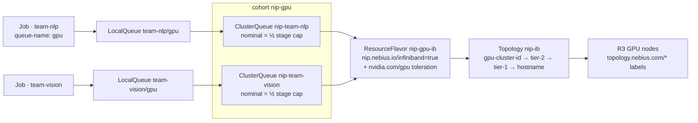

# `workloads/kueue` — Team scheduling with topology-aware placement (R16)

**Purpose.** Several teams share one InfiniBand GPU cluster (R3, [`stacks/training`](../../terraform/stacks/training/README.md))
without a scheduler war: each team owns a GPU share it can always get back, may borrow what the
others leave idle, and a multi-node job is admitted only when all its pods fit inside one
InfiniBand domain. [Kueue](https://kueue.sigs.k8s.io/docs/concepts/topology_aware_scheduling/) does
both: quota and fair borrowing through queues, and placement through the topology labels Nebius sets
on GPU nodes (topology-aware scheduling, TAS below: [Nebius steps](https://docs.nebius.com/kubernetes/gpu/topology-aware-scheduling#how-to-enable-topology-aware-scheduling)).

**Used by.** [S9](../../solutions/S9-data-science-notebooks/README.md) data-science notebooks; optional in [S4](../../solutions/S4-burst-training-preemptible/README.md) burst training on preemptible ([all solutions](../../solutions/README.md)).

| Use it when | Don't use it when |
|---|---|
| Two or more teams submit batch or training jobs to one GPU cluster and need guaranteed shares | One team owns the cluster: submit jobs directly ([`workloads/training`](../training/README.md)) |
| Multi-node jobs must land in one GPU cluster or one rack-level block | Users want `sky launch` across clusters: [R5 SkyPilot](../../recipes/team-platform/README.md) (it can submit into these queues too) |
| Jobs should wait in a queue instead of sitting `Pending` with half their pods scheduled | Users want Slurm: [R4 Soperator](../../terraform/stacks/soperator/README.md) |

## What it builds

Kubernetes objects only (no Terraform, no cloud resource). Kueue itself is installed by
[`install.sh`](install.sh) at the version pinned in [`platform/versions.yaml`](../../platform/versions.yaml)
(`workloads.kueue`).

| Path | Objects | Notes |
|---|---|---|
| `install.sh` | Kueue release manifest | downloads `manifests.yaml` of the pinned release, checks its sha256 against the pin, `kubectl apply --server-side`, waits for `kueue-controller-manager` |
| `base/namespaces.yaml` | Namespaces `team-nlp`, `team-vision` | labelled `nip.nebius.io/team`, Pod Security Standards (PSS) `baseline` enforced, like R5's `team-research`; **no GPU ResourceQuota**: the ClusterQueue is the cap |
| `base/networkpolicies.yaml` | NetworkPolicy `ingress-isolation` per namespace | same rule as [`components/ingress-isolation`](../components/ingress-isolation/) |
| `base/topology.yaml` | Topology `nip-ib` | levels `topology.nebius.com/gpu-cluster-id`, `tier-2`, `tier-1`, `kubernetes.io/hostname`, as in the docs' example |
| `base/resource-flavor.yaml` | ResourceFlavor `nip-gpu-ib` | the training stack's GPU nodes (`nip.nebius.io/gpu`, `nip.nebius.io/infiniband` = `true`), toleration for `nvidia.com/gpu`, `topologyName: nip-ib` |
| `base/cluster-queues.yaml` | ClusterQueues `nip-team-nlp`, `nip-team-vision` | cohort `nip-gpu`; cpu, memory and `nvidia.com/gpu` covered; `reclaimWithinCohort: Any`, `withinClusterQueue: LowerPriority` |
| `base/local-queues.yaml` | LocalQueue `gpu` in each team namespace | what a job names in `kueue.x-k8s.io/queue-name` |
| `overlays/<stage>` | the above, labelled `nip.nebius.io/stage` | each team's nominal share is half the stage's training cap: sandbox 16 + 16 GPUs, staging 32 + 32, prod 128 + 128 (`max_gpu_nodes.training` × 8) |
| `sample-job/` | Job `team-nlp/tas-sample` | 2 pods × 8 GPUs, Indexed, `podset-required-topology: topology.nebius.com/gpu-cluster-id`; image `nvidia/cuda` pinned by digest |

Names follow [naming](../../docs/naming.md#kubernetes): objects we add by hand carry the `nip-`
prefix; team namespaces are `team-<team>`; we never set `topology.nebius.com/*` or `nebius.com/*`
labels, we only read them.

**Why these choices, with the docs behind them:**

- **Topology levels are Nebius's labels.** GPU nodes carry `topology.nebius.com/gpu-cluster-id` (one
  high-speed network domain), `tier-2` (wider locality, e.g. spine switches) and `tier-1` (narrower,
  e.g. rack-level switches); nodes outside a GPU cluster carry none
  ([topology labels](https://docs.nebius.com/kubernetes/gpu/topology-aware-scheduling#how-to-view-topology-labels-in-your-cluster),
  [example output](https://docs.nebius.com/kubernetes/gpu/topology-aware-scheduling#example-output)).
  The exact physical meaning of a tier is not guaranteed, so the recipe asks for "one GPU cluster",
  which is a connectivity fact, and offers `tier-1` as a preference.
- **No `tier-0` level.** `tier-0` (multi-node NVLink, e.g. GB300 NVL72 racks, [R15](../../terraform/stacks/nvl/README.md))
  is set only on nodes that support it; a Topology level every node lacks would leave the H100/H200
  nodes unplaceable. An NVL72 flavor gets its own Topology when R15 has capacity.
- **Flavor by our label, not by node-group ID.** The docs' example selects
  `nebius.com/node-group-id: <id>` ([steps](https://docs.nebius.com/kubernetes/gpu/topology-aware-scheduling#steps));
  the training stack's own labels select the same nodes, keep IDs out of the repository and survive
  a node-group replacement.
- **Required topology `gpu-cluster-id` in the sample.** It is the docs' "required to run within a
  GPU cluster" case: Kueue admits the job only if all pods fit in one GPU cluster and otherwise keeps
  it pending; `podset-preferred-topology` lets it spread instead
  ([steps](https://docs.nebius.com/kubernetes/gpu/topology-aware-scheduling#steps)). The InfiniBand
  network is what a GPU cluster groups its VMs on ([InfiniBand](https://docs.nebius.com/compute/clusters/gpu#infiniband-fabrics)),
  so for NCCL across nodes "one GPU cluster" is the correctness requirement, not an optimisation.
- **No feature-gate patch.** The Nebius steps patch `--feature-gates=TopologyAwareScheduling=true`
  into the controller. At the pinned Kueue v0.20.1 the gate is beta and on by default (since
  v0.14, [Kueue TAS](https://kueue.sigs.k8s.io/docs/concepts/topology_aware_scheduling/)), so
  `install.sh` applies the release manifest unchanged.
- **API `kueue.x-k8s.io/v1beta2`** as in the docs' manifests; Kueue v0.20 no longer serves
  `v1beta1` (release notes of [v0.20.0](https://github.com/kubernetes-sigs/kueue/releases/tag/v0.20.0)).
- **Cohort with reclaim.** Borrowing keeps idle GPUs busy; `reclaimWithinCohort: Any` returns a
  team's nominal share by preempting borrowers, so a share is a guarantee, not a hope. Jobs must
  checkpoint to survive that, as they must for preemptible capacity ([ADR-0007](../../docs/decisions/0007-capacity-on-demand-vs-preemptible.md)).

## Inputs that matter

| Input | Where | Default | Meaning |
|---|---|---|---|
| Kueue version and manifest sha256 | `platform/versions.yaml` `workloads.kueue` | `v0.20.1` | `install.sh` refuses a manifest whose digest differs |
| team shares | `overlays/<stage>/kustomization.yaml` patch | half the stage cap per team | the sum may not exceed `max_gpu_nodes.training` × 8 (policy) |
| per-GPU cpu / memory | same patch | 14 vCPU, 175 Gi | below the `8gpu-128vcpu-1600gb` preset to leave room for system pods; set from the nodes' real allocatable |
| flavor node labels | `base/resource-flavor.yaml` | `nip.nebius.io/gpu`, `nip.nebius.io/infiniband` | the nodes the queues may use |
| topology request | the job's pod template annotation | `podset-required-topology: topology.nebius.com/gpu-cluster-id` | `…-preferred-topology: topology.nebius.com/tier-1` for "close if possible" |

Adding a team: a namespace labelled `nip.nebius.io/team: <team>`, a ClusterQueue
`nip-team-<team>` in cohort `nip-gpu` selecting that label, a LocalQueue `gpu` in the namespace,
and the shares re-divided in each overlay. R5's `team-research` joins the same way; drop the GPU
lines of its ResourceQuota first, or pods Kueue admits beyond one GPU are rejected at creation.

## Outputs and composition

Needs a cluster with InfiniBand GPU nodes: [R3](../../terraform/stacks/training/README.md) with
`enable_gpu_cluster = true` (its GPU nodes get `nip.nebius.io/infiniband=true`). Plain `batch/v1`
Jobs queue as they are (the `batch/job` integration is on in the release configuration). The jobs in
[`workloads/training`](../training/README.md) do not yet: their MPIJob is the Kubeflow Training
Operator's `kubeflow.org/v1` kind, while Kueue's `kubeflow.org/mpijob` integration is written for the
MPI Operator (v0.8.0 or later), and `kubeflow.org/pytorchjob` is commented out in the v0.20.1
controller configuration ([Kueue MPIJob](https://kueue.sigs.k8s.io/docs/tasks/run/kubeflow/mpijobs/)).
Queueing them means enabling the integration in Kueue's configuration and adding the queue label and
topology annotation to their pod templates; not done here. Solution S9
(notebooks for a data-science team) composes R5, R12 and this recipe.

## Quotas and cost

No cloud resource and no quota of its own: the queues divide the GPUs the training stack already
runs. Kueue's controller runs on the cluster's CPU nodes, which need non-GPU vCPU quota: its default
is **0** in `eu-north1` and `us-central1` (`.cache/nebius-docs/compute/resources/quotas-limits.md:41`), so request it before the R3 apply
([evidence](../../docs/evidence/2026-10-11-sandbox-inference-portal-connectors.md)). The sample job occupies two 8-GPU nodes
for about a minute; billed GPU-hours are the training stack's nodes, which bill while they exist
whether or not a job runs ([`docs/cost.md`](../../docs/cost.md#cost-shape-per-recipe)). Quota
math for those nodes is in [`docs/capacity.md`](../../docs/capacity.md#stackstraining).

## Validate

- **Static (CI):** `make kustomize` builds the three overlays and the sample job; `make policy` runs
  [`policy/kueue.rego`](../../policy/kueue.rego) over each overlay with the sample job and
  `platform/stages.yaml`: every Kueue object is `v1beta2`; Topology levels are Nebius topology labels
  and end at `kubernetes.io/hostname`; flavors, queues and the job reference objects that exist;
  flavors select nodes and tolerate the GPU taint; queues select team namespaces only; the job asks
  for a topology level a Topology has and requests GPUs equal to its limits; the cohort's nominal
  GPUs fit the stage cap. `make pins` checks the job image digest; `install.sh --dry-run` runs in
  `make recipes-check`.
- **Live** ([`runbooks/team-scheduling.md`](../../runbooks/team-scheduling.md)): Kueue installed,
  queues `Active`, the sample job admitted with both pods in one GPU cluster, a second team's job
  borrowing and then being reclaimed, scripted as [`tests/validate/kueue.sh`](../../tests/validate/kueue.sh)
  (fixture test `tests/scripts/test-kueue-acceptance.sh` in `make selftest`). **Not run live yet.**

## Teardown

`kubectl delete -k workloads/kueue/sample-job`, then `kubectl delete -k workloads/kueue/overlays/<stage>`
(the team namespaces go with it, and every job in them), then the Kueue release
(`kubectl delete -f <the same manifests.yaml>`). Nothing in the cloud to remove.

## Limits

Placement is only as good as the labels: nodes outside a GPU cluster have no topology labels and
cannot be placed by this Topology. Kueue admits workloads; kube-scheduler still binds pods, so a node
that turns `NotReady` after admission leaves a pod pending until Kueue's node replacement
(`TASFailedNodeReplacement`, beta and on by default) finds another. No priority classes or
fair-sharing weights are set; add `WorkloadPriorityClass` objects when teams need them.

## Evidence

| Date | What | Result |
|---|---|---|
| — | Kueue install, queues `Active`, sample job admitted in one GPU cluster, cohort borrow and reclaim | **not yet run** |

## Upstream references

[Topology-aware scheduling on Managed Kubernetes](https://docs.nebius.com/kubernetes/gpu/topology-aware-scheduling) ·
[SkyPilot on Managed Kubernetes](https://docs.nebius.com/kubernetes/skypilot) ·
[InfiniBand GPU clusters](https://docs.nebius.com/compute/clusters/gpu) ·
[Kueue TAS](https://kueue.sigs.k8s.io/docs/concepts/topology_aware_scheduling/) ·
[Kueue installation](https://kueue.sigs.k8s.io/docs/installation/) ·
[Kueue v0.20.1](https://github.com/kubernetes-sigs/kueue/releases/tag/v0.20.1).
